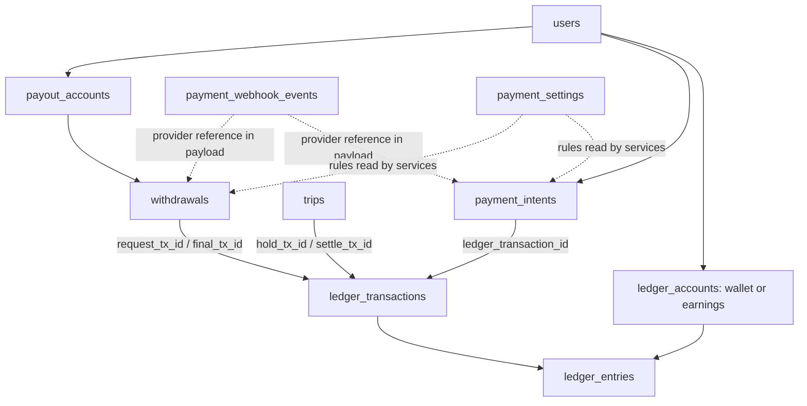

# Rakky Ride: money and database ownership guide

Initially reviewed on 6 October 2026 against the working files in this checkout, based on commit `62ec86b` with existing uncommitted changes. Updated on 7 October 2026 after the requested cumulative-refund and OTP-attempt fixes. This describes the implementation present in the files, not a proposed payment design.

**The most important fact:** an immediate wallet ride deducts the fare from the rider's available wallet when the trip is requested. That money is recorded in trip escrow. Completion distributes the escrow to driver earnings and platform commission. Completion does not deduct the fare from the rider a second time. The scheduled-trip code present at the final review delays the hold until activation near departure; see section 12.6.

The accounting has useful protections, but it is not accurate to promise that the application has no money-related errors. On 7 October 2026, the cumulative-refund and OTP-attempt gaps were fixed, all 20 backend tests passed, and backend/mobile typechecks passed. Section 17 explains the fixes and the remaining limitations. No real payment, SMS, refund, or bank transfer was initiated for this review or these regression tests.

## Reading order

1. Read sections 1–4 for the money model and database foundations.
2. Read sections 5–10 for each table you asked about.
3. Follow sections 11–14 for top-ups, trips, bank accounts, and withdrawals in execution order.
4. Use sections 15–18 when investigating a payment or changing the application.
5. Use section 19 to find the actual implementation files.

All amounts in worked examples are hypothetical. Migration defaults are development settings, not confirmation of the settings in a running database or of Paystack's current charges.

## 1. What “money in the app” means

There are three separate things to keep track of:

- **External money movement:** a customer pays through Paystack, or Paystack transfers money to a driver's bank account.
- **Internal accounting:** PostgreSQL records what the platform owns, owes, earns, spends, or reserves.
- **The screen balance:** the phone fetches an accounting balance from the backend and displays it through Zustand.

An internal ledger entry does not itself debit a bank account. `gateway.initializeCharge()` creates checkout; Paystack handles the customer's payment. `gateway.initiateTransfer()` requests a payout. A trip settlement changes internal balances without calling Paystack to charge a card.

Likewise, updating a Zustand value cannot legitimately create money. The database is authoritative. The app's store is a display cache that can be refreshed.

### 1.1 Kobo, naira, and safe arithmetic

The backend records integer **kobo**:

```text
₦1       =       100 kobo
₦100     =    10,000 kobo
₦5,000   =   500,000 kobo
₦10,000  = 1,000,000 kobo
```

Money columns use PostgreSQL `BIGINT`. The `pg` library returns these values as strings by default; the services convert them with `Number(...)`. The ledger rejects entry amounts that are not positive JavaScript safe integers, checks the summed debit amount, and checks resulting balances. This avoids fractional-kobo entries and many overflow errors. It does not make every input conversion throughout the application automatically safe.

The mobile top-up/withdrawal screens calculate `Number(amount) * 100`. Backend validation still decides whether an amount is allowed. Future changes should keep integer-kobo calculations and explicit rounding rules; floating-point naira should not become the storage format.

### 1.2 The rider wallet and driver earnings are separate

The same user can have:

- `user_wallet:<user UUID>`: money available for wallet rides.
- `driver_earnings:<user UUID>`: what the platform owes the driver, or what the driver owes the platform if negative.

The account rows are created lazily by the ledger helpers when first needed, not necessarily at signup. A user can therefore have no account rows and still see zero balances. Creating an earnings account requires an approved driver profile.

Adding ₦5,000 to the rider wallet does not add ₦5,000 to driver earnings. A top-up's `target` chooses which one receives the credit. There is no general wallet-to-earnings transfer flow in the reviewed implementation.

Driver withdrawals use **earnings**, not the rider wallet. An earnings top-up can clear cash commission debt; any positive remainder becomes part of the earnings balance available to the withdrawal flow.

### 1.3 Debit and credit do not always mean money out and money in

For a user wallet, a credit increases the balance and a debit decreases it. For a platform asset such as `gateway_balance`, a debit increases the balance and a credit decreases it.

The exact rule from `postTransaction()` is:

```ts
const delta = entry.direction === account.normal_side ? entry.amountKobo : -entry.amountKobo;
```

The platform treats wallets and earnings as **liabilities**: amounts it owes users. Their normal side is `credit`. Assets and expenses normally use `debit`; revenue normally uses `credit`.

Every accounting transaction must have equal debit and credit totals. This means an amount has a corresponding accounting source/destination. It does not prove the underlying customer payment was real or that the business policy was correct. Those require separate verification and business rules.

## 2. How the tables were created

The database structure is written explicitly in SQL migrations. There is no ORM generating these payment tables from TypeScript classes.

The migration runner is [migrate.ts](/Users/mac/Desktop/ride_app/backend/src/shared/config/migrate.ts). `npm run migrate`, executed from the backend directory, reads numbered `.sql` files in order. For each file not already recorded in `schema_migrations`, it begins a database transaction, executes the SQL, records the filename, and commits. An error rolls the migration back.

Relevant files:

- [001_auth.sql](/Users/mac/Desktop/ride_app/backend/migrations/001_auth.sql): users, driver profiles, OTP codes, and the `pgcrypto` extension used by later SQL.
- [002_trip_system.sql](/Users/mac/Desktop/ride_app/backend/migrations/002_trip_system.sql): trips, fare configuration, history, and the original `wallet_transactions` table.
- [003_payments_ledger.sql](/Users/mac/Desktop/ride_app/backend/migrations/003_payments_ledger.sql): the current ledger, top-ups, webhooks, payout accounts, withdrawals, settings, audit log, and legacy balance migration.
- [004_scheduled_trips.sql](/Users/mac/Desktop/ride_app/backend/migrations/004_scheduled_trips.sql): adds the scheduled trip state/time; no new money table. This file and its callers appeared in concurrent workspace changes during this review. Their financial timing is described in section 12.6; deployment/application of this migration was not verified here.

This explains how the schema is generated. It does not establish who originally authored every line. The current working files and migrations are the evidence used here.

### 2.1 How row IDs and references are generated

- Most table IDs default to PostgreSQL `gen_random_uuid()`.
- `ledger_entries.id`, `payment_webhook_events.id`, and `admin_audit_log.id` use `BIGSERIAL`, a database sequence. Gaps in sequence numbers can happen after rollbacks; a gap alone is not evidence of missing money.
- Top-up creation generates a UUID in Node with `randomUUID()`, supplies it as the intent ID, and makes a provider reference `tu_` plus the UUID without hyphens.
- Withdrawal creation does the same with prefix `wd_`.
- Paystack returns its own recipient and transfer codes. These are different from your database UUIDs.
- Ledger idempotency keys are business-operation identifiers such as `topup:<intent ID>` or `trip:<trip ID>:settle`.

An ID locates a record; an idempotency key prevents the same operation being posted twice. They have different jobs.

### 2.2 Existing project instructions versus the implementation

The project instructions describe an earlier, smaller schema. The current migrations already contain more tables and a newer ledger model. This guide documents those existing tables; it does not add any.

In particular:

- Current money movements use `ledger_transactions` and `ledger_entries`. `wallet_transactions` is retired.
- `ledger_accounts.balance_kobo` is a mutable cached balance backed by immutable entries.
- Immediate trips use `searching → driver_assigned → driver_arrived → in_progress → completed`, with cancellation/no-driver branches. The scheduled-trip changes add `scheduled → searching` or `scheduled → cancelled`.
- The OTP table is named `otp_codes`, not `otp_verifications`.
- `users.role` is the staff-access role (`user`, `admin`, `super_admin`); `active_role` selects rider/driver experience, and approved `driver_profiles` establishes driver eligibility.
- No separate `payments` table is created in these migrations. Payment evidence is spread across intents, ledger records, trip payment fields, webhooks, and withdrawals.

The older [payments-ledger-gap-report.md](/Users/mac/Desktop/ride_app/docs/features/payments-ledger-gap-report.md) describes the starting point before migration 003. Its description of charging a wallet only at completion is historical.

## 3. The three ledger tables, one by one

### 3.1 `ledger_accounts`: whose balance is this?

**One row represents one accounting account.** It is not necessarily a real bank account.

Columns and their meaning:

- `id`: UUID used by ledger entries.
- `code`: unique readable identifier, such as `escrow_trips` or `user_wallet:<UUID>`.
- `kind`: `user_wallet`, `driver_earnings`, or `system`.
- `type`: accounting classification: `asset`, `liability`, `revenue`, or `expense`.
- `normal_side`: which direction increases this account (`debit` or `credit`).
- `owner_user_id`: points to `users.id` for user accounts; must be null for system accounts.
- `currency`: defaults to `NGN`. Current flows use NGN; the generic posting helper does not independently check all account currencies match.
- `balance_kobo`: cached current balance. Normally changed only by `postTransaction()` together with new entries; migration 003 also sets opening balances explicitly.
- `allow_negative`: permits debt on accounts where that is intentional.
- `is_frozen`: the posting service rejects balance-decreasing entries when true. Credits/increases remain possible.
- `created_at`, `updated_at`: creation and last account update times.

Unique indexes allow at most one wallet and one earnings account per user. A database check rejects negative balances when `allow_negative` is false. Approved drivers' earnings accounts permit negative balances because cash commission can create debt.

System accounts seeded by migration 003:

- **`gateway_balance`** — asset, debit-normal. Your ledger's estimate of funds associated with the provider. It is not a live call to Paystack's balance API.
- **`bank_account`** — asset, debit-normal. Records platform funds moved from the gateway in a manual accounting sweep.
- **`escrow_trips`** — liability, credit-normal. Aggregated fares held for wallet trips. This is an internal accounting reservation, not a separate bank escrow product.
- **`payout_in_transit`** — liability, credit-normal. Withdrawal principal reserved for payouts not yet finalized.
- **`revenue_commission`** — revenue, credit-normal. Commission earned on trips.
- **`revenue_fees`** — revenue, credit-normal. Fees charged by the platform on withdrawals.
- **`expense_gateway_fees`** — expense, debit-normal. Top-up processing fees and estimated transfer fees borne by the platform.
- **`expense_refunds`** — expense, debit-normal. Platform-funded credits given to riders as refunds.
- **`expense_adjustments`** — expense, debit-normal, permits negative balances. Counterpart for manual adjustments and migrated opening balances.
- **`suspense`** — liability, credit-normal. Seeded for unresolved amounts, but no reviewed runtime service posts to it automatically.

The gateway balance, bank balance, commission, and user balance are not interchangeable. A platform can have a balanced ledger while lacking enough immediately available provider funds for a payout.

### 3.2 `ledger_transactions`: why did money move?

**One row represents one accounting operation.** A top-up, a trip hold, and a trip settlement are separate transactions, even when they are part of one customer's journey.

Columns:

- `id`: UUID connecting the operation to its entries.
- `type`: operation name, such as `topup`, `trip_hold`, or `withdrawal_success`.
- `idempotency_key`: globally unique identifier for this particular operation.
- `request_hash`: SHA-256 of the ordered entry triples `[accountId, direction, amountKobo]`.
- `reference_type`, `reference_id`: business object to investigate, such as a trip, payment intent, or withdrawal. This pair is a generic reference, not a foreign key to all those different tables.
- `description`: optional readable explanation, used particularly for admin actions.
- `metadata`: JSON information; empty object by default.
- `created_by`: optional user ID of the actor; automatic postings often leave it null.
- `created_at`: posting time.

The transaction header has no total-amount column. Its entries contain the amounts.

The schema includes future-facing transaction types such as `chargeback`, `cancellation_fee`, `promo_credit`, and `tip`. Their existence in the enum does **not** mean those complete workflows exist. The reviewed services do not implement those postings.

Database triggers reject `UPDATE` and `DELETE` on transaction rows. Correcting an operation means adding an offsetting operation, not editing the old one.

### 3.3 `ledger_entries`: what changed in each account?

**One row represents one side of an accounting operation.** A normal operation has two or more entries.

Columns:

- `id`: sequential entry identifier, also used for statement pagination.
- `transaction_id`: foreign key to the transaction header.
- `account_id`: foreign key to the affected account.
- `direction`: `debit` or `credit`.
- `amount_kobo`: strictly positive integer amount. A decrease is represented by direction, not by storing a negative entry amount.
- `balance_after_kobo`: the account balance immediately after this entry within the posting sequence.
- `created_at`: insertion timestamp.

For example, holding ₦5,000 produces one header and two entries:

```text
Transaction type: trip_hold
Entry 1: debit  rider wallet  500,000 kobo
Entry 2: credit trip escrow   500,000 kobo
Total debits = total credits = 500,000 kobo
```

Those two entries do not represent a ₦10,000 payment. They are the two accounting sides of a ₦5,000 reservation.

Entries cannot be updated or deleted through ordinary SQL because of triggers. Deferred database constraint triggers check that the debit and credit totals match and are nonzero at commit. Deferring the check lets the code insert one side before inserting the other inside the same database transaction.

### 3.4 How the relationships fit together



Dashed connections are application-level lookups, not database foreign keys. Additional transactions, such as a hold release or withdrawal gateway fee, can be found through the transaction's reference fields even when the business row has no dedicated pointer for them.

## 4. How one posting is saved safely

The central writer is [ledger.service.ts](/Users/mac/Desktop/ride_app/backend/src/modules/payments/ledger.service.ts), function `postTransaction(client, input)`.

It must receive a client inside an explicit database transaction. It does **not** call `BEGIN` or `COMMIT` itself. The surrounding service normally uses `inTransaction()` from [db.ts](/Users/mac/Desktop/ride_app/backend/src/shared/config/db.ts).

Its execution order is:

1. Require at least two entries.
2. Validate every amount as a positive safe integer and every direction as debit/credit.
3. Add up debits and credits; reject an imbalance.
4. Hash the ordered entry data.
5. Insert the transaction header using `ON CONFLICT(idempotency_key) DO NOTHING`.
6. If the key already exists, compare the stored hash. Identical entries return the existing transaction ID with `replayed: true`; different entries produce a conflict.
7. Collect the affected account IDs, sort them, and lock the account rows with `FOR UPDATE` in that order.
8. Compute each new balance. Reject frozen-account reductions, disallowed negative balances, and unsafe numeric results.
9. Insert each immutable entry with its resulting `balance_after_kobo`.
10. Update each account's cached balance.
11. Return to the surrounding service, which updates the intent/trip/withdrawal record in the same transaction.
12. Commit. Deferred database checks run here. If anything fails, roll back all the database changes in that transaction.

Actual account-lock query:

```ts
const locked = await client.query<AccountRow>(
  'SELECT id,normal_side,balance_kobo,allow_negative,is_frozen FROM ledger_accounts WHERE id=ANY($1::uuid[]) ORDER BY id FOR UPDATE',
  [accountIds],
);
```

The values travel separately from SQL through `$1`, `$2`, and so on. This is parameterized SQL.

### 4.1 Why concurrent requests cannot both spend the same available wallet balance

Suppose two requests each want ₦4,000 from a ₦5,000 wallet. Both transactions need the same account lock. The second waits. Once the first commits, the second sees ₦1,000, not the old ₦5,000, and fails the insufficient-funds check. Sorting account locks also reduces deadlocks when operations touch several accounts in different input orders.

This is a database guarantee for this posting path. An in-memory `busy` flag on the phone or in one Node process would not protect another server process.

### 4.2 A database transaction is different from a ledger transaction

A PostgreSQL transaction is the all-or-nothing unit between `BEGIN` and `COMMIT`. It can contain several ledger transactions and status changes.

For example, withdrawal success can post the payout principal and a separate gateway-fee transaction within one PostgreSQL transaction. If fee posting fails, both postings and the status update roll back.

A database rollback does not undo an external Paystack operation that already occurred. Webhooks, verification, persistent references, and reconciliation bridge that boundary.

### 4.3 Idempotency has a specific scope

Posting keys include:

```text
topup:<intent ID>
trip:<trip ID>:hold
trip:<trip ID>:release
trip:<trip ID>:settle
withdrawal:<withdrawal ID>:request
withdrawal:<withdrawal ID>:success
withdrawal:<withdrawal ID>:gateway_fee
withdrawal:<withdrawal ID>:reversal
```

The hash covers the ordered entries, not the type, description, or metadata. Reordering otherwise identical entries changes the hash. Reusing the same entries with changed descriptive fields can replay the old transaction. Preserve key meanings and stable entry order when changing callers.

Creating a new top-up request creates a new intent/reference; there is no client-supplied top-up creation idempotency key. Ledger protection prevents confirming one intent twice, not paying two different checkouts.

## 5. `payment_intents`: the request to collect a top-up

**One row means “this user intends to pay this amount into this balance.”** A pending intent does not prove payment and does not increase the wallet.

Columns:

- `id`, `user_id`: the intent and its owner.
- `target`: `wallet` or `earnings`.
- `amount_kobo`: expected gross amount the user should receive internally after verification.
- `status`: `pending`, `succeeded`, `failed`, `abandoned`, or `mismatch`.
- `provider`: defaults to `paystack`.
- `provider_reference`: unique `tu_...` reference sent to Paystack.
- `authorization_url`, `access_code`: returned by checkout initialization. The access code is not a stored card number or a reusable card authorization.
- `channel`: reported payment channel after successful verification.
- `fee_kobo`: provider fee recorded at success.
- `paid_at`: provider-reported payment time.
- `ledger_transaction_id`: points to the successful top-up posting.
- `failure_reason`: initialization failures currently use `initialization_failed`.
- `created_at`, `updated_at`: record lifecycle times.

`createTopup()` inserts the pending row before contacting Paystack, then saves checkout information. Initialization exceptions mark it failed.

`applySuccessfulTopup()` verifies Paystack's result, locks the intent, posts the ledger, and marks it succeeded together. A repeated confirmation of a succeeded intent does not post another credit.

`mismatch` means the verification result did not satisfy the expected reference, NGN currency, amount, or fee checks. It is not automatically credited.

The reconciler may change an old pending intent to `abandoned` after 24 hours if verification says abandoned/failed. A provider failure is not always immediately reflected as a failed local intent. The normal get-status route only initiates verification while the local status is pending.

## 6. `payment_webhook_events`: what Paystack told the server

**One row stores a signed provider event and its processing state.** This is durable event evidence, not the money ledger.

Columns:

- `id`: sequence ID.
- `provider`: currently `paystack`.
- `dedupe_key`: event type plus the first available reference, transfer code, or provider ID.
- `event_type`: for example `charge.success` or `transfer.success`.
- `payload`: parsed event JSON.
- `status`: normally `received`, then `processed`, `ignored`, or `failed`. This is a text column, not a database enum restricting those values.
- `error`: processing exception message when there is a failure.
- `received_at`, `processed_at`: receipt and processing timestamps.

The unique `(provider, dedupe_key)` constraint prevents inserting the same event twice. A success event and a reversed event for the same withdrawal have different keys because their event types differ.

Execution order in `receivePaystackWebhook()`:

1. Receive `POST /webhooks/paystack` with the raw body. In `app.ts`, this route is registered before the JSON body parser.
2. Verify `x-paystack-signature` using HMAC-SHA512 over the raw bytes and a timing-safe comparison. Missing or invalid signatures receive 401.
3. Parse JSON and require an event and data object.
4. Save the event, with duplicate insertion ignored.
5. Respond with HTTP 200 after the database save.
6. Enqueue processing if this was a new event.

Processing dispatches `charge.success` to top-up verification and `transfer.*` to withdrawal outcome handling. Dispute creation currently attempts to freeze the associated rider wallet and logs a review message. Other events can be ignored.

**`processed` does not necessarily mean money was posted.** For example, a top-up handler can return `mismatch` or `unknown_reference` without throwing; the event can still be marked processed. Always inspect the intent or withdrawal and its ledger link.

The official provider contract also calls for signature validation and a prompt acknowledgement; see [Paystack webhooks](https://paystack.com/docs/payments/webhooks/). The details above describe this repository's implementation.

## 7. `payment_settings`: the rules read by payment services

This is a singleton table. Its Boolean primary key has `CHECK(id)`, so the one permitted key is `true`.

All monetary settings below are stored in kobo. Migration 003 seeds:

- `min_topup_kobo = 10,000`: minimum ₦100 top-up.
- `max_topup_kobo = 100,000,000`: maximum ₦1,000,000 top-up.
- `min_withdrawal_kobo = 100,000`: minimum ₦1,000 withdrawal.
- `max_daily_withdrawal_kobo = 50,000,000`: ₦500,000 daily principal limit.
- `withdrawal_fee_kobo = 0`: platform withdrawal charge, initially zero.
- `cash_debt_limit_kobo = 500,000`: ₦5,000 cash commission debt boundary.
- `payout_name_match = 'lenient'`: at least one eligible name token must match. Strict mode requires every eligible user-name token to occur in the bank name; off disables this comparison.
- `new_payout_account_cooldown_hours = 0`: initially no waiting period before a saved account can be used.
- `paystack_balance_alert_kobo = 1,000,000`: low-provider-balance alert below ₦10,000.
- `admin_adjustment_approval_kobo = 1,000,000`: adjustments above ₦10,000 require a super-admin role. This is a role threshold, not a two-person approval workflow.
- `transfer_fee_tiers`: first matching estimate: up to ₦5,000 → ₦10; up to ₦50,000 → ₦25; otherwise → ₦50.

These are explicitly **development placeholders** in the migration. The fee tiers are your configured estimates, not a quotation of verified current Paystack pricing.

`GET /api/admin/payments/settings` reads them for staff. `PATCH` requires a super-admin, a reason, and a UUID request key; the service updates the row and writes `admin_audit_log` in one transaction. There is no settings-change UI shown in the reviewed mobile wallet screens.

The daily withdrawal limit uses the `Africa/Lagos` calendar date and excludes failed/reversed withdrawals. The maximum counts principal, not the platform fee.

Trip commission comes from **`fare_config.commission_bps`**, not `payment_settings`. The seed is 1,500 basis points, meaning 15%.

## 8. `payout_accounts`: where a driver can receive money

**One row is a saved bank destination, not a balance.** Saving it does not move money.

Columns:

- `id`, `user_id`: saved account ID and owner.
- `bank_code`, `bank_name`: selected bank information.
- `account_last4`: last four account-number digits.
- `account_name`: name resolved through Paystack.
- `recipient_code`: provider token identifying the payout destination.
- `is_active`: whether the destination is available for new withdrawal requests.
- `created_at`: used by the withdrawal cooldown check.

The full bank account number is submitted to resolve/create the provider recipient but is not stored in this table. The saved recipient code lets the backend request a transfer later. The raw webhook payload is a separate storage surface and may contain provider-supplied personal/banking metadata; masking this table does not sanitize webhook payloads.

The unique constraint is `(user_id, recipient_code)`, not “one bank account per user.” Multiple active destinations are possible. Saving the same recipient again reactivates the existing row. The original `created_at` remains, which matters if a cooldown is expected on reactivation.

Deleting through the API sets `is_active=false`. It does not delete history, and it refuses a destination referenced by a pending/processing withdrawal.

## 9. `wallet_transactions`: the old accounting table

This is the legacy single-entry table from migration 002. Its columns are `id`, `user_id`, `trip_id`, signed `amount_kobo`, `entry_type`, unique `idempotency_key`, `metadata`, and `created_at`.

Unlike the new entries, the old amount's sign supplied the meaning: positive for credit, negative for debit. A historical balance was calculated as `SUM(amount_kobo)`.

Migration 003 handles this history as follows:

1. Reject unknown user-owned legacy entry types.
2. Group `driver_earning_credit` and `driver_cash_commission_debit` into driver earnings; classify `trip_fare_debit` as rider wallet activity.
3. Reject a negative earnings opening balance for an unapproved driver. A negative rider wallet is also not supported by the new wallet constraints.
4. Create accounts for nonzero grouped balances.
5. Post one opening `adjustment` per user/account kind against `expense_adjustments`. Negative driver debt produces a debit to earnings and a credit to adjustments.
6. Compare each migrated balance to its old grouped sum; abort if there is a mismatch.
7. Install a trigger rejecting new inserts into `wallet_transactions`.

The old update/delete protection remains. After migration it is effectively read-only history. Legacy platform rows with `user_id IS NULL` are not migrated as separate system revenue or gateway balances; the migration establishes user opening balances, not a reconstruction of all historic provider cash and platform revenue.

New wallet statements come from `ledger_entries`, joined to the accounts and transaction headers. The endpoint name `/wallet/transactions` does not mean it reads the old table.

Do not add old historical sums to the new balance: their opening amounts are already carried into the ledger. That would count them twice.

## 10. `withdrawals`: the request and outcome of a bank payout

**One row tracks a requested payout across several accounting and provider steps.** The table name is `withdrawals`.

Columns:

- `id`, `user_id`: withdrawal and requesting driver.
- `payout_account_id`: foreign key to the saved bank destination.
- `amount_kobo`: principal intended for the driver's bank.
- `fee_kobo`: platform withdrawal fee captured at request time.
- `status`: `pending`, `processing`, `success`, `failed`, or `reversed`.
- `provider_reference`: unique `wd_...` reference retained across retries.
- `provider_transfer_code`: Paystack transfer identifier when available.
- `attempts`: incremented for certain initiation outcomes/errors; it is not a complete audit of every worker execution.
- `failure_reason`: column exists, but the current outcome handler does not populate it from provider verification failures.
- `request_tx_id`: the posting that removed available earnings and reserved the payout principal.
- `final_tx_id`: the success or reversal posting. If a successful withdrawal is later reversed, this points to the newer reversal; the original success remains in immutable ledger history.
- `requested_at`, `completed_at`, `updated_at`: lifecycle timestamps. `completed_at` is also set on failure/reversal, so it does not by itself prove success.

A partial unique index allows only one withdrawal per user whose status is pending or processing. Its purpose is to block concurrent in-flight requests, not to prevent all future withdrawals.

## 11. Worked flow: a ₦10,000 wallet top-up

Assume the wallet starts at zero and Paystack verification reports a **hypothetical ₦150 fee**. The actual fee used by this code comes from the verification response, not this example.

### Step 1: the mobile screen requests checkout

`TopUpSection` in `WalletSections.tsx` converts the entered amount to kobo and calls the mobile `createTopup()` helper. The HTTP request is:

```json
{
  "amountKobo": 1000000,
  "target": "wallet"
}
```

It goes to `POST /api/payments/topups`. Authentication supplies `req.userId`; the client cannot choose another user's wallet by sending a user ID in this request.

### Step 2: the backend records the intention

`createTopup()` checks the amount/target, configured limits, active user, driver approval for an earnings target, and availability of an email or configured synthetic email domain. It rate-limits creation to 10 attempts per hour per user.

Actual insert:

```ts
await db.query(
  'INSERT INTO payment_intents(id,user_id,target,amount_kobo,provider_reference) VALUES($1,$2,$3,$4,$5)',
  [id,userId,target,amountKobo,reference],
);
```

The intent is pending. No accounting entries exist yet.

### Step 3: Paystack handles checkout

The backend calls `/transaction/initialize` with the amount, reference, email, metadata, and optional callback URL. It saves the returned checkout URL/access code and returns the URL to the phone.

The app opens that URL using `WebBrowser.openBrowserAsync()`. A browser return or a screenshot of “success” is not sufficient proof to credit the balance.

### Step 4: one of three paths triggers server verification

- A signed `charge.success` webhook is processed.
- The mobile app calls `GET /api/payments/topups/:reference`; while pending, this invokes verification. The screen polls roughly every three seconds for up to a minute, then offers “Check again.”
- The scheduled reconciler picks up an old pending intent.

All three converge on `applySuccessfulTopup(reference)`, which calls Paystack's `/transaction/verify/:reference` from the server. [Paystack's verification documentation](https://paystack.com/docs/payments/verify-payments/) distinguishes the API request's status from the payment's status and advises preventing duplicate fulfillment.

### Step 5: verification and accounting happen

The handler requires provider payment status `success`. Inside a database transaction it locks the intent and verifies the reference, NGN currency, exact amount, and a nonnegative integer fee smaller than the gross amount.

It posts:

```text
Debit  gateway_balance        985,000 kobo  (₦9,850 net funds)
Debit  expense_gateway_fees    15,000 kobo  (₦150 expense)
Credit rider wallet        1,000,000 kobo  (₦10,000 user credit)
```

The platform absorbs the fee in this implementation. The wallet receives the full top-up amount.

The intent is then marked succeeded with its fee, channel, paid time, and ledger transaction ID. These writes commit together. The top-up transaction has three entries in this example; a zero-fee top-up has two.

### Step 6: the app refreshes

After commit, `emitWalletUpdated(userId)` emits the named event into `user:<ID>`. `WalletBootstrap` responds by fetching `/api/wallet`. The backend returns balances; Zustand updates; the screen formats kobo as naira.

The browser callback's reference helps find the payment. Its `target` parameter is not authority to change the saved intent's target.

The raw webhook can also be absent: the polling route can successfully verify and post the top-up. Conversely, a webhook row alone is not evidence of credit.

## 12. Worked flow: wallet trip, completion, cancellation, and cash

### 12.1 Fare calculation before recording the trip

`estimateTrip()` obtains a Google route and reads `fare_config`. `calculateFare()` adds base fare, distance component, and duration component, applies the minimum fare, then rounds up to a whole naira.

The trip stores the resulting `fare_kobo`. In the reviewed completion flow there is no recalculation from actual driven distance, waiting time, or final GPS route; settlement uses the saved fare.

### 12.2 Request a ₦5,000 wallet trip from a ₦10,000 wallet

`createTrip()` validates the request and its idempotency key. Within one database transaction it:

1. Inserts a `trips` row, initially `searching`.
2. Inserts the initial `trip_status_history` row.
3. Calls `holdTripFare()`.
4. Posts debit wallet 500,000 / credit escrow 500,000.
5. Changes `trips.payment_status` to `held` and records `hold_tx_id`.
6. Commits all those records together.

Actual posting from `holdTripFare()`, reformatted:

```ts
const { transactionId } = await postTransaction(client, {
  type: 'trip_hold',
  idempotencyKey: `trip:${trip.id}:hold`,
  referenceType: 'trip',
  referenceId: trip.id,
  entries: [
    { accountId: wallet, direction: 'debit', amountKobo: Number(trip.fare_kobo) },
    { accountId: escrow, direction: 'credit', amountKobo: Number(trip.fare_kobo) },
  ],
});
```

The rider now has ₦5,000 available; escrow holds ₦5,000 for this trip. An insufficient-funds failure rolls back the trip creation, history, header, entries, and cached balance changes.

### 12.3 Complete the ride at 15% commission

`completeTrip()` selects the driver's trip `FOR UPDATE`, requires `in_progress`, reads the current fare configuration, and calls `splitFare()`:

```ts
const commissionKobo = Math.floor((fareKobo * commissionBps) / 10_000);
return { commissionKobo, driverEarningKobo: fareKobo - commissionKobo };
```

For 500,000 kobo at 1,500 basis points:

```text
Commission:       75,000 kobo = ₦750
Driver earnings: 425,000 kobo = ₦4,250
Total:           500,000 kobo = ₦5,000
```

Within the same database transaction, the trip state machine records completion and the commission/earning amounts. `settleTrip()` requires the wallet fare to be held, then posts:

```text
Debit  escrow_trips        500,000
Credit driver earnings    425,000
Credit revenue_commission  75,000
```

It sets `payment_status='settled'` and `settle_tx_id`, then the outer transaction commits. If settlement fails, the completed status and history roll back too.

After this example, the rider wallet remains ₦5,000, driver earnings have increased by ₦4,250, and the trip's escrow has been consumed. The gateway asset did not change at trip completion: this was internal accounting. The driver's bank receives nothing until a withdrawal is made.

A racing completion request cannot settle twice: the trip lock and state check permit one winner, and the ledger settlement key provides another duplication guard. A later request may return `trip_not_in_progress`; it is not necessarily a successful replay response.

### 12.4 Cancel, or find no driver

Before the ride is in progress, permitted cancellation routes call `releaseTripHold()` in the same transaction as the state change. The no-driver path in `dispatch.service.ts` also calls it.

The release is a new transaction:

```text
Debit  escrow_trips  500,000
Credit rider wallet 500,000
```

The wallet returns to ₦10,000 and the trip payment state becomes `released`. The original hold remains in history. There is no current cancellation-fee posting, despite that enum value existing.

The runtime state machine does not permit ordinary cancellation once the trip is `in_progress`. A completed-trip refund is a separate admin action.

### 12.5 The same ₦5,000 ride paid in cash

No rider wallet hold occurs. The rider physically gives the driver ₦5,000. The application does not independently verify that handover through a payment provider.

At completion the ledger posts only the platform commission:

```text
Debit  driver earnings     75,000
Credit revenue_commission 75,000
```

If earnings started at zero, they become **−₦750**: the driver holds the cash fare and owes the platform its commission. Crediting another ₦4,250 digitally would pay the driver twice, so the code does not do that.

If the driver already had ₦4,250 earnings, the cash commission reduces them to ₦3,500. If commission is zero on a cash trip, the code marks it settled without creating a zero-value ledger transaction.

To repay negative earnings, the driver can top up with `target='earnings'`. A later wallet ride also offsets existing debt when its earnings credit arrives.

`getBalances()` returns `owedKobo = max(0, -earningsKobo)` and `withdrawableKobo = max(0, earningsKobo)`. The eligibility rule is `earningsKobo > -cashDebtLimitKobo`: at exactly the negative limit, new online eligibility is blocked. Matching also filters on this rule. This is an eligibility rule, not a database cap stopping the account from ever going beyond that debt amount.

The driver “net earnings” API sums wallet credits and subtracts cash commissions; it does not include cash physically retained. A negative value for cash-only trips is therefore the change in the platform-held earnings balance, not a statement that the driver earned no cash profit.

Direct `card` trip payment is rejected by `parsePayment()`. Paying by card in Paystack to top up first is a different, supported path.

### 12.6 Scheduled wallet trips: the hold happens later

The scheduled-trip changes present during final review add a `scheduledAt` request value. `createTrip()` saves the fare and scheduled trip but skips `holdTripFare()` at booking time. Its payment state remains unpaid, and the rider can still spend the wallet balance elsewhere.

The trip maintenance worker checks roughly every 30 seconds for trips within five minutes of their scheduled time. `activateDueScheduledTrips()` locks the trip, checks for another active trip, calls `holdTripFare()`, and transitions scheduled to searching within the same database transaction. From that point, the ordinary escrow, completion, and cancellation behavior applies.

If the activation fails for insufficient funds or another active trip, that activation transaction rolls back and the handler records system cancellation in a separate transaction. Cancelling a still-scheduled trip normally has no hold to release. Booking a scheduled trip therefore does not guarantee that the wallet will have sufficient funds when it is activated. These new activation paths were not exercised by the existing payment integration tests reviewed here.

## 13. Worked flow: save a driver's bank account

The screen uses the payment service HTTP helpers in this order:

1. Fetch `/api/payments/banks`. The backend caches the bank list in Redis for 24 hours and deduplicates by bank code.
2. Submit a 10-digit number and bank code to `/api/payout-accounts/resolve`. The backend requires an approved driver and limits resolution to 10 attempts per hour.
3. Show the provider-resolved account name.
4. Request `/api/payout-accounts/otp`. The backend creates a purpose-specific `payout_account` OTP in `otp_codes`.
5. Submit the account number, bank code, and OTP to `/api/payout-accounts`.
6. The backend checks the bank, resolves the account again, compares name tokens according to settings, and verifies/consumes the OTP in a transaction.
7. It calls Paystack `/transferrecipient` with type `nuban` and currency NGN.
8. It inserts `payout_accounts` using the returned recipient code and masked number.

OTP generation hashes the code, stores a five-minute expiry, and uses the existing Termii provider. In development the provider logs a code instead of sending an SMS; “code sent” in a development screen does not establish real SMS delivery.

The OTP commit, external recipient creation, and final insert are not one distributed transaction. If the provider call or final save fails after OTP consumption, a retry can need a fresh OTP. No money moves during this process.

## 14. Worked flow: withdraw ₦3,000 to the bank

Assume driver earnings are ₦4,250, platform withdrawal fee is zero, and sufficient gateway funds exist. The seeded tier estimates a ₦10 transfer expense for this principal.

### Step 1: authorize the request

The driver selects a saved bank account, enters ₦3,000, requests a `withdrawal` OTP, and submits:

```json
{
  "payoutAccountId": "<saved payout account UUID>",
  "amountKobo": 300000,
  "otpCode": "<six-digit code>"
}
```

`POST /api/withdrawals` requires authentication and an approved driver. `requestWithdrawal()` also applies a five-per-day Redis request rate limit.

### Step 2: validate and reserve inside PostgreSQL

The service uses `withVerifiedOtp()` to begin a transaction and:

1. Locks the latest withdrawal OTP, verifies it, and marks it consumed. An invalid attempt is committed before returning its error, without running the withdrawal action.
2. Locks the user's row to serialize that user's withdrawal requests.
3. Reads settings and validates the minimum amount.
4. Locks and validates the owned, active payout account and its cooldown.
5. Sums nonfailed/nonreversed withdrawal principal for the current Lagos date and checks the daily limit.
6. Acquires a transaction-level advisory lock for payout capacity, then reads gateway balance and payout principal in transit.
7. Requires `gatewayBalance - inTransit >= amount + estimatedProviderFee`.
8. Inserts a pending withdrawal with its generated ID/reference and platform fee snapshot.
9. Posts the reservation and checks the resulting earnings are nonnegative.
10. Saves `request_tx_id` and commits.

The nonnegative post-check is necessary because driver earnings accounts generally permit negative cash commission debt. Withdrawals are specifically not allowed to create that debt. A failure rolls back the reservation, withdrawal row, and OTP consumption together.

Zero platform fee example:

```text
Debit  driver earnings   300,000
Credit payout_in_transit 300,000
```

Earnings are now ₦1,250. The driver's bank has not yet received the payout, and the internal gateway asset has not yet been reduced.

If the platform fee were ₦50 instead, debit earnings 305,000, credit transit 300,000, and credit `revenue_fees` 5,000. The bank principal would still be ₦3,000. The provider transfer expense is separate from this platform fee.

### Step 3: enqueue after commit

The backend adds a payout job to the Redis-backed BullMQ `payments` queue and emits a wallet update. `pending` means the reservation exists; it is not a payout success message.

If queue submission fails after commit, the request can report an error despite the reservation already being saved. The reconciliation job is intended to find old pending withdrawals. Inspect history before treating an HTTP error as proof that no withdrawal exists.

### Step 4: ask Paystack to transfer

`initiatePayout()` loads the pending withdrawal and recipient code, then calls `/transfer` with the original reference and `source: 'balance'`. On a normal response it moves the row to processing and saves the transfer code. Immediate final outcomes are applied; otherwise a webhook or verification resolves it later.

A transport error does not immediately return the reserved money. The provider might already have accepted the transfer. The code increments attempts, logs the uncertainty, and leaves it for reconciliation. Reusing the original reference helps avoid requesting the same payout as a new transfer; see [Paystack single transfers](https://paystack.com/docs/transfers/single-transfers/).

If the provider responds that its own transfer OTP is required, the code logs the configuration issue and leaves the withdrawal unresolved. The user's application OTP and Paystack's merchant transfer OTP are different controls.

### Step 5A: success

`applyWithdrawalOutcome()` locks the withdrawal. It posts the principal:

```text
Debit  payout_in_transit 300,000
Credit gateway_balance  300,000
```

It also posts the configured provider-fee estimate as a separate transaction:

```text
Debit  expense_gateway_fees 1,000
Credit gateway_balance     1,000
```

Then it saves success, `final_tx_id`, and completion time, committing both accounting transactions together. Earnings stay at ₦1,250: the driver was already debited at reservation.

### Step 5B: failed or reversed before success

The service releases the reservation:

```text
Debit  payout_in_transit 300,000
Credit driver earnings  300,000
```

Earnings return to ₦4,250. If a platform fee was charged, it also debits `revenue_fees` and returns that fee to earnings. Status becomes failed/reversed and the original reservation remains in history.

### Step 5C: reversed after success

The principal had already left the internal gateway account, so the offset is:

```text
Debit  gateway_balance 300,000
Credit driver earnings 300,000
```

This assumes the reversal returns the principal to provider funds. It also refunds any platform fee. The previously posted provider transfer-fee expense is not automatically reversed. Actual provider fee treatment needs reconciliation.

Duplicate success and duplicate reversal outcomes are guarded by row locking, status checks, and operation-specific ledger keys. However, the code does not provide a complete ordering model for all contradictory provider events; see section 17.

### Check the complete successful example to the kobo

If all accounts start at zero, combine the ₦10,000 top-up (₦150 provider fee), the ₦5,000 wallet trip (15% commission), and the successful ₦3,000 withdrawal (₦10 estimated provider fee, zero platform withdrawal fee):

```text
Rider wallet:           ₦5,000
Driver earnings:       ₦1,250
Trip escrow:           ₦0
Payout in transit:     ₦0
Gateway asset:         ₦6,840  = 10,000 - 150 - 3,000 - 10
Commission revenue:    ₦750
Gateway-fee expense:   ₦160

Gateway asset 6,840 = user liabilities 6,250 + net revenue after these fees 590
```

The driver has also received ₦3,000 externally. Those funds are no longer in the internal gateway asset. This example excludes every other platform expense and any unrelated transactions.

## 15. Refunds, adjustments, freezes, and platform sweeps

These are existing admin endpoints under `/api/admin/payments`. They require authenticated staff roles and, for the mutation helpers, a reason and UUID request key.

### 15.1 Completed-trip refund

`refundTrip()` requires a completed trip and locks its row. For a new request key, it sums the credit entries of all previously posted refund transactions for that trip and checks that the total plus the requested amount does not exceed the fare. It posts debit `expense_refunds` / credit rider wallet. The trip lock makes the cumulative check safe when requests arrive concurrently.

This is a platform-funded **wallet credit**, even for a cash trip. It does not call Paystack's refund API, return money to the original card, reverse driver earnings, or reverse commission automatically. The trip stays completed and its settlement history remains.

Repeated requests with the same request key still pass through the ledger's entry-hash check and replay the financial posting, even after the fare has been fully refunded. Reusing a key with different amounts is rejected. A new key exceeding the remaining fare returns `refund_exceeds_remaining_fare`. Exact retries do not add another refund audit row. Existing historical over-refunds are not automatically reversed by this fix.

### 15.2 Manual balance adjustment

`adjustBalance()` uses `expense_adjustments` as the other side of a wallet/earnings credit or debit. Requests above the configured threshold require super-admin. The code does not require a second human approver.

An adjustment creates or removes an internal claim; it does not fund Paystack. Giving a driver ₦100,000 earnings via an adjustment does not add ₦100,000 provider liquidity.

### 15.3 Freeze

`freezeAccount()` toggles `ledger_accounts.is_frozen` and writes an audit record. `postTransaction()` blocks reductions of a frozen balance while allowing increases. A freeze does not cancel a withdrawal whose earnings have already been reserved and whose payout job is pending.

### 15.4 Gateway sweep

`sweepGateway()` is super-admin-only. It posts debit `bank_account` / credit `gateway_balance` and audits the change. It does **not** call a bank-transfer API. It should represent an externally verified platform settlement, not be mistaken for initiating one.

### 15.5 `admin_audit_log`

This supporting table stores actor, action, target user, request key, reason, optional ledger transaction link, metadata, and time. It explains who requested an administrative change. Unlike the ledger tables, it has no append-only trigger in the reviewed migration. Refund retries now reuse the existing posting without adding another audit row. Other admin actions may still add another audit row when their financial posting is deduplicated.

## 16. Reading history and reconciling the system

### 16.1 What the app reads

`GET /api/wallet` reads cached account balances and the debt limit. `GET /api/wallet/transactions?account=wallet` or `account=earnings` joins entries, transactions, and accounts for the authenticated user. It returns 50 entries, with a cursor if more exist.

The statement is per account: a top-up displays the user's credit, not every system-side entry. If you need the fee or the accounting counterpart, follow the transaction ID in the backend.

`WalletBootstrap` refreshes balances on the wallet-update socket event and when the app becomes active. The statement component independently loads entries when mounted/account changes or when more are requested; it does not subscribe to wallet updates. A refreshed balance with a temporarily stale statement is possible.

### 16.2 Scheduled work already implemented

`startPaymentWorkers()` starts BullMQ processing from the backend startup path when Redis is configured. This is scheduled queue work, not a separate operating-system cron command.

- **Every 10 minutes:** requeue received/failed webhooks older than two minutes; verify pending top-ups older than 10 minutes, up to 100 of each per run.
- **Every 5 minutes:** inspect pending withdrawals older than two minutes and processing withdrawals unchanged for 15 minutes, up to 100 per query.
- **Every hour:** compare the provider's NGN balance to `gateway_balance`; alert if the absolute difference exceeds 10,000 kobo (₦100), or the actual balance falls below the configured threshold.
- **Every 15 minutes:** check terminal trips still holding funds and compare escrow to the summed held fares of active trips.
- **01:00 Africa/Lagos daily:** compare transaction debit/credit totals, recomputed balances, and last-entry balances.
- **00:30 Africa/Lagos daily:** generate a finance report. Its activity totals use a rolling previous 24 hours, not the previous Lagos calendar day.

Alerts go to logs and optionally `ALERT_WEBHOOK_URL`. Integrity checks report discrepancies; they do not automatically edit ledger rows to make the numbers agree.

Provider balance reconciliation is essential: internal balanced postings alone cannot establish actual bank/provider balances. Top-up settlement timing, platform sweeps, fees, and reversals can cause differences.

### 16.3 Safe read-only investigation examples

These are diagnostic query examples, not queries executed against customer records for this guide. Bind parameters through a database client; `$1` is a parameter, not text to concatenate into SQL. Use a read-only connection where available. For a consistent multi-query investigation use a read-only repeatable-read transaction.

Find a user's wallet and earnings:

```sql
SELECT id, code, kind, normal_side, balance_kobo,
       allow_negative, is_frozen
FROM ledger_accounts
WHERE owner_user_id = $1;
```

Follow a top-up from provider reference to accounting:

```sql
SELECT i.id, i.status, i.target, i.amount_kobo, i.fee_kobo,
       i.provider_reference, i.ledger_transaction_id,
       t.type, t.idempotency_key, t.created_at
FROM payment_intents i
LEFT JOIN ledger_transactions t ON t.id = i.ledger_transaction_id
WHERE i.provider_reference = $1;
```

Inspect every side of one accounting transaction:

```sql
SELECT e.id, a.code, a.normal_side, e.direction,
       e.amount_kobo, e.balance_after_kobo
FROM ledger_entries e
JOIN ledger_accounts a ON a.id = e.account_id
WHERE e.transaction_id = $1
ORDER BY e.id;
```

Follow all accounting operations for a trip, including releases/refunds:

```sql
SELECT t.id, t.type, t.idempotency_key, t.created_at,
       a.code, e.direction, e.amount_kobo
FROM ledger_transactions t
JOIN ledger_entries e ON e.transaction_id = t.id
JOIN ledger_accounts a ON a.id = e.account_id
WHERE t.reference_type = 'trip' AND t.reference_id = $1
ORDER BY t.created_at, t.id, e.id;
```

Follow a withdrawal and compare its request/final pointers:

```sql
SELECT w.id, w.status, w.amount_kobo, w.fee_kobo,
       w.provider_reference, w.provider_transfer_code,
       w.request_tx_id, w.final_tx_id, w.attempts,
       w.requested_at, w.completed_at, p.bank_name, p.account_last4
FROM withdrawals w
JOIN payout_accounts p ON p.id = w.payout_account_id
WHERE w.provider_reference = $1;
```

Find webhook processing state without exporting full payloads:

```sql
SELECT id, event_type, status, error, received_at, processed_at
FROM payment_webhook_events
WHERE provider = 'paystack' AND payload->'data'->>'reference' = $1
ORDER BY id;
```

Recompute an account balance from immutable entries:

```sql
SELECT a.id, a.code, a.balance_kobo AS cached_kobo,
       COALESCE(SUM(CASE WHEN e.direction = a.normal_side
                         THEN e.amount_kobo ELSE -e.amount_kobo END), 0)
         AS recomputed_kobo
FROM ledger_accounts a
LEFT JOIN ledger_entries e ON e.account_id = a.id
WHERE a.id = $1
GROUP BY a.id;
```

Find transactions with unequal totals or no positive debit total:

```sql
SELECT t.id,
       COALESCE(SUM(e.amount_kobo) FILTER (WHERE e.direction='debit'),0) AS debits,
       COALESCE(SUM(e.amount_kobo) FILTER (WHERE e.direction='credit'),0) AS credits
FROM ledger_transactions t
LEFT JOIN ledger_entries e ON e.transaction_id = t.id
GROUP BY t.id
HAVING COALESCE(SUM(e.amount_kobo) FILTER (WHERE e.direction='debit'),0) = 0
    OR COALESCE(SUM(e.amount_kobo) FILTER (WHERE e.direction='debit'),0)
       <> COALESCE(SUM(e.amount_kobo) FILTER (WHERE e.direction='credit'),0);
```

Investigate a mismatch before correcting it. Do not delete entries, change an old amount, or directly overwrite a cached balance to hide the discrepancy. An approved monetary correction uses a new balanced posting with a clear reason; fixing corruption also requires identifying how it was introduced.

## 17. What is verified, and where caution is still needed

### 17.1 Checks performed during this review

The initial review on 6 October 2026 ran eight passing backend tests and reproduced the two issues below in isolated fixtures. Mobile typecheck briefly failed during concurrent scheduled-trip work. The latest verification on 7 October 2026, after the two requested fixes, is:

- Backend `npm run typecheck`: passed.
- Mobile `npm run typecheck`: passed.
- Backend `npm test`: 20 tests passed, zero failures, zero skips (including nested regression cases).
- PostgreSQL integration tests ran in uniquely named temporary schemas on the configured local server and removed those schemas afterward.

Existing coverage includes fare arithmetic, state transitions, webhook signatures, ledger balancing, concurrent debits, ordered locks, replay/conflicting keys, immutability, trip holds/releases/settlement, competing completion, top-up verification, and payout outcomes/reversals. New regression coverage adds cumulative refund limits, concurrent partial refunds, identical retry behavior, audit deduplication, persisted rejected OTP attempts across every purpose, concurrent invalid/valid codes, expiry, purpose isolation, and rollback/retry of a protected operation. Login and registration services are also checked for persisted rejected attempts without creating unauthorized users or sessions.

The payment integration test stubs provider verification and constructs withdrawal fixtures directly. It is not an end-to-end test of a real bank payout, SMS delivery, the complete withdrawal request route, queue delivery, or every failure sequence. Passing these tests does not certify live-money readiness. The earlier rollout notes' external checks were not rerun here.

### 17.2 Fixed: cumulative refunds cannot exceed the fare

**Original evidence:** a 500,000-kobo completed-trip fixture accepted two 500,000-kobo refunds with different keys, crediting 1,000,000 kobo.

**Fix on 7 October:** while holding the existing trip row lock, `refundTrip()` checks immutable refund entries for that trip before posting a new request. The cumulative comparison uses integer `BigInt` arithmetic. It counts posted ledger credits rather than audit rows, so repeated audit records cannot inflate the total. Exact retries bypass the new-money limit but still pass the ledger's existing hash comparison; they create no duplicate financial entries or refund audit records.

**Verified behavior:** partial refunds can reach the fare exactly; another new refund then fails. Two racing refund requests cannot jointly exceed the remaining amount. Concurrent identical full-refund requests all return the same transaction ID. A changed amount under the same key is rejected. This protects future requests and does not undo historical over-refunds.

### 17.3 Fixed: rejected OTP attempts remain saved

**Original evidence:** `verifyOtp()` incremented attempts and threw inside the caller's transaction, so rollback erased the increment. An invalid-code check left attempts at zero.

**Fix on 7 October:** the shared `withVerifiedOtp()` helper owns the entire database transaction. It locks the latest OTP for the phone/purpose and increments its attempt counter. Expected validation errors are returned inside the transaction, allowing that counter to commit; the helper throws the API error only after commit. The protected action never runs for a rejected code. Once the configured maximum is reached, further checks cannot authorize the action, even with the correct code.

For a correct code, consumption and the protected action use the same transaction. If that action fails, both the action's writes and successful-code consumption roll back, allowing a safe retry. This intentionally differs from a wrong-code attempt, which must persist. Database failures continue to roll back normally. There is no extra connection or nested transaction needed to save an attempt.

Login, registration, withdrawal requests, and payout-account verification all use this helper. In withdrawals, OTP verification now precedes the balance/limit checks inside the transaction; a correct OTP remains reusable if those later checks fail. Payout-account creation retains its existing separate provider-call boundary after OTP verification.

Only the latest code is eligible. Once it is consumed, the implementation does not fall back to older unconsumed codes. Regression tests confirm that concurrent valid uses execute the protected action once, while concurrent wrong guesses persist exactly the configured maximum number of attempts.

### 17.4 Code-review finding: retrying exhausted webhook jobs can stall

`enqueueWebhook()` uses a deterministic job ID, five attempts, and no `removeOnFail`. The reconciler calls `queue.add()` with that same ID. The installed BullMQ duplicate-job path retains an existing job instead of making another run just because it is added again.

An exhausted retained failed job can therefore block the intended recovery enqueue. A proper failed-job retry/removal policy is needed. Independent top-up/withdrawal reconciliation may still recover some financial outcomes, so this is not proof that all such payments remain stuck. The exhausted-job scenario was inspected in code, not reproduced through the production queue.

### 17.5 Code-review finding: payout liquidity is an estimate, with incomplete fee reservation

The capacity calculation reserves pending principal in `payout_in_transit`, but not each pending payout's estimated provider fee. It includes only the new request's fee in that request's capacity comparison.

For example, with **1,001,000 kobo** in the gateway account and two different eligible drivers each requesting 500,000 kobo, each request sees enough principal capacity plus its own 1,000-kobo estimated fee. Their combined principal and fees require **1,002,000 kobo**. The current reservation is short by 1,000 kobo.

The provider fee is also recomputed from current settings at success, not saved as a fee estimate at request time or read as an actual charged fee. Settings changes can alter expense posting for an existing payout. A later insufficient gateway balance can cause success accounting to roll back even if the external transfer succeeded.

`sweepGateway()` does not use the payout-capacity reservation lock or check outstanding payout reservations. The internal gateway balance also assumes net top-ups correspond to usable provider funds; settlement timing and real Paystack balance behavior still need verification.

### 17.6 Code-review finding: reversal ordering and late outcomes are incomplete

`applyWithdrawalOutcome()` ignores all later outcomes once a withdrawal is failed or reversed. A success arriving after a failure will not trigger financial correction. It also treats a failed event after success through the same source-account reversal path, and it uses the signed webhook's reference/outcome without re-verifying transfer amount/recipient in that path.

Withdrawals already marked success are not selected by the periodic pending/processing reconciler. If a post-success reversal webhook never arrives, there is no equivalent scheduled scan of successful payouts to discover it. Provider-state reconciliation and tests for contradictory/out-of-order outcomes are needed.

### 17.7 Code-review finding: settlement assumes the driver remains approved

`settleTrip()` and withdrawal outcome processing call `getOrCreateEarningsAccount()`, which requires the driver to be currently approved, even if an earnings account already exists. If approval changes during a trip or payout, the service can reject completion or financial finalization. Acceptance eligibility and the obligation to finish existing accounting should be considered separately.

### 17.8 Code-review finding: dispute handling is partial

The `charge.dispute.create` path looks for a reference at `payload.data.reference`, looks up the intent, and freezes only `user_wallet`. It does not post a chargeback, debit the gateway, manage the dispute lifecycle, or freeze driver earnings when the disputed intent targeted earnings. Its matching also needs validation against the actual provider dispute payload.

The enum value `chargeback` and a frozen wallet are not a completed chargeback system. Already reserved withdrawals and money already spent may require different recovery steps.

### 17.9 Other boundaries to understand before changes

- **Commission is read at completion.** The trip stores its fare but not a commission-rate snapshot. Changing `fare_config.commission_bps` during an active trip changes the split used at completion.
- **The withdrawal screen does not disclose the platform fee in its request form.** Its available check compares principal to earnings; the backend requires principal plus fee. Enabling a nonzero fee can make an apparently valid screen amount fail.
- **Some top-up failures need operator attention.** Initialization failures and mismatches are not selected by the normal pending-intent reconciler. A late signed success event can still invoke verification, but losing that event leaves a recovery gap.
- **Settings validation is incomplete.** Fee tiers are not fully checked for positive ordered ceilings and a final catch-all. Several database money settings have no nonnegative checks, so direct SQL bypasses API validation. The API permits zero top-up bounds, while the intent/entry tables require positive amounts.
- **Balanced does not mean unalterable by any database actor.** Triggers reject edits/deletions of existing ledger records, but new balanced entries can still be inserted into an existing transaction by direct SQL, and cached account balances can be directly updated. Posting discipline, database permissions, and reconciliation remain necessary. The ledger hash is not a cryptographic seal over all later database writes.
- **Notifications can be lost after commit.** Database success remains valid even if a process stops before emitting the socket event. A balance refresh should recover the display; notification delivery itself is not an accounting guarantee.

Sections 17.2 and 17.3 were fixed at the user's request on 7 October 2026. The other findings remain documented for follow-up and were not changed as part of those two fixes.

## 18. How to make changes without losing the accounting trail

### 18.1 If you change limits or fees

Use the settings service so there is an actor, reason, and audit record. Review the mobile wording and validations alongside backend rules. Decide what happens to requests already pending before changing fee semantics. Do not assume a newly configured fee is a verified provider fee.

### 18.2 If you add a new monetary operation

Write down the real event first: who paid whom, what the platform owes, and which account increases/decreases. Then specify the balanced entries, stable idempotency key, reference object, and allowed lifecycle transitions. Use `postTransaction()` inside the caller's database transaction and update the business record in that same transaction.

Do not add a new table or dependency without the project's required discussion. An enum value alone is not an implementation: refunds, tips, promotions, and chargebacks each need their own complete business flow and failure behavior.

### 18.3 If you change withdrawals

Treat “Paystack accepted the request but the HTTP response was lost” as a normal scenario to handle. Preserve the provider reference through retries. Keep reservation, success, and reversal as distinct accounting operations. Test pending failure, success, reversal after success, repeated events, out-of-order events, frozen accounts, approval changes, queue outages, and actual fee/liquidity accounting.

### 18.4 If you change the ledger writer

Preserve the explicit transaction boundary, sorted database account locks, amount checks, balanced entries, immutable history, and idempotency behavior. Account balance updates must remain coupled to inserted entries. Never call the multi-query posting writer using uncoordinated pool queries without a transaction.

Run backend and mobile typechecks plus the relevant existing tests. Add tests for new business rules and failure cases, especially issues listed in section 17. Before live use, exercise the real provider's test environment end to end and reconcile database results against provider records.

### 18.5 If you change the schema

Create a new numbered migration for an already deployed schema. Editing migration 003 does not change databases where its filename is already in `schema_migrations`. Review opening balances and migration assumptions against actual data before executing schema changes. Never rerun historical opening postings as though they were new money.

## 19. Source map for taking ownership

The following files contain the implementation described above. Function names are stable navigation anchors even when line numbers change.

- [Payment schema and legacy migration](/Users/mac/Desktop/ride_app/backend/migrations/003_payments_ledger.sql): table definitions, constraints, system accounts, defaults, and opening balances.
- [Ledger writer](/Users/mac/Desktop/ride_app/backend/src/modules/payments/ledger.service.ts): `postTransaction`, account creation, balances, debt eligibility.
- [Transaction wrapper](/Users/mac/Desktop/ride_app/backend/src/shared/config/db.ts): `inTransaction` and the Postgres pool.
- [Top-ups](/Users/mac/Desktop/ride_app/backend/src/modules/payments/topups.service.ts): `createTopup`, `applySuccessfulTopup`, `getTopup`.
- [Trip accounting](/Users/mac/Desktop/ride_app/backend/src/modules/payments/tripPayments.service.ts): `holdTripFare`, `releaseTripHold`, `settleTrip`.
- [Trip orchestration](/Users/mac/Desktop/ride_app/backend/src/modules/trips/trips.service.ts): request, completion, cancellation.
- [Trip state machine](/Users/mac/Desktop/ride_app/backend/src/modules/trips/tripStateMachine.ts): allowed state changes and history.
- [Fare arithmetic](/Users/mac/Desktop/ride_app/backend/src/modules/trips/fare.service.ts): fare and commission calculations.
- [No-driver cleanup](/Users/mac/Desktop/ride_app/backend/src/modules/trips/dispatch.service.ts): reservation release when matching terminates.
- [Bank destinations](/Users/mac/Desktop/ride_app/backend/src/modules/payments/payoutAccounts.service.ts): bank list, name checks, OTP flow, recipient saving.
- [Withdrawals](/Users/mac/Desktop/ride_app/backend/src/modules/payments/withdrawals.service.ts): request, reservation, initiation, finalization, reversal.
- [Paystack adapter](/Users/mac/Desktop/ride_app/backend/src/modules/payments/gateway.ts): HTTP requests, provider result mapping, raw-byte signature verification.
- [Webhook handling](/Users/mac/Desktop/ride_app/backend/src/modules/payments/webhook.service.ts): durable event intake and dispatch.
- [Payment queue](/Users/mac/Desktop/ride_app/backend/src/modules/payments/paymentQueue.ts): BullMQ jobs, retries, schedules, worker lifecycle.
- [Reconciliation](/Users/mac/Desktop/ride_app/backend/src/modules/payments/reconciliation.service.ts): recovery, integrity checks, balance alerts, report.
- [Wallet queries](/Users/mac/Desktop/ride_app/backend/src/modules/payments/wallet.service.ts): statements from the new ledger.
- [Payment routes](/Users/mac/Desktop/ride_app/backend/src/modules/payments/payments.routes.ts): user endpoints and driver earnings report.
- [Admin services](/Users/mac/Desktop/ride_app/backend/src/modules/payments/admin.service.ts) and [admin routes](/Users/mac/Desktop/ride_app/backend/src/modules/payments/admin.routes.ts): refunds, adjustments, freezing, sweeps, settings, access roles.
- [OTP verification](/Users/mac/Desktop/ride_app/backend/src/modules/auth/otp.service.ts): code hashing, expiry, attempts, consumption, and `withVerifiedOtp()` transaction ownership.
- [OTP regression tests](/Users/mac/Desktop/ride_app/backend/src/modules/auth/otp.integration.test.ts) and [refund regression tests](/Users/mac/Desktop/ride_app/backend/src/modules/payments/refunds.integration.test.ts): concurrency, retry, cumulative limits, and rollback behavior.
- [Express registration](/Users/mac/Desktop/ride_app/backend/src/app.ts) and [startup](/Users/mac/Desktop/ride_app/backend/src/index.ts): route paths, raw webhook body, worker startup.
- [Wallet notifications](/Users/mac/Desktop/ride_app/backend/src/websocket/notifications.ts): post-commit user-room notifications.
- [Mobile API helpers](/Users/mac/Desktop/ride_app/mobile/src/services/paymentService.ts): request/response types and naira formatting.
- [Mobile wallet screens](/Users/mac/Desktop/ride_app/mobile/src/screens/shared/WalletSections.tsx): top-up checkout, balances, bank setup, withdrawal forms, statements.
- [Zustand wallet store](/Users/mac/Desktop/ride_app/mobile/src/store/walletStore.ts) and [refresh bootstrap](/Users/mac/Desktop/ride_app/mobile/src/components/common/WalletBootstrap.tsx): balance fetching and refresh triggers.
- [Ledger integration tests](/Users/mac/Desktop/ride_app/backend/src/modules/trips/ledger.integration.test.ts), [trip integration tests](/Users/mac/Desktop/ride_app/backend/src/modules/trips/trip.integration.test.ts), and [payment integration tests](/Users/mac/Desktop/ride_app/backend/src/modules/payments/payments.integration.test.ts): current database-level coverage.
- [Rollout notes](/Users/mac/Desktop/ride_app/docs/features/payments-ledger-rollout.md): environment requirements and earlier external-test status; distinguish historical statements there from this review's test results.

For any individual payment, follow this chain: **business request → provider reference/outcome where applicable → ledger transaction → all ledger entries → resulting account balances**. Each link answers a different question, and together they give you the evidence needed to understand the movement.

## 20. Plain-language walkthrough: from the button to the saved rows

**Added 8 October 2026. Start here if you want to follow the application as a user.** The earlier sections are the detailed reference; this section tells the story in execution order.

First, one vocabulary correction: the application normally creates **rows inside existing tables**. Migrations created the tables during setup. When a customer tops up, we insert a new payment-intent row; we do not create a new payment-intents table.

In the steps below, **READ** means look up an existing row, **INSERT** means add a new row, and **UPDATE** means change an existing row. **COMMIT** makes a database transaction permanent. **ROLLBACK** discards only the uncommitted work in that transaction. It cannot undo an earlier commit, a Redis counter, a sent SMS, or a payment already made at Paystack.

### 20.1 “I open my wallet and want to see my balance”

1. **You open the wallet screen.** `RiderWalletSection` calls the Zustand wallet store's `refresh()` function. This starts a read; it does not move money.
2. **The phone calls `GET /api/wallet`.** `paymentService.getWallet()` uses the authenticated API client. In the backend, `app.ts` mounts `walletRouter` at `/api/wallet`; `payments.routes.ts` sends this request to `walletSummary()`.
3. **The backend checks who you are.** Authentication reads your active `users` row. You cannot choose another customer's wallet by putting their ID in the request body.
4. **The backend reads your `ledger_accounts` and `payment_settings`.** Accounts answer “what are this user's wallet and earnings balances?” Settings answer “how much cash-commission debt is permitted?” No new account or financial transaction is created merely by this balance read.
5. **The phone receives the balances.** The store saves them in memory and React redraws the amount on screen. A credit shown here must come from previously committed accounting work.
6. **The statement makes a separate call: `GET /api/wallet/transactions?account=wallet`.** The backend joins `ledger_entries`, `ledger_transactions`, and `ledger_accounts`. Entries provide the amount/direction/balance afterward; the transaction supplies the reason; the account identifies whose money it is. Driver statements select `account=earnings`.

**Rows added by opening the wallet: none.** Redis is not used as the authoritative wallet balance. The statement reads the current ledger, not the legacy `wallet_transactions` table.

### 20.2 “I click Top up, enter ₦5,000, and click Continue to Paystack”

Follow this in order. This is the complete journey of one top-up, including the period when it is pending.

1. **You click Top up.** `RiderWalletSection` navigates to `/account/top-up` with `target=wallet`. This opens `TopUpSection`. No payment row exists yet.
2. **You enter `5000`.** The field holds this text locally. The component calculates `Number(amount) * 100`, producing `500000` kobo. Typing does not call Paystack or save a payment.
3. **You click Continue to Paystack.** `begin()` checks that the kobo amount is a positive safe integer. If that check fails, it shows an error and stops before the API. The wording says “whole naira,” but the actual condition checks whole kobo after conversion.
4. **The phone calls `POST /api/payments/topups`.** The actual body is `{ amountKobo: 500000, target: 'wallet' }`. The API client adds the bearer token. `app.ts` mounts `paymentsRouter`; its `/topups` route calls `createTopup(userId, amountKobo, target)` in `topups.service.ts`.
5. **The server validates the amount and target again.** It checks a safe-integer amount and permits only `wallet` or `earnings`. A client-side check can be bypassed, so the server repeats the important checks.
6. **READ `payment_settings`.** The service checks `min_topup_kobo` and `max_topup_kobo`. This table exists so limits can be configured centrally rather than trusted to a phone. Migration defaults are ₦100 minimum and ₦1,000,000 maximum; the saved settings in your running database decide the real limits. If out of range, the request stops with no intent or ledger posting.
7. **READ `users`, and sometimes `driver_profiles`.** The service requires an active user and a usable email or configured synthetic-email domain. An `earnings` top-up additionally requires an approved driver. These checks establish who will receive the credit and whether the selected account type is allowed.
8. **Redis checks the frequency of requests.** `payments:topup:<userId>` allows ten attempts per hour. Exceeding that limit stops this request. This counter can remain incremented even if later work fails; it is not part of a PostgreSQL rollback.
9. **First payment INSERT: `payment_intents`.** The server generates an intent UUID and provider reference such as `tu_<uuid-without-hyphens>`. It saves your user ID, target account, expected amount, and reference. The row starts `pending`. **Why this row?** It is the application's durable note: “This user is trying to pay this exact amount, and this provider reference belongs to that attempt.” No wallet credit has happened.
10. **The backend asks Paystack to initialize checkout.** `gateway.initializeCharge()` sends the reference, amount, email, and metadata to Paystack's `/transaction/initialize`. This external call happens after the intent INSERT has already committed.
11. **UPDATE that same `payment_intents` row.** When initialization succeeds, the backend saves the authorization URL and access code returned by Paystack. It returns the reference and checkout URL to the phone. This is an update, not a second intent row.
12. **The phone stores the reference and opens the browser.** It displays a pending/confirming state and opens the Paystack URL. Paystack handles payment details. Browser navigation itself does not create ledger entries.
13. **While you pay, the phone checks `GET /api/payments/topups/:reference`.** `getTopup()` confirms that this reference belongs to the authenticated user. If the intent is pending, it asks the shared verification function to check Paystack. The UI normally checks every three seconds and stops the initial polling window after roughly a minute with “Still processing.” That is a local display state; it does not change the database intent to `still_processing`.
14. **Paystack can independently notify your server.** Its callback goes to `POST /webhooks/paystack`, not an authenticated customer API route. The raw-body handler verifies the `x-paystack-signature` before trusting the notification. An invalid signature is rejected before saving an event.
15. **INSERT `payment_webhook_events` for a new valid event.** It stores event type, provider, payload, and a deduplication key. **Why this row?** It is a durable inbox: “Paystack told us this.” It lets workers retry processing after an outage and recognize a repeated notification. This row does not prove that the wallet has been credited. A duplicate key does not create another row.
16. **Respond to Paystack, then enqueue processing in Redis.** The receiver acknowledges HTTP 200 after the inbox INSERT and queues a BullMQ payment job. If queueing fails, the inbox row remains; reconciliation can requeue it. Polling verification can also finish the payment without waiting for this event worker.
17. **The worker calls `applySuccessfulTopup(reference)`.** The phone's status-check path calls the same function. It asks Paystack's `/transaction/verify/:reference` for the actual payment result. A webhook payload or successful browser redirect alone is insufficient.
18. **If Paystack has not reported success, no money is posted.** The function returns the provider's state. The intent can remain pending while later webhook/poll/reconciliation work checks again.
19. **If Paystack reports success, BEGIN the credit transaction and lock `payment_intents`.** `SELECT ... FOR UPDATE` means two concurrent verifiers cannot both independently process this intent. If it is already `succeeded`, this is a replay; do not credit it again.
20. **Check the verified payment against the saved request.** The reference must match, currency must be NGN, amount must be exactly `500000`, and the provider fee must be an integer from zero up to less than the gross amount. A mismatch updates the intent to `mismatch` and commits that review flag, without crediting the wallet.
21. **Find or INSERT the user's row in `ledger_accounts`.** If the wallet account already exists, reuse it. Otherwise create it within this transaction. **Why this row?** It identifies the balance bucket belonging to this user. System accounts such as `gateway_balance` and `expense_gateway_fees` already come from setup; the service reads them.
22. **INSERT one `ledger_transactions` row.** `postTransaction()` uses type `topup` and the unique key `topup:<intentId>`. **Why this row?** It groups the money movement as one named, repeat-protected operation and links it to the payment intent.
23. **Lock the affected `ledger_accounts`, then INSERT `ledger_entries`.** For an illustrative ₦100 provider fee, the entries are debit gateway balance ₦4,900; debit fee expense ₦100; credit your wallet ₦5,000. **Why multiple rows?** They show where the entire ₦5,000 went and keep total debits equal to total credits. The real verified fee is used, not this example fee. A zero fee omits the fee entry.
24. **UPDATE cached account balances and the intent.** The ledger updates `ledger_accounts.balance_kobo` alongside its new immutable entries. The service marks the intent `succeeded`, saves fee/channel/payment time, and links `ledger_transaction_id`. The cached balance is a quick-read total; the entries preserve its explanation.
25. **COMMIT the credit transaction.** New account creation, transaction, entries, balance updates, and succeeded intent now become permanent together. If this transaction throws before commit, all of those attempted changes roll back together. The earlier pending intent and independently saved webhook inbox row remain.
26. **Tell the phone to refresh.** The backend emits `wallet:updated` to `user:<userId>`. `WalletBootstrap` receives it and calls `GET /api/wallet` again. Successful status polling also refreshes the wallet. The event is a refresh signal; it does not perform another credit.
27. **Finish the inbox job.** After webhook processing returns successfully, the worker updates the event row to `processed`; thrown processing errors mark it `failed` for retry. `processed` describes handler completion: it does not by itself mean the intent is succeeded, because verification may have returned a mismatch or another non-applied outcome.
28. **You see the new balance.** The phone redraws from the API result. The accounting credit happened at step 25, before the display update.

**The usual row sequence is:** pending `payment_intents` → optional independent webhook inbox row → wallet account if missing → one `ledger_transactions` row → its `ledger_entries` → updated account balances and succeeded intent → notification. The webhook row can arrive before or after status polling credits the wallet, so it is not a mandatory predecessor of the ledger rows.

**Actual mobile call, shortened only for formatting:**

```ts
apiClient.post('/payments/topups', { amountKobo, target });
// apiClient supplies the /api base path and authentication.
```

**What can go wrong, and what remains saved?**

- **Amount/identity/rate validation fails:** no new intent or money posting; applicable Redis counters may remain.
- **Checkout initialization throws:** the already-saved intent is updated to `failed` with `initialization_failed`. It is not rolled back or deleted. External provider state may still need investigation if its response was lost.
- **You close the checkout:** that does not cancel or erase the intent. Payment verification determines whether any credit occurs.
- **Paystack succeeded but crediting throws:** the external payment is not undone. The database credit transaction rolls back; verification/reconciliation must apply it later.
- **The browser returns “success”:** the app still verifies; the URL is not authority to increase a balance.
- **A notification is duplicated:** inbox deduplication, intent locking, succeeded-state checks, and the ledger key prevent repeat credit in the normal flow.
- **The socket notification is missed:** the balance remains committed. Polling/foreground wallet refresh can fetch it later.
- **The intent stays pending:** the ten-minute reconciliation job checks pending intents older than ten minutes. After a day, an uncredited pending attempt verified as abandoned/failed can be marked abandoned. Failed initialization or mismatch rows are not part of that pending-intent scan.

### 20.3 “I am a driver and click Pay cash commission”

1. The driver screen opens the same top-up screen with `target=earnings`.
2. The amount goes to `POST /api/payments/topups`, now with `{amountKobo, target:'earnings'}`.
3. The backend performs the same limits, identity, Redis, intent, checkout, webhook, and verified-payment steps above, plus driver approval checks.
4. On verified success, the receiving `ledger_accounts` row is `driver_earnings`, not `user_wallet`. The same top-up posting structure credits that account.
5. Example: earnings balance is −₦750 because cash commission is owed; a verified ₦1,000 top-up changes it to ₦250. No new trip is created and no old commission entry is edited.
6. After commit, `wallet:updated` triggers a balance read. Eligibility to go online is calculated from earnings and `payment_settings.cash_debt_limit_kobo`; depositing does not itself click Go online or start location tracking.

**Why reuse the tables?** It is still a provider payment attempt followed by an internal credit. The target changes which user account gets that credit, not the need for a payment intent, verification, and audit trail.

### 20.4 “I add a bank account so I can withdraw”

1. **Open Add bank.** The mobile screen calls `GET /api/payments/banks`. The backend requires an approved driver. It reads Redis `payments:banks:nigeria`; on a miss it fetches Paystack's bank list and caches it for a day. No payout row is created yet.
2. **Choose a bank and enter the ten-digit account number.** This is local form state.
3. **Click Verify account name.** The phone calls `POST /api/payout-accounts/resolve` with bank code/account number. The backend validates their formats and driver approval, limits resolution attempts in Redis, and asks Paystack to resolve the name. The returned name is displayed; still no saved payout account.
4. **Click Send verification code.** The phone calls `POST /api/payout-accounts/otp`. The server checks the driver/phone and Redis OTP cooldown/rate limits, generates a code, and **INSERTS `otp_codes`** with its hash, purpose `payout_account`, and five-minute expiry. It calls the SMS provider, then commits if successful. **Why this table?** It records the limited-time challenge and attempts; the actual table is `otp_codes`, not the older overview name `otp_verifications`.
5. **Enter the code and click Save bank account.** The phone calls `POST /api/payout-accounts` with `{accountNumber, bankCode, otpCode}`. The backend checks approval/formats, finds the bank, resolves the name again, and reads `payment_settings.payout_name_match`. It checks the resolved account name against the user's name according to strict/lenient/off mode. The earlier screen result is not blindly trusted.
6. **Verify the OTP under a row lock.** `withVerifiedOtp()` reads the latest matching `otp_codes` row, checks consumption/attempts/expiry/hash, and handles the result. An incorrect code commits the attempt increment then returns an error; no payout row is created. A valid code is consumed and that OTP transaction commits.
7. **Ask Paystack to create a recipient.** Only after valid OTP consumption does the server obtain a provider recipient code. This is the destination token used for later transfers.
8. **INSERT `payout_accounts`, or reactivate an existing matching recipient.** It saves owner, bank code/name, last four account digits, resolved name, recipient code, and activity status. **Why this table?** Future withdrawals can identify an approved saved destination without accepting arbitrary bank details on every withdrawal.
9. **Return to Payouts.** The screen calls `GET /api/payout-accounts` and `GET /api/withdrawals` to display saved destinations and payout history. Adding a destination does not move money or create ledger entries.

**Important rollback boundary:** OTP consumption commits before recipient creation and payout-row saving. If either later step fails, that consumed OTP is not rolled back. A recipient created at Paystack is also not undone by a failed PostgreSQL INSERT. For an SMS-send failure during OTP generation, the OTP insertion rolls back, but the Redis cooldown/rate counters are separate and can remain.

### 20.5 “I click Withdraw and request money to my bank”

1. **Click Withdraw.** `WithdrawSection` loads saved destinations through `GET /api/payout-accounts` and refreshes `GET /api/wallet`. Opening the screen moves no money.
2. **Choose destination and enter amount.** The phone converts naira to kobo. It disables submission for missing destination, a nonpositive/invalid amount, amount above displayed withdrawable earnings, or a code not six characters long. Server checks remain authoritative, especially for fees.
3. **Request the code.** `POST /api/withdrawals/otp` creates an `otp_codes` row with purpose `withdrawal` using the same challenge/SMS process. A bank-setup code cannot authorize withdrawal.
4. **Click Request withdrawal.** The phone sends `POST /api/withdrawals` with `{payoutAccountId, amountKobo, otpCode}`. `withdrawalsRouter` checks authentication/driver approval and calls `requestWithdrawal()`.
5. **Check the driver, phone, amount, and Redis frequency limit.** The withdrawal service allows five attempts per day using `payments:withdraw:<userId>`. This attempt counter is independent of the monetary daily limit.
6. **BEGIN the OTP-owned database transaction.** Lock and verify the OTP. If wrong, commit the attempt increment and stop without withdrawal or money rows. If valid, mark it consumed provisionally and continue inside this same transaction.
7. **Lock `users` and READ `payment_settings`.** The user lock serializes concurrent requests for this driver. Check minimum amount. Read daily cap, customer withdrawal fee, destination cooldown, and provider transfer-fee tiers. Seed defaults include a ₦1,000 minimum and ₦500,000 daily amount cap; actual saved settings control behavior.
8. **READ and lock `payout_accounts`.** It must belong to this driver, be active, and be old enough for the configured cooldown. This prevents using another person's destination or an unavailable saved account.
9. **READ today's `withdrawals`.** Sum amounts excluding failed/reversed rows using Lagos calendar date. Add the new amount and reject if the daily cap would be exceeded. **Why keep withdrawal rows?** Besides payout status/history, they make this daily-limit calculation possible.
10. **Check payout capacity.** Acquire a transaction-scoped database advisory lock and read system ledger balances. Require `gateway_balance − payout_in_transit` to cover the requested amount plus estimated provider fee. A driver's sufficient earnings do not alone prove sufficient provider cash is available to send.
11. **Get/create the driver's `ledger_accounts` earnings row, then INSERT `withdrawals`.** The row stores driver, destination, amount, customer fee, generated provider reference, and initial `pending` status. **Why this row?** It is the durable instruction whose progress can be followed while the bank transfer happens later.
12. **INSERT the reservation `ledger_transactions` and `ledger_entries`.** Key: `withdrawal:<id>:request`. Debit driver earnings by amount plus customer fee; credit `payout_in_transit` by amount; credit fee revenue when the customer fee is nonzero. This reserves the money so it cannot also be withdrawn/spent again.
13. **Check the resulting earnings balance.** Earnings accounts can normally be negative for cash debt, so this service explicitly rejects a negative remainder for withdrawal. If insufficient, the attempted withdrawal INSERT, ledger work, and valid OTP consumption all roll back. The OTP can be retried while otherwise valid.
14. **UPDATE `withdrawals.request_tx_id` and COMMIT.** The pending withdrawal, reservation, account balances, and consumed OTP become permanent together. Any earlier business failure in this transaction discards that uncommitted group.
15. **Queue the payout in Redis, then notify.** `enqueuePayout(id)` adds a payment job; `wallet:updated` signals a refreshed balance. The HTTP response says pending and includes the reference. A queue failure here cannot roll back the already-committed reservation; reconciliation is needed.
16. **The worker calls Paystack.** `initiatePayout()` reads the withdrawal joined to its saved recipient. If still pending, it sends the amount, recipient code, and existing reference to Paystack's transfer API. It then records the transfer code/attempt and normally changes the same row to `processing`.
17. **While processing, the money stays reserved.** The user sees reduced withdrawable earnings. A network timeout does not justify immediately returning the funds: Paystack may already have accepted the transfer. The current worker increments attempts and leaves uncertain initiation for reconciliation.
18. **A final outcome arrives.** It can come from immediate provider success, a signed transfer webhook saved in `payment_webhook_events`, or the reconciliation worker verifying the existing reference. The same `applyWithdrawalOutcome()` performs database finalization.
19. **On success, BEGIN and lock the withdrawal.** INSERT a `withdrawal_success` ledger transaction: debit transit, credit gateway balance. If configured provider fee is positive, add a separate fee-expense posting. UPDATE balances and withdrawal status to `success`, set final transaction/time, then COMMIT. The earnings reservation is not deducted a second time.
20. **On failed/reversed outcome, post a correction.** The service INSERTS `withdrawal_reversal` rather than deleting the reservation. It credits earnings with amount plus customer fee and offsets transit—or gateway balance if reversing an already successful payout—plus customer fee revenue where applicable. It saves failed/reversed status and commits the correction atomically. A previously posted provider fee expense is not automatically erased by this branch.
21. **Refresh the UI.** The backend emits `wallet:updated`; the phone rereads balances. Opening Payouts reads withdrawal history/status. The current Payouts list is not a continuously polling transfer-status screen.

**Pending recovery:** the reconciliation scheduler runs every five minutes. It checks pending requests older than two minutes and processing requests unchanged for more than 15 minutes. These thresholds plus scheduler timing are approximate recovery timing, not a promise that a payout completes within five minutes.

**The difference to remember:** a failure before reservation commit means rollback and no saved new withdrawal. A provider failure after reservation commit means a new reversal posting. A network uncertainty means pending/reconciliation, not automatic reversal.

### 20.6 “I pay for a ride, then it completes or is cancelled”

1. Final ride confirmation calls `POST /api/trips`. The server validates rider, points, payment method, duplicate key/active trip, and authoritative price.
2. **BEGIN → INSERT `trips`.** This row identifies the ride and saved fare. **INSERT `trip_status_history`.** This records who created it and its first state.
3. For an immediate wallet trip, get/create the rider account and **INSERT a `trip_hold` ledger transaction plus entries** moving the fare from wallet to escrow. Escrow means “reserved for this trip, not yet earned by a driver.” UPDATE account balances and `trips.payment_status/hold_tx_id`, then COMMIT all together.
4. If wallet funds are insufficient, roll back that whole booking transaction. If successful, queue matching in Redis and notify the wallet. Cash booking does not create this hold. Scheduled booking waits until activation to create it.
5. Driver acceptance/arrival/start update the trip and append status history. They do not debit the rider again.
6. **Driver clicks Complete trip → `POST /api/trips/:id/complete`.** Lock the trip, require the correct state, calculate the split, UPDATE completed state, INSERT history, then INSERT settlement transaction/entries and UPDATE balances/payment links. COMMIT that whole group.
7. For wallet, settlement moves escrow to driver earnings and commission revenue. For cash, the rider hands the fare to the driver outside the app; the ledger charges the driver's commission, not a second rider-wallet debit.
8. If completion settlement fails, its transaction rolls back: the trip remains in its previous state and the earlier hold remains. After success, release the Redis driver lock and emit trip/wallet events so both screens refresh.
9. **Cancellation before start → `POST /api/trips/:id/cancel`.** Lock/check trip; UPDATE cancelled; INSERT history; INSERT hold-release transaction/entries if held; UPDATE balances/payment status; COMMIT. Matching failure does the same release through the worker when it records `no_drivers_found`.
10. That release is an internal wallet credit. It is not a Paystack refund or a deletion of the old hold. A completed-trip refund is a different operation below.

The full button-to-matching and courier/schedule sequences are appended to the [trip guide](/Users/mac/Desktop/ride_app/docs/architecture/trips-schedules-courier-ownership-guide.md).

### 20.7 “An administrator refunds a completed trip”

There is currently no functioning customer refund button in this app. This journey begins with an authorized admin API request, not an implemented mobile refund form.

1. Staff calls `POST /api/admin/payments/refunds` with `tripId`, positive integer `amountKobo`, a reason of at least five characters, and a UUID `requestKey`.
2. Authentication/staff middleware checks admin or super-admin permission. The service validates the supplied fields.
3. **BEGIN and READ/lock `trips`.** Require a completed trip and an amount no greater than its fare. Current returned courier rows fail this completed-only rule.
4. Check whether this refund key already exists. For a new key, READ previous refund ledger credits for this trip. Reject if previous refunds plus this request exceed the fare. The locked trip serializes competing refund requests.
5. Get/create the rider's wallet account. **INSERT `ledger_transactions` and `ledger_entries`** for the refund: debit `expense_refunds`, credit rider wallet. **Why the expense account?** This implementation funds the refund as a platform expense; it does not automatically claw back driver earnings or call Paystack to return money to a bank/card.
6. **INSERT `admin_audit_log`** for a new posting. It records who authorized the refund, the reason/key, target user, and ledger link. The ledger explains the money; the audit row explains staff accountability.
7. COMMIT the posting, balance updates, and audit together. A failure rolls back this new group; original trip/settlement remain. Exact retries return the existing posting without another credit/audit; changed posting data with the same key is rejected by the ledger.
8. Emit `wallet:updated` to the rider. The phone reads the new balance. The trip stays completed; a refund is not a trip-state rewind.

Example: fare ₦5,000, previous refund ₦2,000. A further ₦3,000 is permitted and reaches the fare. A further ₦3,001 is rejected. The remaining ₦3,000 in this example is not a universal minimum or a required batch size.

### 20.8 “Staff change a limit, freeze a wallet, or correct a balance”

These are staff API flows; the customer wallet screen does not provide these controls.

- **Change limits:** super-admin calls `PATCH /api/admin/payments/settings` → validate allowed settings → UPDATE the existing `payment_settings` row and INSERT `admin_audit_log` in one transaction → COMMIT. The next service validation reads those settings. This does not create a customer's financial posting.
- **Freeze/unfreeze:** staff calls `POST /api/admin/payments/accounts/:userId/freeze` → validate role, account kind, boolean, reason, and key → get/create that user's account → UPDATE `ledger_accounts.is_frozen` and INSERT audit row → COMMIT. This records a restriction, not money movement. Ledger debits that reduce a frozen account are rejected; the operation does not erase past entries.
- **Balance correction:** staff calls `POST /api/admin/payments/adjustments` → validate input and read the configured large-adjustment threshold; require super-admin above it → get/create target account → INSERT adjustment transaction and balanced entries → UPDATE cached balances → INSERT audit → COMMIT → emit wallet update. A debit can fail funds/frozen checks, rolling back the new work. Existing financial rows remain unchanged.
- **Record a gateway sweep:** super-admin calls `POST /api/admin/payments/sweeps` → validate amount/reason/key → INSERT posting moving the recorded balance from gateway to bank account plus audit → COMMIT. This endpoint records accounting; it does not itself invoke a provider bank-transfer API.

### 20.9 The five questions to ask at every step

1. **Did the user only change the screen, or did an API request leave the phone?** A filled field or pending spinner is not proof of a database write.
2. **Which row records the intention?** Top-up: `payment_intents`. Bank destination: `payout_accounts`. Withdrawal: `withdrawals`. Trip: `trips`.
3. **Which rows prove money moved internally?** A `ledger_transactions` row, its balanced `ledger_entries`, and corresponding account balances. An intent or webhook row alone is insufficient.
4. **Where is the commit boundary?** Before it, rollback discards that transaction's new work. After it, later failures need recovery or an explicit corrective posting.
5. **What tells the screen?** An HTTP response, status polling, or a WebSocket refresh signal. None of these should credit money a second time.

Source paths for this appendix are in section 19. The walkthrough was checked against those implementation files on 8 October 2026. It adds explanation only; it does not change limits, tables, balances, or runtime behavior.
