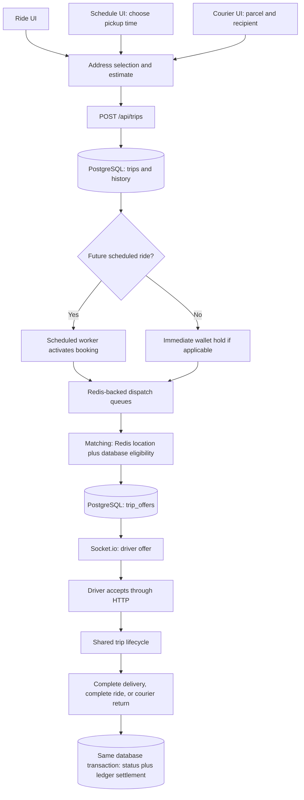

# Trips, scheduled rides, and courier: code and database ownership guide

**Code snapshot: 7 October 2026.** This guide describes the application files in this working tree, including the current scheduled-ride and courier additions. It explains implemented behavior, not a proposed architecture. It does not establish what version is deployed on a phone or server.

Read this alongside the [money and database ownership guide](/Users/mac/Desktop/ride_app/docs/architecture/money-and-database-ownership-guide.md). That guide explains funding, the ledger, Paystack, withdrawals, and refunds. This guide follows the trip that causes a fare to be held, released, or settled.

Code blocks marked **excerpt** come from the application, sometimes reformatted or shortened. Blocks marked **walkthrough** explain the same sequence with names simplified; they are not additional application functions. Sample IDs, coordinates, times, and amounts are illustrations, not real customer records. Amounts described as seed prices are migration defaults, not a claim about your current production prices.

## Reading route

1. Sections 1–6 explain the shared engine, files, tables, Redis, and startup.
2. Sections 7–15 follow a normal ride from address selection to completion or cancellation.
3. Section 16 follows a scheduled ride, including activation and failure.
4. Section 17 follows courier collection, delivery codes, delivery, and return.
5. Sections 18–21 cover reconnection, chat, calls, history, API/event references, and worked examples.
6. Sections 22–25 explain limitations, database investigation, safe change locations, and verification.

## 1. Three services, one trip engine

A passenger ride, a scheduled passenger ride, and a courier delivery all use **one row in `trips` for each booking**. They share the status machine, driver offers, matching, location tracking, and payment services.

- An immediate passenger ride has `service_type='ride'`, `vehicle_type='economy'`, `scheduled_at=NULL`, and starts as `searching`.
- A scheduled passenger ride also has `service_type='ride'` and `vehicle_type='economy'`, but has a future `scheduled_at` and starts as `scheduled`.
- A courier delivery has `service_type='courier'`, `vehicle_type='courier'`, parcel information in `courier_details`, wallet payment, and starts as `searching`.

There is no separate `schedules` or `courier_orders` table in this implementation. The recipient of a parcel is not automatically registered as a user. Recipient details belong to the delivery's JSON data; `rider_id` identifies the sender.

The current API rejects scheduling a courier delivery. These are three supported flows, not every possible combination of service and timing.



The drawing separates responsibilities. Redis does not automatically copy data into PostgreSQL. Your backend functions explicitly read and write each system. A WebSocket event does not itself create a booking or settle money.

## 2. The words used in this guide

**UI state** means data currently held by the running app, such as the selected pickup. Changing this state redraws the screen; it does not necessarily save anything remotely.

**HTTP request** means the app asks the backend to perform an operation and waits for a response. Booking, accepting, starting, completing, cancelling, and rating use HTTP.

**Redis** holds fast-changing location data, expiring locks, rate-limit counters, fare caches, and BullMQ job data. Some Redis data disappears deliberately after a short lifetime.

**Socket.io/WebSocket** carries immediate notifications, offers, locations, and chat messages. It helps the other phone notice a change; the durable trip record lives in PostgreSQL.

**Database transaction** means several SQL statements commit together or roll back together. A completion must not save `completed` but lose its money posting.

**Row lock / `FOR UPDATE`** means concurrent transactions trying to change that row must wait. This is why two drivers cannot both win the same trip merely because both tapped quickly.

**Idempotency key** identifies a repeat of the same operation. For creation, `(rider_id, idempotency_key)` is unique. For ledger postings, the posting's idempotency key is unique. Their replay validation differs, as explained later.

**TTL** means time to live. `EX 30` tells Redis to expire that key after 30 seconds unless another write refreshes it.

**Queue/worker** means a stored job and backend code that processes it. A rider does not need to leave the Schedule screen open for the worker to activate a booking.

**Kobo** is the unit used by money fields. `500000` kobo is ₦5,000. A distance ending `_m` is metres; a duration ending `_s` is seconds. JavaScript timestamps commonly use milliseconds; PostgreSQL timestamps are date/time values.

## 3. Find the implementation in the repository

### 3.1 Mobile entry points

- [HomeScreen.tsx](/Users/mac/Desktop/ride_app/mobile/src/screens/shared/HomeScreen.tsx): Ride, Courier, Schedule, and destination entry points.
- [SetDestinationScreen.tsx](/Users/mac/Desktop/ride_app/mobile/src/screens/rider/SetDestinationScreen.tsx) and [AddressSheet.tsx](/Users/mac/Desktop/ride_app/mobile/src/components/map/AddressSheet.tsx): pickup/drop-off, place search, route preview, next screen.
- [RideSelectionScreen.tsx](/Users/mac/Desktop/ride_app/mobile/src/screens/rider/RideSelectionScreen.tsx), [RideDetailsScreen.tsx](/Users/mac/Desktop/ride_app/mobile/src/screens/rider/RideDetailsScreen.tsx), and [RideConfirmationModal.tsx](/Users/mac/Desktop/ride_app/mobile/src/components/map/RideConfirmationModal.tsx): passenger ride/payment selection and final confirmation.
- [ScheduleRideScreen.tsx](/Users/mac/Desktop/ride_app/mobile/src/screens/rider/ScheduleRideScreen.tsx) and [scheduleTime.ts](/Users/mac/Desktop/ride_app/mobile/src/utils/scheduleTime.ts): future booking date/time and booking list.
- [CourierScreen.tsx](/Users/mac/Desktop/ride_app/mobile/src/screens/rider/CourierScreen.tsx) and [CourierReviewScreen.tsx](/Users/mac/Desktop/ride_app/mobile/src/screens/rider/CourierReviewScreen.tsx): parcel form and wallet-funded review.
- [DriverDashboardScreen.tsx](/Users/mac/Desktop/ride_app/mobile/src/screens/driver/DriverDashboardScreen.tsx): online control, courier opt-in, offer countdown, accept/decline.
- [OngoingTripScreen.tsx](/Users/mac/Desktop/ride_app/mobile/src/screens/rider/OngoingTripScreen.tsx) and [DriverTripScreen.tsx](/Users/mac/Desktop/ride_app/mobile/src/screens/driver/DriverTripScreen.tsx): live passenger/sender and driver actions.
- [TripCompletedScreen.tsx](/Users/mac/Desktop/ride_app/mobile/src/screens/shared/TripCompletedScreen.tsx), [TripReceiptScreen.tsx](/Users/mac/Desktop/ride_app/mobile/src/screens/shared/TripReceiptScreen.tsx), and [AccountSectionScreen.tsx](/Users/mac/Desktop/ride_app/mobile/src/screens/shared/AccountSectionScreen.tsx): result, rating, receipt, and history.

Expo route files under `mobile/src/app/(app)` mount these screens. They are not separate backend applications.

### 3.2 Shared mobile plumbing

- [tripStore.ts](/Users/mac/Desktop/ride_app/mobile/src/store/tripStore.ts): active trip, offer, driver location, API actions, errors, and screen routing.
- [mapStore.ts](/Users/mac/Desktop/ride_app/mobile/src/store/mapStore.ts): chosen addresses, current location, route coordinates, and map camera.
- [courierDraftStore.ts](/Users/mac/Desktop/ride_app/mobile/src/store/courierDraftStore.ts): parcel information before submitting.
- [tripService.ts](/Users/mac/Desktop/ride_app/mobile/src/services/tripService.ts): HTTP methods and trip types.
- [apiClient.ts](/Users/mac/Desktop/ride_app/mobile/src/lib/apiClient.ts): access token, HTTP timeout, refresh/retry, error translation.
- [socket.ts](/Users/mac/Desktop/ride_app/mobile/src/services/socket.ts): socket connection and subscriptions.
- [TripRecovery.tsx](/Users/mac/Desktop/ride_app/mobile/src/components/trip/TripRecovery.tsx): startup recovery, foreground recovery, status subscriptions, and navigation.
- [locationService.ts](/Users/mac/Desktop/ride_app/mobile/src/services/locationService.ts), [DriverOnlineControl.tsx](/Users/mac/Desktop/ride_app/mobile/src/components/map/DriverOnlineControl.tsx), and [mapsService.ts](/Users/mac/Desktop/ride_app/mobile/src/services/mapsService.ts): device GPS, driver publishing, and map HTTP calls.

### 3.3 Backend plumbing

- [app.ts](/Users/mac/Desktop/ride_app/backend/src/app.ts) mounts `/api/trips`, `/api/location`, `/api/driver`, map routes, and payments.
- [index.ts](/Users/mac/Desktop/ride_app/backend/src/index.ts) starts HTTP, Socket.io, trip workers, and payment workers.
- [trips.routes.ts](/Users/mac/Desktop/ride_app/backend/src/modules/trips/trips.routes.ts) applies authentication, role checks, and selected rate limits.
- [trips.controller.ts](/Users/mac/Desktop/ride_app/backend/src/modules/trips/trips.controller.ts) translates HTTP into service calls and starts/removes jobs.
- [trips.service.ts](/Users/mac/Desktop/ride_app/backend/src/modules/trips/trips.service.ts) owns booking, scheduling, courier verification, trip actions, and reads.
- [tripStateMachine.ts](/Users/mac/Desktop/ride_app/backend/src/modules/trips/tripStateMachine.ts) validates and records transitions.
- [fare.service.ts](/Users/mac/Desktop/ride_app/backend/src/modules/trips/fare.service.ts) calculates fares and commission.
- [dispatch.service.ts](/Users/mac/Desktop/ride_app/backend/src/modules/trips/dispatch.service.ts), [tripQueue.ts](/Users/mac/Desktop/ride_app/backend/src/modules/trips/tripQueue.ts), and [matching.service.ts](/Users/mac/Desktop/ride_app/backend/src/modules/matching/matching.service.ts) select drivers and manage timeouts.
- [location.service.ts](/Users/mac/Desktop/ride_app/backend/src/modules/location/location.service.ts), [handlers.ts](/Users/mac/Desktop/ride_app/backend/src/websocket/handlers.ts), and [tripSocket.ts](/Users/mac/Desktop/ride_app/backend/src/modules/trips/tripSocket.ts) handle live locations and events.
- [tripPayments.service.ts](/Users/mac/Desktop/ride_app/backend/src/modules/payments/tripPayments.service.ts) calls the shared ledger for holds, releases, and settlements.

The actual code has more modules/tables and different status names than the early project overview. Follow the source and migrations below when changing this implementation.

## 4. PostgreSQL: what is saved, one table at a time

### 4.1 `trips`: the current booking and its result

The database creates `id` with `gen_random_uuid()`. The app does not choose the trip UUID. `rider_id` and `driver_id` reference `users(id)`; the driver is initially null.

**Identity and classification:** `id`, `rider_id`, `driver_id`, `service_type`, `vehicle_type`, and `idempotency_key`. The tariff reference is `vehicle_type`; using `courier` there selects a courier price, not a separate vehicle record.

**Pickup:** `pickup_lat`, `pickup_lng`, `pickup_address`, `pickup_place_id`. Coordinates are required; a Google place ID is optional.

**Destination:** `dropoff_lat`, `dropoff_lng`, `dropoff_address`, `dropoff_place_id`.

**Saved route and price:** `estimated_distance_m`, `estimated_duration_s`, `route_polyline`, `fare_kobo`, `commission_kobo`, `driver_earning_kobo`. The last two are calculated on completion/return. The distance and duration are the booking estimate, not a continuously billed GPS meter.

**Lifecycle:** `status`, `requested_at`, `accepted_at`, `arrived_at`, `started_at`, `completed_at`, `cancelled_at`, `created_at`, `updated_at`. A scheduled trip's `requested_at` is reset when dispatch starts; `created_at` preserves when the advance booking was created.

**Cancellation:** `cancelled_by` is rider/driver/system, and `cancel_reason` explains the cancellation. `no_drivers_found` is its own status, not an ordinary cancellation with a reason.

**Money linkage:** `payment_method`, `payment_status`, `hold_tx_id`, and `settle_tx_id`. The status values are `unpaid`, `held`, `settled`, and `released`. These fields summarize the payment relationship; the ledger entries explain the actual movements.

**Scheduling:** `scheduled_at` is a timezone-aware PostgreSQL timestamp, nullable for immediate requests.

**Courier:** `courier_details` JSONB; `delivery_attempts`; `delivery_code_version`; `delivery_reset_count`; `delivery_verified_at`; `delivery_issue_reason`; `returned_at`. A returned delivery uses `returned_at`, not `completed_at`, as its terminal timestamp.

An example of the JSON data is:

```json
{
  "description": "Sealed box of books",
  "weightKg": 2,
  "recipientName": "Example Recipient",
  "recipientPhone": "+2348012345678",
  "pickupInstructions": "Meet at the gate",
  "dropoffInstructions": "Call on arrival"
}
```

The restrictions checkbox is validated when creating the courier trip but is not retained in this returned JSON structure as an acceptance record.

`trips` is a mutable current-state row. Updating its status is expected. Financial ledger entries and `trip_status_history` have separate append-only rules.

### 4.2 `trip_status_history`: how the status changed

Each row has `id`, `trip_id`, `from_status`, `to_status`, `actor_id`, `actor_type`, `metadata`, and `created_at`.

Creation inserts `NULL → searching` or `NULL → scheduled`, with the rider as actor. Each later transition inserts another row through `transitionTrip()`. System actions normally have no actor user ID. Metadata defaults to `{}` when no extra metadata is provided.

An immediate ride that completes normally has five history rows: creation, assignment, arrival, start, and completion. A scheduled ride that completes normally has six because it also records scheduled activation.

A trigger rejects UPDATE and DELETE on this table. Do not repair a trip by silently rewriting its recorded history. Not every trip field update creates a history row: delivery-code attempt increments and resets are examples that do not change status.

### 4.3 `trip_offers`: which drivers were asked

Each offer stores `id`, `trip_id`, `driver_id`, `status`, `distance_to_pickup_m`, `sent_at`, `expires_at`, and `responded_at`.

Offer statuses are `sent`, `accepted`, `declined`, `expired`, and `rescinded`. These rows are updated as an offer is answered or expires. They are not append-only ledger entries.

`UNIQUE(trip_id, driver_id)` means the same driver gets at most one stored offer for a particular trip, even after declining or expiry. Matching excludes drivers who already have any offer for that trip. A retry does not keep asking the same driver.

Receiving an offer does not set `trips.driver_id`. Successful acceptance does that.

### 4.4 `trip_locations`: sampled historical coordinates

Fields are `id`, `trip_id`, `lat`, `lng`, and `recorded_at`. During an active trip, the socket handler occasionally inserts a point here, controlled by a Redis sampling key.

The default sampling interval is 15 seconds. This is not the source for the moving live marker, and the app does not write every GPS update to PostgreSQL. Idle drivers do not generate trip breadcrumb rows. `recorded_at` comes from the accepted client timestamp, converted from milliseconds.

There is no route-replay screen wired to this table in the flows described here.

### 4.5 `trip_ratings`: one rating per participant per trip

Fields are `id`, `trip_id`, `rater_id`, `ratee_id`, `rating`, `comment`, and `created_at`. Rating must be an integer from 1 to 5. `(trip_id, rater_id)` is unique.

The same transaction updates the other user's `users.rating_avg` and `users.rating_count`. Rating currently requires status `completed`; `returned` is excluded and its completion screen hides the rating form.

### 4.6 `fare_config`: price and commission inputs

The key is `vehicle_type`. Other fields are `base_fare_kobo`, `per_km_kobo`, `per_min_kobo`, `min_fare_kobo`, `commission_bps`, `is_active`, and `updated_at`.

The migration seeds these development defaults:

- Economy: base ₦800, ₦250/km, ₦35/minute, minimum ₦1,200, commission 1,500 basis points (15%).
- Courier: base ₦1,000, ₦300/km, ₦25/minute, minimum ₦1,500, commission 1,500 basis points (15%).

Your database can contain changed values. Booking reads an active tariff through `getFareConfig()`, unless a Redis estimate cache is reused. Completion reads the then-current commission rate again. The price is saved on the trip; the commission rate itself is not snapshotted there at booking.

### 4.7 `users` and `driver_profiles`

`users` supplies identity, active mode, account activity, names, avatars, and ratings. Detail reads join rider and driver user rows. Authentication reads the user from the database instead of trusting an arbitrary user ID supplied by the client.

`driver_profiles` supplies approval, vehicle make/model/color/plate, and `accepts_courier`. Courier opt-in defaults to false. The approved driver's dashboard toggle saves through `PUT /api/driver/courier-preference`; it updates this row, not Redis.

### 4.8 Financial tables linked to the trip

`ledger_transactions` records postings with `reference_type='trip'` and `reference_id=trip.id`. `ledger_entries` records the balanced debit/credit lines. `ledger_accounts` supplies rider wallet, escrow, driver earnings, and commission accounts, including cached balances protected by database locks.

The current trip payment functions write these ledger tables. They do **not** also insert equivalent rows into the older `wallet_transactions` table. That legacy table exists, but it is not where these current holds and settlements are recorded. The money guide explains this distinction in detail.

No Paystack payment intent is created merely by requesting a wallet trip. A prior wallet top-up is a separate provider/payment-intent flow. Holding or settling an already funded wallet is internal ledger work.

### 4.9 Migrations: how these structures were created

- [002_trip_system.sql](/Users/mac/Desktop/ride_app/backend/migrations/002_trip_system.sql): base trips, fares, offers, history, ratings, locations, legacy wallet table, uniqueness rules, and append-only triggers.
- [003_payments_ledger.sql](/Users/mac/Desktop/ride_app/backend/migrations/003_payments_ledger.sql): ledger/payment structures and trip payment links.
- [004_scheduled_trips.sql](/Users/mac/Desktop/ride_app/backend/migrations/004_scheduled_trips.sql): scheduled status, timestamp, and index.
- [005_courier_trips.sql](/Users/mac/Desktop/ride_app/backend/migrations/005_courier_trips.sql): courier fields, constraint, and tariff.
- [006_courier_returns.sql](/Users/mac/Desktop/ride_app/backend/migrations/006_courier_returns.sql): returning and returned enum values.
- [007_courier_return_columns.sql](/Users/mac/Desktop/ride_app/backend/migrations/007_courier_return_columns.sql): return reason/timestamp and active-trip indexes including returning.
- [008_driver_courier_preference.sql](/Users/mac/Desktop/ride_app/backend/migrations/008_driver_courier_preference.sql): driver opt-in.
- [009_courier_code_rotation.sql](/Users/mac/Desktop/ride_app/backend/migrations/009_courier_code_rotation.sql): code version and reset counter.

The migration runner sorts numbered SQL filenames, checks `schema_migrations`, and applies each unapplied file in its own transaction before recording the filename. Return enum values are introduced before the later migration uses them in indexes. Do not merge those migrations casually.

Opening a screen does not run migrations. Deployment/setup runs `npm run migrate` from the backend directory. This documentation task did not migrate your application database or deploy anything.

## 5. Redis: every trip-related key and why it exists

**`drivers:locations`** is the geographic index. `GEOADD` saves longitude, latitude, driver ID. `GEOSEARCH` finds nearby candidates ordered by geographic distance. It is a radius search, not Google driving ETA. Individual members have no TTL; nearby searches remove members whose online status has expired.

**`driver:<driverId>:status`** stores `online` for 30 seconds. Successful location updates refresh it. Missing status makes the driver unavailable for matching.

**`driver:<driverId>:location`** stores the latest coordinate JSON for 30 seconds. This contains identity, coordinates, timestamp, and optionally heading.

**`driver:offer:<driverId>`** temporarily reserves a driver for an offer. Its value is the trip ID, set with `NX` and a lifetime of offer timeout plus five seconds: normally 20 seconds.

**`driver:<driverId>:onTrip`** is the acceptance/busy lock. Its value is the trip ID. Acceptance uses `NX EX 60`; active location updates renew an existing lock owned by that trip. Renewal does not recreate an already expired key. PostgreSQL still excludes drivers with active trips if this Redis lock expires.

**`trip:<tripId>:loc`** holds the latest active-trip driver coordinate for 30 seconds. `/trips/active` reads it so a recovered screen can begin with a recent location.

**`trip:<tripId>:breadcrumb`** is a sampling gate, normally 15 seconds. The first update gets `SET ... NX EX`; only that update inserts a historical coordinate. Its value is a timestamp, not the breadcrumb history itself.

**`trip:estimate:<pickup-rounded>:<dropoff-rounded>:<vehicleType>`** caches the route/fare response for 60 seconds. Coordinates are rounded to five decimal places. Changing a tariff can therefore leave old cached estimates usable briefly.

**`rate:trip:<userId>:<request-path>:<minute-number>`** counts selected HTTP calls. It expires after 61 seconds. Creation allows 10 calls/minute; route and estimate default to 20 each; code rotation allows 2 per minute per path. This is separate from the maximum two courier resets for the trip's entire lifetime.

**BullMQ-managed Redis keys** back `trip-dispatch`, `trip-offer-timeout`, `trip-search-expiry`, and `trip-maintenance`. BullMQ manages their internal format. Do not treat their keys as your own editable tables.

A Redis restart can affect presence, pending job availability, and caches depending on its persistence configuration. PostgreSQL trip and ledger rows remain a separate source of durable business records.

## 6. Startup, authentication, and who can act

1. Backend `index.ts` creates Express and the HTTP server.
2. It attaches Socket.io and registers that instance for trip and wallet emissions.
3. It starts the trip and payment workers asynchronously.
4. It starts listening for HTTP requests. Listening does not prove workers started successfully; worker startup failures are logged.
5. The mobile root layout waits for fonts and persisted authentication/UI preferences, then mounts `LocationBootstrap`, `TripRecovery`, and `WalletBootstrap` for signed-in users.
6. Trip/map/courier draft stores themselves are in-memory Zustand stores. They do not persist unfinished booking drafts or active trips in AsyncStorage. Native driver background-location context is separately stored in AsyncStorage.
7. `apiClient` adds the access token to protected HTTP requests. It uses a 10-second timeout. A protected 401 can cause one refresh-and-retry; concurrent refreshes share one refresh promise. Failed refresh clears authentication.
8. Backend `requireAuth` verifies the bearer token and checks an active `users` row. It sets `req.userId` and `req.authUser`.
9. Creation, estimate, and scheduled-list routes require `active_role='rider'`. Driver action routes use `requireApprovedDriver`.
10. Driver middleware has an exception allowing a driver already attached to an active trip to reach those trip routes after approval changes. A later ledger check still requires approval when obtaining a driver earnings account; this exception does not guarantee successful settlement after approval is revoked.
11. Trip detail, cancellation, rating, room joining, and chat also check that the authenticated user actually participates. Delivery-code reads/resets require the sender/rider, not merely any participant.

Socket authentication uses the access token at connection time and checks an active user. The server joins `driver:<userId>` and `user:<userId>` automatically. Joining `trip:<tripId>` requires a database participant check.

The automatic `driver:` room name is a delivery address, not proof that someone is approved. Business operations perform their own checks.

## 7. Rider clicks Ride: addresses and route preview

### 7.1 Navigation and local state

The Home screen's Ride/“Where to” action opens `/set-destination`. No trip row is created by navigating there.

`SetDestinationScreen` reads `mapStore`: pickup, drop-off, current device location, camera, and route coordinates. A `scheduledAt` route parameter carries the chosen future time; `service='courier'` carries the courier flow. These route parameters are not database writes.

The GPS button requests device permission, gets coordinates, reverse-geocodes them through your backend, and updates the local pickup/current location and map camera. Moving the pickup map uses a debounce before reverse geocoding and guards against an older response replacing a newer selection.

### 7.2 Typing and choosing an address

1. `AddressSheet` waits for at least two characters and roughly 300 ms without further typing.
2. It calls the mobile maps service.
3. `POST /api/places/autocomplete` reaches the authenticated backend maps route.
4. `maps.service.ts` calls Google Places autocomplete with Nigerian region restriction and, when available, a 50 km location bias.
5. Results return to the sheet. They are suggestions, not saved trips.
6. Tapping a suggestion calls `POST /api/places/details` for coordinates, formatted address, and country information.
7. The frontend rejects an explicitly non-Nigerian country result, then stores the selected point in `mapStore`.
8. Editing an address invalidates its previously selected point/route. The code uses selection-version checks so slow results cannot overwrite a later choice.
9. Once both points are valid, the sheet requests the route and fare estimate in parallel.

Backend maps code uses the configured server key. It calls Google, not PostgreSQL, for address suggestions, details, reverse geocoding, and directions. These searches do not create saved-address records.

### 7.3 Route and estimate are separate calls

`POST /api/trips/route` returns the Google driving route: encoded polyline, distance, and duration. The mobile maps service decodes the polyline into coordinates for the map.

`POST /api/trips/estimate` calls the trip pricing service described next. It also obtains a route on cache miss. Two parallel requests can therefore both ask Google for route information; they do not automatically share one pending request.

`mapsService.getTripEstimate()` has a small in-memory 60-second coordinate cache on the phone. The backend has its separate 60-second Redis cache. Neither is a reservation or a saved booking.

The shared address sheet requests the standard economy estimate even during address selection for courier. `CourierReviewScreen` subsequently requests `vehicleType='courier'` for the actual courier price. Do not use the earlier economy preview as the courier charge.

### 7.4 What Find Now/Continue does

The address sheet moves to ride selection, preserving `scheduledAt`, or to courier review when `service='courier'`. The selected locations and route are already in the local store.

At this stage there may be Google API requests, Redis rate counters, and an estimate cache. There is still **no `trips` row, no offer, and no wallet hold**.

## 8. How the fare is calculated

`estimateTrip()` validates coordinates/address, rejects identical pickup and drop-off coordinates, builds the Redis cache key, then reads an existing estimate or obtains Google directions and the active database tariff.

**Excerpt: actual fare calculation, `fare.service.ts`:**

```ts
const raw = Number(config.base_fare_kobo)
  + Math.round((distanceM / 1000) * Number(config.per_km_kobo))
  + Math.round((durationS / 60) * Number(config.per_min_kobo));
return Math.ceil(Math.max(Number(config.min_fare_kobo), raw) / 100) * 100;
```

Read that in order:

1. Start with the base fare.
2. Multiply estimated kilometres by the per-kilometre price.
3. Multiply estimated minutes by the per-minute price.
4. Round each distance/time charge to kobo.
5. Apply the minimum fare if the sum is smaller.
6. Round upward to a whole naira, expressed again in kobo.

With the economy seed tariff and a hypothetical 10 km/20 minute route:

```text
Base                       ₦800
10 km × ₦250             ₦2,500
20 minutes × ₦35           ₦700
Total                    ₦4,000 = 400000 kobo
Minimum                  ₦1,200, so it does not change this result
```

The response contains `fareKobo`, `estimatedFare` in naira, `distanceM`, `durationS`, `distanceKm`, `durationMin`, `encodedPolyline`, `vehicleType`, and `currency='NGN'`.

The submitted booking does not get to dictate its own price: `createTrip()` calls the backend estimate service again using the requested service's tariff. That call may reuse its valid Redis cache.

There is no toll calculation, waiting-time meter, surge multiplier, extra-stop charge, or GPS-based repricing in the completion function. Some UI copy mentions estimates changing for waiting/tolls/routes, but this implementation settles the saved `fare_kobo`.

There is also a display difference: ride selection rounds its displayed naira price upward to the next ₦50; backend pricing rounds to whole naira. Ride details displays the estimate directly. The database amount is the backend amount, so the selection display can differ. The displayed pre-assignment pickup ETA is a heuristic based on estimated trip duration, not a measured route from a selected driver.

## 9. Rider confirms a normal ride: the first durable booking

### 9.1 Buttons before the server call

`RideSelectionScreen` lets the rider choose cash or wallet. The main request button opens `RideConfirmationModal`; merely opening that modal creates nothing.

Its final confirm action performs a client wallet-balance check for an immediate wallet ride. If short, it navigates to top-up. This is convenient feedback, not the concurrency protection: another request could spend the wallet between that check and submission.

The screen keeps a request key in `useRef`, for example `trip-<time>-<random>`. Retrying while the screen remains mounted reuses the key. Remounting can produce a new key. The “ride details” route has its own similar booking handler and local payment selection, initially cash; the selected payment is not passed from ride selection into that route.

**Walkthrough of the mobile request shape:**

```ts
await useTripStore.getState().request({
  pickup: {
    latitude: 6.4474,
    longitude: 3.4723,
    address: 'Example pickup, Lagos',
  },
  dropoff: {
    latitude: 6.50,
    longitude: 3.40,
    address: 'Example destination, Lagos',
  },
  paymentMethod: 'wallet',
}, requestKey);
```

`tripStore.request()` sets loading/error state and calls `tripService.requestTrip()`. That sends `POST /api/trips` with the body and `Idempotency-Key` header. The server derives the rider ID from authentication.

### 9.2 Backend checks before opening the write transaction

`createTrip()` performs these checks:

1. Require a nonempty idempotency key of at most 80 characters.
2. Query `trips` for that rider/key. If found, return the old trip with `created:false`.
3. Parse and validate optional scheduled time and service type.
4. Validate courier details when applicable; reject scheduled courier.
5. For immediate requests, check for another active trip for that rider.
6. Validate pickup/drop-off coordinates and addresses.
7. Accept cash or wallet; reject card. Courier additionally requires wallet.
8. Calculate/retrieve the authoritative fare, route, distance, and duration.

Reusing a trip-creation key with a different body returns the old booking; the trip create API does not hash/compare the changed payload. This differs from `ledger.postTransaction()`, which rejects reused posting keys with different entry data.

### 9.3 Exactly what commits together

`inTransaction()` owns one PostgreSQL client and executes `BEGIN`, the callback, then `COMMIT`. If the callback throws, it executes `ROLLBACK` and rethrows.

**Excerpt: the actual transaction wrapper in `shared/config/db.ts`:**

```ts
export async function inTransaction<T>(work: (client: PoolClient) => Promise<T>): Promise<T> {
  const client = await db.connect();
  try {
    await client.query('BEGIN');
    const result = await work(client);
    await client.query('COMMIT');
    return result;
  } catch (error) {
    await client.query('ROLLBACK');
    throw error;
  } finally {
    client.release();
  }
}
```

The same `client` must be passed into the history and payment functions. Calling an unrelated pooled `db.query()` for one of those writes would put it outside this transaction. Returning normally from `work()` commits; throwing from it rolls back. This distinction also explains the courier attempt-counter implementation in section 17.

**Walkthrough of immediate creation, preserving the actual transaction boundary:**

```ts
const trip = await inTransaction(async (client) => {
  // Parameterized INSERT includes pickup, drop-off, route, fare,
  // rider ID, payment method, idempotency key, and searching status.
  const insertedTrip = await insertTripWithSameClient(client);

  // Actual service inserts NULL -> searching here.
  await insertInitialHistoryWithSameClient(client, insertedTrip);

  // Does nothing for cash; posts rider-wallet -> escrow for wallet.
  await holdTripFare(client, insertedTrip);
  return insertedTrip;
});
// PostgreSQL has committed before notifications or queue additions.
```

The two `insert...` names above are explanatory placeholders. In the actual source, these are inline `client.query(...)` calls in `createTrip()`.

For wallet payment, `holdTripFare()` gets/creates the rider wallet account, gets `escrow_trips`, and posts:

```ts
// Excerpt from tripPayments.service.ts
{
  type: 'trip_hold',
  idempotencyKey: `trip:${trip.id}:hold`,
  referenceType: 'trip',
  referenceId: trip.id,
  entries: [
    { accountId: wallet, direction: 'debit', amountKobo: Number(trip.fare_kobo) },
    { accountId: escrow, direction: 'credit', amountKobo: Number(trip.fare_kobo) },
  ],
}
```

It then sets `trips.payment_status='held'` and `hold_tx_id` on the same client. The ledger locks affected account rows in sorted ID order, checks balances/frozen accounts, inserts balanced entries, and updates cached account balances.

If the wallet is insufficient, the whole creation transaction rolls back: no newly committed trip, history row, or hold survives. The earlier Redis estimate/rate counters are outside this PostgreSQL transaction and can still exist.

Cash skips the hold. The new cash trip remains `payment_status='unpaid'` until successful completion records its settlement behavior.

### 9.4 What happens after commit

1. For immediate wallet trips, the service emits `wallet:updated` to the rider's user room.
2. The controller sees `created:true` and `status='searching'`.
3. It adds dispatch and search-expiry jobs to BullMQ, in parallel.
4. It returns HTTP 201 with `{trip, created:true}`. Existing-key responses are normally 200 with `created:false`.
5. `tripStore` saves the returned immediate trip and clears an old offer/location.
6. The screen refreshes wallet state and navigates to `/ongoing-trip`.
7. `TripRecovery` subscribes to the trip room and begins searching-state detail polling.

Some in-memory returned rows are updated only partially after payment helpers: for example, `payment_status` is set but a newly saved `hold_tx_id` may not be copied into the immediate creation response. Reading the trip again returns the database version. Do not mistake a missing response field for proof that the database write did not happen.

### 9.5 Two taps, two phones, or a lost response

The database has a unique rider/key constraint and an active-trip unique index. The early SELECT is useful but not sufficient; the constraints catch a race after both requests pass that SELECT.

The active rider index includes `searching`, `driver_assigned`, `driver_arrived`, `in_progress`, and `returning`. Scheduled bookings are deliberately outside that active index. Concurrent immediate requests with different keys cannot both become active trips for one rider.

A network timeout can happen after commit. Check `/trips/active` and reuse the same creation key where available. A failed HTTP response does not automatically mean no booking exists. Queue failures after commit are a separate limitation in section 22.

## 10. Driver clicks Go online: how a matchable location appears

### 10.1 Device and app steps

1. `DriverOnlineControl` checks whether device location services are enabled.
2. It requests foreground permission. Native platforms also require background permission for this flow; web skips native background tracking.
3. `startDriverLocationUpdates()` reads a high-accuracy location.
4. It updates the local map and sends the initial location over the authenticated socket, waiting up to eight seconds for acknowledgement.
5. On success it starts the foreground watcher. Settings request roughly four-second/10-metre updates; actual delivery depends on the device/browser.
6. A ten-second heartbeat sends the latest coordinate with a current timestamp even when stationary. A socket reconnect sends the latest coordinate again.
7. Native background tracking starts through Expo Location/Task Manager and stores driver context in AsyncStorage. Background callbacks send their latest coordinate using `driver:location:update`.
8. The UI shows online after the startup operations succeed. Its `online` boolean is local display state, not the database's record of availability.

### 10.2 Server validates the update

The handler accepts both `driver:location` and `driver:location:update`. The foreground publisher currently uses the former.

It verifies latitude/longitude ranges and requires a finite timestamp within two minutes of server time. It looks up any active trip for the authenticated user as driver and checks driver approval. An approved idle driver must also pass the cash-commission debt gate. A driver on an active trip can continue location updates through that trip exception.

The handler constructs its own `driverId` from `socket.data.userId` and finds `tripId` from PostgreSQL. Sending someone else's IDs in a location payload cannot choose whose location is saved.

**Excerpt: location service Redis writes:**

```ts
await client
  .multi()
  .geoadd('drivers:locations', location.longitude, location.latitude, location.driverId)
  .set(`driver:${location.driverId}:status`, 'online', 'EX', 30)
  .set(`driver:${location.driverId}:location`, JSON.stringify(location), 'EX', 30)
  .exec();
```

Longitude comes first in Redis geographic commands. The successful handler acknowledges the update. For an idle driver, this path does not insert `trip_locations` or create a trip.

### 10.3 How nearby cars appear for the rider

`useNearbyDrivers` polls `/api/location/nearby` approximately every five seconds while enabled. The backend uses Redis geographic search and checks database approval/active trips plus Redis online/busy state. Stale offline geographic members are removed.

The generic nearby endpoint does not apply all booking-specific checks, such as courier opt-in and the final cash-debt eligibility check. Seeing a nearby car does not guarantee that car can accept this particular request.

### 10.4 Going offline

The phone stops foreground/background publishing and emits `driver:offline`. The server refuses to mark a driver offline if an active trip exists; otherwise it removes status/location keys and the geo member.

The current frontend does not wait for the offline acknowledgement before displaying offline. This can disagree with a server rejection. Disconnecting does not immediately delete presence: its 30-second TTL eventually expires.

The foreground publisher belongs to the dashboard control and stops when that control unmounts. Native background tracking is separate; web has no native background task. Tracking continuity after navigation away from the dashboard needs real-device/browser testing, rather than assuming another watcher runs on `DriverTripScreen`.

## 11. Dispatch: from a new trip to a driver's offer popup

### 11.1 The four queues

- `trip-dispatch` runs `dispatchNext(tripId, radiusIndex)`.
- `trip-offer-timeout` marks an unanswered offer expired, then queues another dispatch attempt.
- `trip-search-expiry` ends a still-searching trip when its search window expires, subject to the scheduled-offer exception.
- `trip-maintenance` activates/rechecks schedules every 30 seconds and logs certain stale trips every five minutes.

These workers run in the backend process in the current bootstrap. They are not timers running on the rider's phone.

Default settings in [env.ts](/Users/mac/Desktop/ride_app/backend/src/config/env.ts) are 3,000/5,000/8,000 metre search radii, 15-second offers, 120-second immediate search timeout, and six total offers per trip. Environment overrides may change these values.

**The 3,000 here is a search distance in metres, not a ₦3,000 minimum payment or refund.**

### 11.2 One dispatch attempt, in order

1. Read the trip from PostgreSQL. Stop if absent or no longer `searching`.
2. Count all offer rows for it.
3. Stop with `no_drivers_found` if the search deadline or maximum offer count has been reached.
4. Select the current search radius, normally starting at 3 km.
5. Use `findNearbyDrivers()` to obtain drivers in geographic distance order.
6. Check `driver_profiles.status='approved'`.
7. For courier, additionally require `accepts_courier=true`.
8. Exclude drivers with an active database trip, including a return.
9. Exclude anyone already offered this trip, regardless of their old offer's status.
10. Check Redis online status and absence of an `onTrip` lock.
11. Check each candidate's earnings/debt-based `canGoOnline` result from the ledger/payment settings.
12. Try the temporary offer lock for a candidate. If unavailable, try another.
13. Insert `trip_offers` with expiry `now()+offer_timeout`; skip duplicate insertion and release that attempted lock.
14. Emit `trip:offer` to `driver:<driverId>`.
15. The queue worker adds that offer's timeout job.

The offer includes trip ID, service type, optional parcel description, pickup/drop-off, fare, distance to pickup, expiry time, and server time. It does not include the courier handoff code.

### 11.3 Why the search expands

If no candidate can be offered at one radius, the worker schedules the next radius after 250 ms. Wider radii make farther drivers eligible; they do not broadcast to everybody at once.

The usual flow sends one offer, waits for its answer/timeout, then proceeds. However, there is no per-trip dispatch lock wrapping the entire offer selection/insertion. Concurrent dispatch jobs can produce multiple outstanding offers to different drivers. The database acceptance lock still gives only one winner. Do not describe sequential offering as a fully enforced database guarantee.

For an immediate ride, exhausting the final radius can end the search immediately, even if 120 seconds have not elapsed. For a scheduled ride still inside its search window, the worker returns `retry`; maintenance later retries. The six-offer cap can still end a scheduled search before the time window ends.

### 11.4 Popup and countdown on the driver phone

The socket lifecycle subscriber stores the offer in `tripStore`, adding local `receivedAt`. The dashboard opens the offer UI. Its countdown estimates server time using `serverNow` plus elapsed local time, rather than trusting the phone clock to equal the server clock.

Accept/decline buttons call HTTP methods. They do not mutate PostgreSQL via Socket.io. If the popup reaches zero, the server's `expires_at` check still determines whether acceptance is valid.

### 11.5 Decline, timeout, or cancellation

Decline updates a `sent` offer to `declined`, saves `responded_at`, releases its Redis offer lock, emits `trip:offer_cancelled`, removes jobs through the controller, and queues a fresh dispatch.

Timeout updates only a `sent` offer whose `expires_at<=now()` to `expired`; it releases the lock, emits cancellation, and queues the next search attempt.

A rider cancellation changes outstanding sent offers to `rescinded` and ends the trip. The difference is useful in support investigations: declined means the driver answered no; expired means no valid response arrived in time; rescinded means the request was withdrawn.

## 12. Driver clicks Accept, Arrived, and Start

### 12.1 Accept

The driver store sends `POST /api/trips/:id/accept`. After driver authorization:

1. Acquire `driver:<driverId>:onTrip = tripId` with `NX EX 60`. Failure returns `driver_has_active_trip`.
2. Begin a PostgreSQL transaction.
3. Lock the trip using `SELECT * FROM trips WHERE id=$1 FOR UPDATE`.
4. Require `status='searching'`.
5. Change this driver's `sent` offer to `accepted` only if `expires_at>now()`.
6. If no such offer changed, throw `offer_expired_or_invalid`; roll back.
7. Call `transitionTrip(searching → driver_assigned)` with driver ID and acceptance time.
8. Update the trip and append history on the same database client.
9. Commit.
10. Release the temporary offer lock, fetch joined driver/rider/vehicle detail, emit `trip:status`, and remove search/offer timeout jobs.
11. Return the detail row. The driver store saves it, clears the offer, and navigation moves to `/driver-trip`.
12. The rider's event subscription applies the new status and requests the complete trip details.

On failure, the service attempts to release the trip lock only if its value still matches this trip. Lua ownership checks prevent an old operation from deleting another trip's lock.

Two drivers racing for the same trip serialize on that trip row: after the first commits, the second sees a non-searching trip. The active-driver unique index also blocks one driver being attached to two active trips. Redis and PostgreSQL provide complementary protections.

### 12.2 The explicit state machine

These are the implemented transitions:

```text
scheduled       -> searching | cancelled
searching       -> driver_assigned | no_drivers_found | cancelled
driver_assigned -> driver_arrived | cancelled
driver_arrived  -> in_progress | cancelled
in_progress     -> completed | returning
returning       -> returned
completed / returned / cancelled / no_drivers_found -> no further transition
```

The generic state machine permits the return edges, while the return/completion services enforce their courier-only use. The older overview terms `requested`, `accepted`, and `driver_arriving` are not the current database enum names.

The state-machine update also contains `WHERE id=$1 AND status=$2`. It does not overwrite whatever status happens to exist. It validates allowed fields and uses parameterized values, then inserts history. Callers use an explicit transaction around it; the function itself does not start one.

### 12.3 I have arrived

`DriverTripScreen` calls the store's `arrived()` → `POST /:id/arrived` → `markDriverArrived()` → `driverTransition()`.

The service locks the driver's trip, requires `driver_assigned`, transitions to `driver_arrived`, sets `arrived_at`, appends history, commits, and emits status. No fare settlement occurs.

There is no distance-to-pickup geofence check here. Pressing the button is the driver's assertion of arrival.

### 12.4 Start trip / Package collected

For a passenger, the button says Start trip. For courier, it says Package collected. Both call `POST /:id/start` and the same `startTrip()` function.

The required old status is `driver_arrived`; the new status is `in_progress`. `started_at` and history are saved, then an event is emitted. There is no separate package collection table, photo record, passenger start PIN, or recipient verification at this stage.

## 13. During the trip: each location update end to end

The driver continues publishing device coordinates. Once the server finds an active driver trip, the location handler does additional work after the general driver-location Redis writes:

1. Add the database-derived trip ID to the authenticated payload.
2. Save `trip:<id>:loc` with TTL 30 seconds.
3. Renew the owned `onTrip` lock to 60 seconds if it still exists and matches.
4. Attempt the breadcrumb sampling key.
5. If the sample gate succeeds, insert a `trip_locations` row.
6. Emit `driver:location` to `trip:<id>`.
7. Acknowledge success to the driver when that publisher supplied an acknowledgement callback.
8. Rider subscriptions update `tripStore.driverLocation`; the map redraws using the latest data.

**Excerpt: the sampled database insert:**

```ts
const sample = await redis.set(
  `trip:${active.id}:breadcrumb`, String(payload.timestamp),
  'EX', env.BREADCRUMB_SAMPLE_SECONDS, 'NX',
);
if (sample === 'OK') {
  await db.query(
    'INSERT INTO trip_locations (trip_id,lat,lng,recorded_at) VALUES ($1,$2,$3,to_timestamp($4/1000.0))',
    [active.id, payload.latitude, payload.longitude, payload.timestamp],
  );
}
```

For a 30-second stretch with updates around 0, 4, 8, 12, 16, 20, 24, 28 seconds, every accepted update refreshes live Redis state, while the sampling gate might permit historical rows around 0 and 16 seconds. This is approximate, dependent on delivery timing and the configured sample interval.

The Redis writes, breadcrumb INSERT, and event are not one distributed transaction. A database failure after the live write can leave the newer Redis position saved even though the later event/acknowledgement failed. It does not roll Redis back.

The frontend has an interpolation helper for driver map state, but the ongoing screen also consumes the raw trip-store coordinate. Do not assume every map marker is smoothed or that an estimated route is being recomputed for every point. The saved route polyline remains the original booking route.

## 14. Complete a passenger trip: status and money together

The driver taps Complete trip and confirms the alert. The store sends `POST /api/trips/:id/complete`. A passenger ride does not require a delivery code.

`completeTrip()`:

1. Starts a transaction and locks the trip belonging to that driver.
2. Requires `in_progress` for an ordinary ride.
3. Reads the active tariff for the trip's saved `vehicle_type`.
4. Splits the saved fare using that tariff's current commission rate.
5. Transitions to `completed`, saving `completed_at`, commission, and driver earning, and appending history.
6. Calls `settleTrip()` on the same database client.
7. Commits status and settlement together. If settlement throws, the completed state/history also roll back.
8. Releases the driver's Redis trip lock.
9. Emits `wallet:updated` for the driver and `trip:status` for trip participants.
10. Returns the result; the driver store saves it and opens the completion screen.

**Excerpt: split calculation:**

```ts
const commissionKobo = Math.floor((fareKobo * commissionBps) / 10_000);
return { commissionKobo, driverEarningKobo: fareKobo - commissionKobo };
```

### 14.1 Wallet completion

For a hypothetical ₦5,000 fare and 15% commission, settlement debits escrow ₦5,000, credits driver earnings ₦4,250, and credits commission revenue ₦750. The rider wallet was already reduced at hold time. Completion does not debit that wallet a second time.

The posting uses `type='trip_settlement_wallet'`, key `trip:<id>:settle`, and the trip reference. `payment_status` becomes `settled` and `settle_tx_id` links the transaction. A wallet trip without a held fare is rejected.

### 14.2 Cash completion

The rider pays the driver physically. The backend cannot prove that cash changed hands.

For the same example, the driver receives ₦5,000 outside the app; the ledger debits the driver's earnings balance ₦750 and credits commission revenue ₦750. It does not credit the full physical cash fare into the driver wallet. This can create a negative earnings balance representing commission owed.

The posting type is `trip_commission_cash`. A zero-commission cash fare is marked settled without a money posting. The trip's displayed net earning is still the saved fare minus commission.

### 14.3 What prevents double completion?

The trip row lock and state requirement allow only one request to transition from `in_progress`. A later completion request sees the terminal status and fails. The ledger settlement key independently prevents duplicate postings.

This is not an HTTP “always return the same successful response” replay design: a second completion can receive `trip_not_in_progress`, even though the first succeeded. Recovery/read endpoints tell the client the final state.

## 15. Cancellation and no available drivers

### 15.1 Rider or assigned driver cancels

The client sends a reason to `POST /api/trips/:id/cancel`. The backend trims/truncates to 200 characters and requires at least three.

The service locks the trip, verifies participation, and permits cancellation only from `scheduled`, `searching`, `driver_assigned`, or `driver_arrived`. A driver cannot cancel an unassigned searching/scheduled request as its participant. In-progress and returning work cannot be cancelled through this route.

If searching, outstanding `sent` offers are changed to `rescinded`. Then `transitionTrip()` saves `cancelled`, the actor/reason/time, and history. If money is held, `releaseTripHold()` posts an escrow debit and rider-wallet credit for the full held fare, with key `trip:<id>:release`, and marks `payment_status='released'`.

The cancellation and release commit together. Afterward, the service releases applicable locks and emits offer/status/wallet notifications; the controller removes jobs. The initiating mobile cancellation action clears its active trip state.

There is no implemented cancellation fee in this path. A hold release is not an external Paystack refund and does not invoke the admin refund endpoint.

### 15.2 Search ends without an accepted driver

`markNoDrivers()` locks and rechecks a searching trip. It transitions to `no_drivers_found` and releases any held fare in the same transaction. After commit it emits status and, if needed, wallet update.

A cash search failure has no wallet debit to reverse. A scheduled wallet booking cancelled before activation likewise has no hold to release.

### 15.3 Retry is a new booking

A terminal trip cannot transition back to searching. A user retry must create a new trip with a fresh creation key. The old trip and its history remain for audit.

The ongoing screen currently routes its generic “Try again” action to ordinary ride selection. For courier, this does not preserve the full parcel flow, and its draft was already cleared after submission. Treat courier retry UI as incomplete; do not assume that button recreates the same courier order.

## 16. Scheduled ride: every extra step

### 16.1 The rider chooses a future time

1. Home → Schedule opens `/schedule`.
2. `ScheduleRideScreen` requests the rider's scheduled bookings, then refreshes them every 30 seconds while mounted. There is also a manual refresh.
3. `scheduleTime.ts` builds Lagos calendar days and half-hour slots.
4. It filters slots to at least 30 minutes and at most seven days from the current time.
5. Selecting a day/time changes component state only.
6. Continue passes `scheduledAt` as an ISO timestamp to `/set-destination`.
7. Pickup/drop-off selection, route calculation, and ride/payment selection use the common flow.
8. The confirmation shows the scheduled time in `Africa/Lagos` and explains that a driver is not guaranteed until acceptance.
9. Final confirmation rechecks that the chosen time is still in range before submission.

For example, a pickup at **10:00 WAT on 8 October 2026** is the instant `2026-10-08T09:00:00.000Z`. PostgreSQL stores the instant in `TIMESTAMPTZ`; the UI formats it back in Lagos time. The server rejects a timestamp lacking an explicit timezone.

The UI offers half-hour choices, but the API validates the allowed time window, not a half-hour boundary. A valid direct API request can use another minute within that window.

### 16.2 Booking transaction

The request is the normal `POST /api/trips` body plus `scheduledAt`. The server allows booking a future ride while another immediate trip is active; activation later performs the active-trip check again.

Inside the creation transaction:

1. Lock the rider's `users` row. This serializes concurrent future-booking overlap checks for that rider.
2. Look for another `status='scheduled'` booking whose time range overlaps the new one.
3. Each range extends from pickup time through estimated duration plus a 30-minute buffer.
4. Reject overlap with `scheduled_trip_overlaps_existing`.
5. Insert the trip with `status='scheduled'`, future timestamp, current calculated route/fare, no driver, and initial payment status.
6. Insert `NULL → scheduled` history.
7. Commit **without holding the wallet fare**.

**Excerpt: overlap query:**

```sql
SELECT 1 FROM trips WHERE rider_id=$1 AND status='scheduled'
  AND scheduled_at<$2
  AND scheduled_at+(estimated_duration_s*interval '1 second')
      +interval '30 minutes'>$3
LIMIT 1
```

`$2` is the new booking's end including duration/buffer; `$3` is its start. This checks overlapping intervals. It is not simply “one booking per day.” Only other still-scheduled bookings participate in this overlap query.

The controller does not enqueue immediate dispatch because the new row is `scheduled`. The mobile store deliberately keeps `trip=null` for this response and returns to the Schedule screen. The durable booking is already in PostgreSQL even though the active trip store is empty.

### 16.3 Waiting period

No driver is preassigned, no `onTrip` lock is held for this booking, and no wallet funds are reserved. A wallet balance sufficient today can be insufficient when the ride activates tomorrow. Conversely, a rider may fund their wallet after booking but before activation.

There is no price recalculation at activation. The saved booking fare is used. Driver acceptance can occur before the exact chosen time once the search has begun; this implementation does not force the driver to wait until the scheduled timestamp before accepting/arriving/starting.

### 16.4 Activation by the server worker

Every 30 seconds, and once at worker startup, maintenance invokes the scheduled dispatch process.

1. Select up to 50 `scheduled` rows due within five minutes, oldest scheduled time first.
2. For each row, begin a transaction and lock it.
3. Recheck status and timestamp because another worker/request might have changed it.
4. If pickup was more than five minutes ago, cancel with `pickup_time_passed` and history.
5. Otherwise check whether the rider is already on another active trip.
6. For wallet payment, attempt `holdTripFare()` now, using the saved fare.
7. Transition `scheduled → searching`, resetting `requested_at` to dispatch start time and appending system history.
8. Commit the hold and transition together.
9. Emit wallet/status notifications.
10. Add a scheduled initial-dispatch job and a search-expiry job with the remaining time until pickup plus five minutes.
11. Matching/acceptance/arrival/start/completion now use the shared ride engine.

If activation throws an expected wallet or active-trip error, its attempted transaction rolls back. A separate locked transaction cancels the still-scheduled booking with one of:

- `wallet_balance_insufficient`: not enough spendable wallet funds.
- `wallet_unavailable`: the account is frozen for the debit.
- `another_trip_active`: the rider cannot activate this booking while another trip is active.

Unexpected errors are not silently converted into cancellations; they propagate from the worker path. Remaining rows may wait for a later successful maintenance run.

### 16.5 Concrete timing example

For the 10:00 WAT pickup:

- Booking time: save `scheduled`; wallet remains available.
- Around 09:55: a maintenance run can activate it. The exact second depends on worker availability and polling.
- At activation: hold the fare if wallet; begin searching.
- Between activation and 10:05: try eligible drivers, subject to the maximum-offer cap and worker health.
- At/after 10:05: end a still-unmatched search unless there is an outstanding unexpired scheduled offer.
- If an offer is still valid at the deadline, `expireSearch()` leaves it active. It can be accepted until its own expiry. After timeout, the next dispatch sees the passed deadline and ends the search.
- If the backend first wakes after 10:05 while the booking is still `scheduled`, activation cancels it as missed pickup time rather than starting a very late search.

This is an attempted future pickup, not a guaranteed vehicle reservation.

### 16.6 Recovery and retry jobs

Scheduled initial job IDs use `scheduled-initial-<tripId>`. Retry IDs include a 30-second time bucket. These jobs specify three attempts with exponential backoff starting at one second.

Maintenance also looks for scheduled-origin trips already `searching` but without a `sent` offer. It can recreate missing dispatch/expiry jobs and retry after an initial job finishes/fails. This helps repair a crash between activation commit and queue addition.

That recovery is specific, not universal: the “without offers” query excludes any row with an offer still marked `sent`, even if that offer's timestamp has expired. If its timeout job is lost, this query may not repair it. The deadline sweep is another eventual exit path when no valid offer remains.

### 16.7 Listing, cancelling, and opening a scheduled ride

`GET /api/trips/scheduled` returns up to 50 rows with a scheduled timestamp: still-scheduled bookings, plus non-completed bookings whose pickup time is within the last 24 hours or later. It can therefore show recent cancellations, failures, and active scheduled-origin trips as well as future ones.

The Schedule screen shows friendly explanations for activation failures. It offers cancellation while a row is still `scheduled`; the API still uses the common cancellation service. Because no hold exists yet, there is no wallet release posting.

After activation, the live trip screen handles the ride. The active recovery endpoint finds it once its status is active. The Schedule list's “view” navigation and the global recovery mechanism connect the advance booking to that live screen.

There is no edit/reschedule endpoint. Changing a saved time is not an implemented UPDATE flow; it would require a designed cancellation/rebooking or rescheduling feature with renewed validation.

## 17. Courier: every extra step

### 17.1 The sender fills the parcel form

Home → Courier opens `/courier`. `CourierScreen` clears old drop-off/route/driver map data; `clearTripMap()` preserves the current pickup and device location.

The sender enters description, weight, recipient name, international phone number, and optional pickup/drop-off instructions, then confirms restrictions. The Continue button saves an in-memory `courierDraftStore` object and opens address selection with `service='courier'`.

Nothing is sent to PostgreSQL by this form alone. Closing/restarting the app can lose this unsent draft.

Server validation at final creation independently requires:

- Description: 3–160 characters after trimming.
- Recipient name: 2–80 characters.
- International phone format: `+` followed by 8–15 digits, first digit nonzero.
- Weight: a finite number greater than zero and no more than 5 kg.
- Optional instructions: at most 200 characters each.
- `acceptedRestrictions === true`.

The API validates the format and declared weight; it does not weigh the package, verify that the phone belongs to the recipient, inspect its contents, or save photographic evidence.

### 17.2 Address selection and review

The common address screen collects pickup/delivery locations, then routes to `/courier-review`.

Review requires the draft and both locations. It refreshes the wallet and requests a dedicated courier estimate through `estimateTrip` with `vehicleType:'courier'`. The review shows the parcel, recipient, route, and price. It requires sufficient displayed wallet funds and offers top-up if needed.

**Walkthrough of the courier booking body:**

```ts
{
  pickup,
  dropoff,
  paymentMethod: 'wallet',
  serviceType: 'courier',
  courierDetails: {
    description: 'Sealed box of books',
    weightKg: 2,
    recipientName: 'Example Recipient',
    recipientPhone: '+2348012345678',
    pickupInstructions: 'Meet at the gate',
    dropoffInstructions: 'Call on arrival',
    acceptedRestrictions: true,
  },
}
```

Its creation key is held in a ref with a `courier-...` prefix. After a successful response, the screen clears the parcel draft, refreshes the wallet, and opens the ongoing screen.

### 17.3 Database creation and matching differences

`createTrip()` follows the same immediate transaction, with these differences:

1. Require courier details and wallet payment.
2. Reject a scheduled timestamp.
3. Use the courier tariff.
4. Save `service_type='courier'`, `vehicle_type='courier'`, and validated `courier_details` JSONB.
5. Initialize delivery fields from their database defaults, including attempts/version/reset counters at zero.
6. Create the normal initial history and wallet hold atomically.
7. Enqueue normal dispatch and expiry jobs after commit.
8. Matching restricts offers to approved drivers who opted into package deliveries.

A database CHECK constraint also requires courier details and wallet payment for courier rows, and null courier details for passenger rides. The detailed JSON field/weight/phone rules live in application validation; the database constraint does not validate every JSON property.

### 17.4 Driver opt-in

The approved driver's Package deliveries toggle reads `GET /api/driver/courier-preference` and writes `PUT /api/driver/courier-preference` with `acceptsCourier`.

The backend validates a boolean and updates `driver_profiles.accepts_courier` plus `updated_at`. The database default is false. The response updates the toggle, and subsequent matching queries use that saved setting.

This is an eligibility filter at offer selection. Existing sent offers are not automatically rescinded by toggling the setting off, and acceptance does not recheck the courier preference.

### 17.5 Collection and moving toward the recipient

An offer identifies the request as courier and includes the parcel description. Accept creates the normal assignment. I have arrived moves to `driver_arrived`; Package collected moves to `in_progress`.

The driver screen displays recipient details and instructions. Calling the recipient opens the operating system's `tel:` handler using the stored recipient phone. Navigation opens Google Maps toward pickup during assignment, drop-off during delivery, or original pickup during return.

There is no second recipient account, recipient wallet debit, or recipient Socket.io room created by this workflow. The sender remains the rider-side participant watching the delivery.

### 17.6 Where the six-digit code comes from

The sender's ongoing screen calls `GET /api/trips/:id/delivery-code`. The server checks that this is a courier trip owned by that rider and that the status is not in its unavailable list.

**Excerpt: current code derivation:**

```ts
function deliveryCode(tripId: string, version: number): string {
  const digest = createHmac('sha256', env.JWT_ACCESS_SECRET)
    .update(`courier-delivery:${tripId}:${version}`).digest();
  return String(digest.readUInt32BE(0) % 1_000_000).padStart(6, '0');
}
```

The secret and trip ID/version deterministically produce the code. There is no plaintext delivery-code column and no row in `otp_verifications` for this handoff code. It is separate from login/withdrawal OTP handling.

The sender manually shares the code with the recipient using the device share sheet or their own communication. The application does not automatically send a recipient SMS or verify a messaging delivery receipt. The driver's offer does not contain the code.

Rotating `JWT_ACCESS_SECRET` while deliveries are active changes their derived codes. The code has no separate expiry timestamp; access and verification depend on trip state, attempts, and version. Possession of the code is what the backend verifies, not the physical identity of the person handing it over.

### 17.7 Driver enters the code and confirms delivery

The driver enters six digits on `DriverTripScreen` and taps Confirm delivery. The app checks the six-digit format and sends `{deliveryCode}` to the common complete endpoint.

The backend locks the trip and, for courier:

1. Require `in_progress` or the special returning path.
2. If `delivery_attempts>=5`, reject `delivery_code_locked`.
3. Derive the current code from the saved version.
4. Require a six-digit string and compare it using `timingSafeEqual`.
5. On a wrong code, increment `delivery_attempts` and return `null` from inside the transaction callback.
6. `inTransaction()` commits that attempt increment.
7. Outside the transaction, throw `invalid_delivery_code` for the HTTP error.

**Excerpt showing why bad attempts persist:**

```ts
// Inside completeTrip's transaction callback:
if (!/^\d{6}$/.test(code) ||
    !timingSafeEqual(Buffer.from(code), Buffer.from(correct))) {
  await client.query(
    'UPDATE trips SET delivery_attempts=delivery_attempts+1 WHERE id=$1',
    [tripId],
  );
  return null;
}
// After the transaction has returned and committed:
if (!trip) throw new ApiError(400, 'invalid_delivery_code');
```

Throwing the invalid-code error immediately after the UPDATE inside the transaction would roll the attempt back. The current implementation deliberately avoids that pattern. Concurrent attempts serialize on the trip row.

For a correct code in `in_progress`, the service sets `delivery_verified_at`, transitions to `completed`, calculates the split, and settles the wallet hold in the same transaction. Failure to settle rolls the success state back too. There is no additional Paystack charge at handoff.

### 17.8 Sender generates a new code

The sender's Generate a new code button is shown during `in_progress` or `returning`. It calls `POST /:id/delivery-code/rotate`.

Inside a locked transaction, the service checks sender ownership, courier type, allowed status, and `delivery_reset_count<2`. It then:

```sql
UPDATE trips
SET delivery_attempts=0,
    delivery_code_version=delivery_code_version+1,
    delivery_reset_count=delivery_reset_count+1
WHERE id=$1
RETURNING *
```

The server derives a code using the updated version and returns it. Prior-version codes are no longer used for verification; because the displayed space is six digits, the derivation is not an absolute mathematical guarantee that two versions could never produce the same digits.

The UI updates the code locally. It does not automatically message the recipient. No dedicated code-rotation history/audit row or socket event is inserted/emitted, so another sender device can still show a previously fetched code until it fetches again.

There are up to five wrong attempts per version and up to two resets over the trip lifetime: at most three such attempt windows if all resets are used. An exhausted code/reset state has no implemented customer-support unlock action in these screens.

### 17.9 Recipient unavailable: start return

During `in_progress`, the driver can choose the recipient-unavailable return action. The current UI submits the reason `Recipient unavailable at drop-off`.

`POST /:id/return` locks the driver-owned courier trip, requires `in_progress`, trims/truncates a reason to 200 characters and requires at least three, then transitions to `returning` with `delivery_issue_reason` and history.

No settlement happens yet. The original fare remains held. The same driver stays attached, location tracking continues, and active-trip indexes include `returning`, preventing another active assignment. The rider-side screen says the package is returning; driver navigation targets the original pickup.

There is no transition from `returning` back to `in_progress` in the current state machine.

### 17.10 Return handoff and its money outcome

At the original pickup, the sender receives the package and gives the driver the current code. The driver taps Confirm return with that code, using the same `/complete` endpoint.

The service verifies the code, transitions `returning → returned`, saves `returned_at` and `delivery_verified_at`, calculates the original fare split, and settles the held fare atomically. The driver's lock is released after commit.

**A returned parcel still charges the original delivery fare in this implementation.** There is no extra return fee and no automatic refund. The terminal row has `returned_at`; `completed_at` can remain null. The completion screen explains the charge and omits rating controls.

A separate admin refund route currently accepts only `completed`, so it rejects `returned`. This is a support-policy/implementation gap, not a hidden refund button or automatic reversal.

## 18. How both apps stay in sync and recover

### 18.1 Normal event flow

Backend state-changing services emit after their PostgreSQL transaction commits. `trip:status` contains `tripId`, `status`, `driverId`, `at`, and sometimes joined driver information. It does not carry the complete trip row or all payment/timestamp changes.

`TripRecovery` listens globally. `tripStore.applyStatus()` updates only the currently held matching trip ID. A `driver_assigned` event additionally causes a detail refresh, supplying vehicle/rider/driver fields.

A store change makes the screen redraw and `routeForTrip()` selects the appropriate route: live rider/driver screen, completion screen for completed/returned, home/dashboard for cancellation, or the rider's no-driver screen.

### 18.2 The three read endpoints do different jobs

- `GET /trips/active`: latest active trip for the user's current rider/driver role, joined participant details, and Redis `latestDriverLocation`. It excludes scheduled and terminal trips.
- `GET /trips/:id`: participant-authorized detail read, including completed/returned/cancelled trips. It does not append Redis latest location the way `/active` does.
- `GET /trips/scheduled`: scheduled-origin bookings for the rider, using the list rules in section 16.

### 18.3 Startup, foreground, reconnect, polling

The app recovers an active trip at signed-in mount, when returning to the foreground, and on socket connect/reconnect. With no active trip held locally, it checks approximately every 30 seconds when not already loading. While a known trip is searching, it refreshes detail approximately every three seconds.

There is no equivalent continuous detail poll for all assigned/in-progress/returning states. Events do not form a stored replay log. If a terminal event is missed and the app later requests only `/active`, it can receive null rather than the missed completion details; history/detail is the durable place to find that result.

Scheduled activation can occur while the phone has no local trip and has not joined its room. The later active recovery/list refresh is therefore significant, not merely a performance optimization.

### 18.4 Room subscriptions and their limits

`subscribeToTrip()` emits `trip:join` and adds a location listener. Its cleanup removes the listener but does not send a room-leave operation. The server validates the join but the mobile helper does not use its acknowledgement.

The location and chat subscription helpers also do not filter received events by trip ID before forwarding them. Since the socket can retain earlier trip-room memberships, this is a correctness gap to address when hardening multi-trip/session behavior.

Socket room delivery currently uses a single server instance's memory. The backend has no configured Socket.io Redis adapter. Redis-backed BullMQ and Redis location keys do not automatically make socket room emissions work across multiple Node instances.

## 19. Chat, calling, sharing, completion, ratings, and receipts

### 19.1 Message button

The live screen opens `/trip-chat` with trip ID and participant name. The chat screen keeps a local messages array and initially inserts a hardcoded welcome message; that message was not actually sent by the other participant.

Send creates a local message ID/timestamp, immediately adds it to the UI, and emits `trip:message:send`. The server validates required fields and text length (maximum 1,000), checks participation in PostgreSQL, replaces sender ID/role with authenticated values, joins the room, and emits `trip:message`.

The UI deduplicates echoed IDs. However, neither PostgreSQL nor Redis stores the messages in this handler. There is no message-history read, offline delivery guarantee, or durable delivery/read receipt. The local optimistic display does not prove the other phone received the message. The handler checks participation, but does not restrict messaging to active trip statuses.

### 19.2 Call and navigation buttons

`TripCallScreen` is a presentation screen with local timer/mute/speaker/camera controls. There is no connected in-app audio/video provider. The video action explicitly says setup is required. Its audio phone button can open `tel:` only if a phone parameter was supplied.

The rider's live-screen call navigation currently passes participant name/type but no phone number. Trip detail joins also do not return the driver's phone. Consequently, those controls do not establish a working phone call from that path. The courier driver's recipient call is a separate real `tel:` action using recipient data.

Driver navigation launches Google Maps; it does not change trip status or reprice the trip. A UI timer or external navigation session does not itself write completion records.

### 19.3 Share and safety

Share ride/delivery details uses the operating system's share sheet with text containing addresses and, when available, driver/plate details. The safety action labelled Share live trip uses that same text-sharing function; there is no generated public tracking URL in it.

Emergency calling opens `tel:112`. It does not insert a dispatch/support incident into the database through the trip service.

### 19.4 Completion and rating

The completion screen reads the locally held trip. The driver gets the HTTP completion response; the other participant may initially have only the partial status event. The latter may still have stale payment/timestamp fields until a detail read.

For completed trips, Submit rating calls `POST /:id/rating`. The server locks the trip, verifies participation and `completed`, validates 1–5, inserts `trip_ratings`, and updates the other user's average/count in one transaction. A duplicate rating returns `trip_already_rated`.

The UI allows a comment up to 500 characters while the backend truncates it to 300. Skip only clears local trip/map state and navigates away; it does not cancel, erase, or alter the completed database trip.

### 19.5 History and receipt

The account history screen calls `/trips/history`. The backend uses the current active role to filter `rider_id` or `driver_id`, includes completed/returned/cancelled/no-driver rows, sorts by creation time descending, and returns a cursor.

The default page size is 20, capped at 50. The current screen loads the first response and does not implement a Load more loop, even though the API supplies `nextCursor`.

Tapping a history card opens `/trip-receipt?tripId=...`, which fetches `/trips/:id`. The receipt is derived from the trip and joins; there is no separate receipt table. It shows saved estimated distance/duration, fare, addresses, vehicle/driver information, and courier parcel/recipient information when applicable. For returned courier, its date falls back to `returned_at`.

History card rendering currently prefers `driver_earning_kobo` whenever present, even on rider history, and its date fallback does not include `returned_at`. The detailed receipt uses full `fare_kobo`. These are display differences; do not infer the rider paid only the driver's share from a history card.

## 20. HTTP actions and socket events: compact reference

### 20.1 Trip HTTP endpoints

All paths below have the `/api` prefix and use authentication. Additional ownership/role/state checks are in the services.

- `POST /trips/route`: route preview; Google request, no trip write.
- `POST /trips/estimate`: rider-mode estimate; tariff read and Redis cache.
- `POST /trips`: creation; body contains points/payment/optional schedule or courier data; requires `Idempotency-Key`.
- `GET /trips/active`: current role's active trip and latest Redis trip location.
- `GET /trips/scheduled`: rider-mode scheduled-origin list.
- `GET /trips/history`: current role's terminal history, optional cursor/limit.
- `GET /trips/:id`: participant detail/receipt data.
- `POST /trips/:id/accept`: valid sent offer → assignment.
- `POST /trips/:id/decline`: decline a sent offer and continue matching.
- `POST /trips/:id/arrived`: assignment → arrival.
- `POST /trips/:id/start`: arrival → in progress.
- `POST /trips/:id/cancel`: `{reason}`; only cancellable states.
- `POST /trips/:id/return`: `{reason}`; driver-owned in-progress courier → returning.
- `POST /trips/:id/complete`: optional `{deliveryCode}`; required for courier success/return.
- `GET /trips/:id/delivery-code`: sender's derived code.
- `POST /trips/:id/delivery-code/rotate`: sender's allowed reset.
- `POST /trips/:id/rating`: `{rating, comment?}`; completed trip only.

Supporting HTTP paths include `/places/autocomplete`, `/places/details`, `/geocode/reverse`, `/location/nearby`, and `/driver/courier-preference`. Wallet/top-up/earnings endpoints are described in the money guide.

### 20.2 Socket event directions

The backend names live in [events.ts](/Users/mac/Desktop/ride_app/backend/src/websocket/events.ts); the mobile names are mirrored in its socket service.

- `trip:join`: client → server, requesting authorized room membership. The server can acknowledge success/failure.
- `driver:location:update`: client → server, used by background publishing.
- `driver:location`: client → server for the foreground publisher, and server → trip room for accepted live updates.
- `driver:offline`: client → server, requesting presence removal if no active trip.
- `location:error`: server → originating socket on location validation/processing errors.
- `trip:offer`: server → selected driver's room with an offer payload.
- `trip:offer_cancelled`: server → driver room with the trip ID to remove the popup.
- `trip:status`: server → trip room after a committed transition.
- `trip:message:send`: client → server with a chat message.
- `trip:message`: server → trip room with authenticated sender identity.
- `trip:message:error`: server → sender for invalid/unauthorized messaging.
- `wallet:updated`: server → user room, prompting a fresh wallet read rather than carrying an authoritative complete balance ledger.

There are no socket commands here that directly accept a trip, complete it, or settle its fare. Those operations go through authenticated HTTP services and PostgreSQL transactions.

## 21. Worked examples: watch records appear

### 21.1 Immediate wallet passenger ride

Assume rider R has ₦10,000, driver D has ₦0 earnings, the server calculates a ₦5,000 fare, and commission remains 15%. These are illustration amounts, not a claim that the earlier sample coordinates cost ₦5,000.

**A. Address search:** local points/route and possible Redis estimate exist. `trips`: no row. Ledger: no trip posting.

**B. Confirm:** database generates trip T. Its row is `searching`, driver null, wallet, `fare_kobo=500000`, `payment_status='held'`. History gets `NULL → searching`. `trip:T:hold` posts rider wallet −₦5,000 and escrow +₦5,000. Rider available wallet is now ₦5,000. Dispatch/expiry jobs are added after commit.

**C. Offer:** `trip_offers` gets T/D, status sent, expiry, distance. Redis gets D's offer lock. D sees a socket offer. The trip still has no assigned driver.

**D. Accept:** T becomes `driver_assigned`, driver D, `accepted_at` set; its offer becomes accepted; history gets searching → assigned. D's offer lock is released; its onTrip lock remains. Rider receives status and fetches detail.

**E. Arrive/start:** two more history rows and the arrival/start timestamps. No additional rider debit. Live points update Redis; sampled points enter `trip_locations`.

**F. Complete:** T becomes completed and settled, with ₦750 commission and ₦4,250 driver earning. `trip:T:settle` debits escrow ₦5,000, credits earnings ₦4,250, and credits revenue ₦750. Rider available wallet remains ₦5,000. D's onTrip lock is released.

**G. Rate:** a `trip_ratings` row appears and D's user rating aggregate changes. Trip fare/settlement do not change.

### 21.2 The same ride cancelled before start

Start again with a separate trip T2 and the same opening balances/hold. Cancellation before start commits `cancelled` and `released` plus a history row and `trip:T2:release`.

Rider wallet returns to ₦10,000; this trip's escrow contribution returns to zero. No driver earning or commission settlement is posted for T2. The hold and release both remain visible; the hold was not deleted.

### 21.3 Scheduled wallet ride with too little money later

R books T3 for tomorrow at 10:00 WAT while holding ₦10,000. Booking stores scheduled fare ₦5,000 but no hold; R still has ₦10,000 available.

R later spends ₦8,000 elsewhere, leaving ₦2,000. At activation, the attempted ₦5,000 hold fails. The attempted activation transaction rolls back. The worker then commits cancellation with `wallet_balance_insufficient` in a separate transaction.

Final result: a cancelled scheduled trip and its history; no committed trip hold or release; wallet still ₦2,000 from the separate spending. This is why a successful scheduled booking is not proof that payment is secured.

### 21.4 Courier wrong code, reset, then delivery

Assume delivery T4 costs ₦4,000. Creation holds ₦4,000 and records parcel JSON. Assignment, arrival, and collection lead to in progress.

The driver submits an incorrect six-digit code: `delivery_attempts` becomes 1 and commits; status remains in progress and money stays held. Four more incorrect submissions bring attempts to 5. The next completion attempt is locked.

The sender resets once: attempts becomes 0, version becomes 1, reset count becomes 1. The sender shares the newly returned code. A correct confirmation sets completed/verified timestamps and settles the same ₦4,000 hold. At 15%, earnings are ₦3,400 and commission ₦600. Wrong attempts created no extra charges.

### 21.5 Courier return

For separate T5, the driver cannot hand the parcel to the recipient after collection. Starting return records `returning` and the reason, but leaves money held and the driver busy.

At pickup the sender receives the parcel and supplies the current code. Confirmation sets `returned`, `returned_at`, `delivery_verified_at`, and payment settled. The original fare splits once. No second trip is created, no extra return distance is priced, and no refund is automatic.

## 22. Important limitations visible in the code

These are findings from reading this snapshot. Unless specifically described in section 25 as tested, they have not been reproduced through a full multi-device runtime scenario. This documentation task does not fix them.

### 22.1 Database commit and external side effects are separate

An immediate trip can commit successfully, then fail to enqueue dispatch/expiry jobs. The controller can return an error even though the booking/hold exists. Retrying the same creation key returns the existing row with `created:false`; that replay does not enqueue missing jobs.

Scheduled maintenance has targeted repair logic; immediate creation has no equivalent general repair sweep here. Similarly, acceptance/completion can commit before lock cleanup or event emission fails. Always establish database state before retrying or performing a financial correction.

An outbox or broader reconciliation could address this, but neither should be described as already implemented for these trip events.

### 22.2 Dispatch and expiry edge cases

Concurrent dispatch jobs are not serialized per trip, so several drivers can receive outstanding offers. The trip row lock protects who wins, but not every offer/notification cleanup path assumes several simultaneous offers.

Cancellation updates all sent offer rows but remembers only the first returned driver ID for immediate lock-release/notification. Other offer locks then rely on expiry. `markNoDrivers()` does not itself rescind all outstanding offer rows.

Decline calls `removeTripJobs()`, which removes the trip-wide search-expiry job as well as that driver's timeout. It then queues dispatch without explicitly restoring the immediate search-expiry job. Normal subsequent dispatch checks elapsed time, but the independent deadline job is absent; a stalled/failing dispatch path is therefore more fragile.

### 22.3 Multi-server sockets and missed events

There is no Socket.io Redis adapter in the server setup. A queue worker on one instance cannot be assumed to notify a phone connected to another instance, even though both use the same Redis/PostgreSQL.

Status events are partial and are not durably replayed. Polling focuses on searching/no-local-trip states. Detail/history remain essential for recovery, especially after missed completion or return events.

### 22.4 Driver tracking lifecycle

Foreground publishing is owned by a dashboard-mounted component; native background tracking is separate and web lacks that task. Navigation, permission changes, screen unmounts, killed apps, and background execution limits can interrupt location updates. No real-device background tracking run was performed for this documentation.

The offline UI does not wait for server acknowledgement. A missing fresh coordinate can also make the rider screen draw the driver at pickup as its fallback, which should not be interpreted as a verified live position.

### 22.5 Courier return is not integrated into every financial/reporting query

Core return settlement posts to the ledger. However:

- Driver trip-based earnings summary queries in `payments.routes.ts` filter `status='completed'` and `completed_at`, so they exclude returned deliveries.
- Daily gross-fare/commission report queries in `reconciliation.service.ts` likewise exclude returned deliveries.
- The stuck terminal-held-trip check lists completed/cancelled/no-driver, but not returned.
- The separate active escrow sum does include returning.
- Admin trip refund requires completed, so a returned delivery is rejected by that route.

Consequently, a returned delivery can change ledger earnings while being absent from a completed-trip summary. That is a reporting/support mismatch, not evidence that the core ledger credited it twice.

### 22.6 Approval changes can block finishing money work

Trip middleware/location handling allow certain active-trip actions after driver approval changes. `getOrCreateEarningsAccount()` still checks current approval, including during completion. A driver whose approval was removed mid-trip can therefore reach completion but fail its settlement and stay active. The current exceptions do not constitute a complete offboarding policy.

### 22.7 UI actions do not all match backend capabilities

Cancel buttons are hidden for `in_progress` but can still appear during `returning`; the backend correctly rejects that cancellation. Generic no-driver retry/change-pickup routes do not preserve the courier booking flow. Call, sharing, chat welcome/history, and some dashboard statistics have the limitations described earlier.

The rider history card can display driver net earnings instead of full fare. Ride selection can round its displayed price differently from the backend. These views should be corrected before treating every displayed number or label as an exact representation of database behavior.

### 22.8 Delivery code and policy gaps

Code reads reject cancelled/no-driver/completed but do not include `returned` in that unavailable list. The sender can therefore still retrieve a code for a returned row through the API, even though completion cannot run again.

Code resets/attempts update counters without a dedicated event history, and resets do not notify other sender sessions. The code is derived from the access-token signing secret. No recipient SMS, signature/photo proof, insurance workflow, lost-package resolution, or exhausted-reset support action is implemented in this flow.

Google place search is Nigeria-restricted and the frontend checks country where provided. The trip creation API itself checks coordinate ranges and an address string, not a Nigeria/service-area geofence or parcel delivery radius. Client UI restrictions should not be mistaken for backend enforcement.

### 22.9 Pricing configuration can affect completion

Completion reads the current active tariff, so changing commission between booking and completion changes the split. Deactivating the required tariff can prevent completion even when the booking's fare was already saved. No immutable tariff-version snapshot is stored with the booking.

Fare estimates can remain cached briefly after a tariff change. There is no implemented toll/waiting/return surcharge despite some general UI text suggesting estimate changes.

### 22.10 Lists and recovery have finite coverage

Scheduled scans/list reads are limited to 50 rows per call. History defaults to 20 rows and the current screen does not page onward. Its cursor uses only creation time; equal timestamps at a page boundary can be skipped by the next `< created_at` page query.

The stale-trip maintenance routine logs assigned trips older than 30 minutes when the driver is not online, and in-progress trips older than six hours. It does not automatically cancel/settle them and does not cover every arrived/returning case.

## 23. How to investigate one trip without changing it

Start with the UUID from the receipt or API. Use a trusted backend/admin environment and bind that ID as a parameter. The following examples are read-only; they are investigation snippets, not new endpoints and not code run against customer trips during this task.

### 23.1 Current state and identifiers

**Example using the project's `pg` client:**

```ts
const result = await client.query(
  `SELECT id,rider_id,driver_id,service_type,status,payment_method,
          payment_status,fare_kobo,commission_kobo,driver_earning_kobo,
          scheduled_at,created_at,requested_at,accepted_at,arrived_at,
          started_at,completed_at,returned_at,cancelled_at,
          cancel_reason,delivery_issue_reason,delivery_attempts,
          delivery_code_version,delivery_reset_count,
          hold_tx_id,settle_tx_id
   FROM trips WHERE id=$1`,
  [tripId],
);
```

Ask: is it scheduled or active; was a driver assigned; is money held, released, or settled; are timestamps consistent with that branch? Do not treat a returned trip's null `completed_at` alone as an error.

### 23.2 Lifecycle and offered drivers

```ts
const history = await client.query(
  `SELECT from_status,to_status,actor_id,actor_type,metadata,created_at
   FROM trip_status_history WHERE trip_id=$1 ORDER BY created_at,id`,
  [tripId],
);
const offers = await client.query(
  `SELECT driver_id,status,distance_to_pickup_m,sent_at,expires_at,responded_at
   FROM trip_offers WHERE trip_id=$1 ORDER BY sent_at,id`,
  [tripId],
);
```

A missing assigned history event plus only expired offers suggests acceptance never committed. An accepted offer and assigned trip alongside an empty phone popup suggests a UI/event/recovery issue rather than a missing booking.

### 23.3 Money trail for the same trip

```ts
const postings = await client.query(
  `SELECT t.id,t.type,t.idempotency_key,t.created_at,
          a.code,e.direction,e.amount_kobo,e.balance_after_kobo
   FROM ledger_transactions t
   JOIN ledger_entries e ON e.transaction_id=t.id
   JOIN ledger_accounts a ON a.id=e.account_id
   WHERE t.reference_type='trip' AND t.reference_id=$1
   ORDER BY t.created_at,t.id,e.id`,
  [tripId],
);
```

Expected patterns:

- Active wallet trip after request/activation: hold.
- Cancelled or no-driver wallet trip after a successful hold: hold plus release.
- Completed or returned wallet trip: hold plus settlement; any later approved refund is a distinct posting.
- Completed cash trip: commission posting, except the zero-commission branch.
- Future scheduled booking before activation: no trip hold yet.

Do not correct a discrepancy by deleting a hold or editing ledger entries. Establish the failed operation and use a reviewed offsetting/service action.

### 23.4 Recent breadcrumb history

```ts
const points = await client.query(
  `SELECT lat,lng,recorded_at FROM trip_locations
   WHERE trip_id=$1 ORDER BY recorded_at DESC,id DESC LIMIT 100`,
  [tripId],
);
```

A small number of points can be normal because sampling is deliberate. No points might mean the driver never started publishing active-trip locations, or sampling/database work failed. This query cannot tell you the current online TTL.

### 23.5 Redis and queues, separately

Using the existing Redis client in an authorized diagnostic context, inspect:

```ts
const latest = await redis.get(`trip:${tripId}:loc`);
const locationTtl = await redis.ttl(`trip:${tripId}:loc`);
const busyTrip = await redis.get(`driver:${driverId}:onTrip`);
const online = await redis.get(`driver:${driverId}:status`);
const offeredTrip = await redis.get(`driver:offer:${driverId}`);
```

For scheduled work, inspect the initial/retry/search job IDs described earlier through BullMQ. For immediate work, inspect dispatch, search, and offer-timeout jobs. A committed `searching` row with no meaningful offer/job progress can indicate a post-commit queue failure.

These values have different meanings. `busyTrip` can expire while the database still says in progress; that does not permit bypassing the database active-trip guard. A pending offer row can remain after its Redis lock expires; its stored status/time and worker state must be inspected together.

### 23.6 Symptom-to-check order

**“I tapped Request and got an error.”** Check active trip and same-key row first; then hold postings and dispatch jobs. Do not immediately create another booking with a new key.

**“No driver sees the request.”** Check searching state, worker startup, online TTL, approved profile, courier opt-in, debt eligibility, existing offers, radius, and socket instance/room delivery.

**“A scheduled ride disappeared.”** Read the scheduled list/history and `cancel_reason`. Check activation time, wallet funds, another active trip, and whether workers ran during the pickup window.

**“The driver marker stopped.”** Check location publisher lifecycle/permissions, socket connection, server timestamp validation, Redis trip-location TTL, and recent breadcrumbs.

**“Courier completion is rejected.”** Check trip ownership/state, attempts/reset counters, current code version, approval, tariff activity, and held payment status. A correct code does not bypass a failed settlement condition.

**“Earnings look wrong after a return.”** Compare the ledger posting with the completed-only summary query. Check `returned_at` rather than expecting `completed_at`.

## 24. Where to change behavior when you take ownership

Change the smallest relevant layer, then trace its consequences through the other layers. Editing a label alone does not change a database rule.

**Pickup window or schedule slots:** change the mobile schedule constants/slot generator and backend `parseScheduledAt()` together. Activation's five-minute lead/grace values are separate backend checks; changing the booking range does not automatically change them. Review overlap duration/buffer and failure copy.

**Fare/minimum/commission:** inspect active `fare_config` rows and `fare.service.ts`. Review estimate cache behavior and the absence of a commission snapshot. Keep money in integer kobo. Do not silently add client-side prices as authoritative values.

**Search distance/offer timeout:** inspect environment defaults, `dispatch.service.ts`, and `tripQueue.ts`. Changing radius is unrelated to the fare minimum. Review offer cap, timeout cleanup, and scheduled retries together.

**Add a new trip status:** plan a migration, TypeScript status types on both sides, state-machine edges, service authorization, active rider/driver indexes, matching exclusion lists, socket active-trip queries, recovery/navigation, UI labels/actions, histories, reports, and payment reconciliation. `returning` shows why a status addition crosses many files.

**Courier weight/restrictions:** update form validation/copy and backend `parseCourierDetails()`. Decide explicitly whether acknowledgement needs a durable version/timestamp, because the current JSON drops the checkbox field.

**Change return charges or allow refunds for returned deliveries:** define the money policy, then update service/ledger behavior, refund eligibility, reports, receipt copy, and regression tests together. Never change old ledger entries to implement the new policy.

**Change code policy:** keep UI format, backend derivation/verification, attempt persistence, reset limits, delivery states, secret-rotation behavior, and support recovery consistent. Never move the invalid-code throw back inside the transaction after the attempt UPDATE.

**Improve chat or calling:** those require actual persistence/provider work; changing placeholder copy or toggling a local state does not implement message history or media transport. A new table/service/dependency requires the project's agreed design discussion.

**Run multiple backend instances:** configure the Socket.io cross-instance adapter and review dispatch/event/job recovery before assuming shared Redis alone is sufficient.

For state/money changes, preserve the common transaction pattern: lock the relevant row, validate its current state, post all required database work on the same client, commit, then notify. For audit history, add rows; for financial corrections, use offsetting postings.

## 25. What was verified for this guide

On 7 October 2026, this documentation work read the relevant UI/store/service/routes, location/socket/matching/queue code, payment hooks, and migrations through `009`. It changed documentation, not application behavior.

Checks run successfully:

- Backend `npm run typecheck`.
- Mobile `npm run typecheck`.
- Backend `npm test`: **20 tests passed, zero failed, zero skipped**, including nested tests.

The PostgreSQL integration tests use generated temporary schemas and remove them afterward. Their coverage includes trip acceptance/completion race guards, ledger settlement idempotency and immutability, wallet hold/release, scheduled state transitions, courier wallet constraint/JSON, courier preference storage, return state transitions, fare/state-machine rules, payment/webhook handling, refund caps, and authentication OTP behavior.

There are important limits to that result. The trip integration test reproduces some database sequences directly instead of exercising every real controller/service over HTTP. It does not prove the full scheduled worker, Redis dispatch, socket delivery, native background GPS, or courier code/reset UI works end to end. The authentication OTP tests are not a substitute for dedicated courier delivery-code tests.

No live customer trip, payment, delivery, or refund was created to write this guide. No external device-to-device ride or production deployment was performed. The code-derived gaps above remain documented findings, and passing typechecks/tests is not a claim that all runtime paths are error-free.

## 26. Plain-language walkthrough: follow each click from the phone to the database

**Added 8 October 2026.** Read this section as a set of user journeys. Each numbered list follows execution order: what you click, which API runs, what the server checks, which rows it saves and why, then what happens on success, waiting, or failure.

**Tables already exist.** A request inserts or updates rows inside them. **Redis** holds temporary location/locks and jobs. **PostgreSQL** holds the durable trip and money records. **WebSocket events** tell a phone that something changed. The phone does not write directly to PostgreSQL or Redis.

**Rollback has a boundary:** only uncommitted work in the current database transaction is undone. Previously saved rows, queue jobs, Redis counters, and already-delivered events do not disappear because a later request fails.

### 26.1 “I click Ride and choose where I am going”

1. **You click Ride/Where to on Home.** `HomeScreen` opens `/set-destination`, which renders `SetDestinationScreen` and `AddressSheet`. This is navigation only. No trip, offer, or ledger row is created.
2. **You type an address.** After the search debounce, the phone calls `POST /api/places/autocomplete`. `app.ts` mounts the maps router under `/api`; the maps controller/service checks authentication and asks Google Places for suggestions. The response fills the dropdown. No trip table is written.
3. **You tap a suggestion.** The phone calls `POST /api/places/details` to get its actual coordinates/address. The frontend checks the supplied country and saves the selection in the in-memory `mapStore`. “Saved in the store” here means phone memory, not saved in PostgreSQL.
4. **If you choose current location instead:** device GPS obtains coordinates and `POST /api/geocode/reverse` asks the backend/Google for an address. The selected pickup remains local form state.
5. **Once pickup and destination are selected, two requests run:** `POST /api/trips/route` for a map route and `POST /api/trips/estimate` for price. The trip router requires authentication; the estimate also requires rider mode. Redis limits their request frequency.
6. **For the estimate, the backend checks Redis first.** A valid `trip:estimate:...` cached response avoids repeating route/pricing work. Otherwise it asks Google for driving distance/time, READS `fare_config`, calculates the fare, and caches the response for 60 seconds. **Why `fare_config`?** It is the server's price rule; the phone cannot invent a cheaper amount.
7. **The phone draws the route and price.** Route coordinates and the estimate are display data. There is still no booking and no wallet deduction.
8. **You click Find Now/Continue.** The phone opens ride selection. Choosing cash/wallet changes local state. Opening the confirmation modal also does not create a trip.

**If an address or estimate fails:** show/retain the appropriate form error or unavailable estimate; the user has not committed a trip. Google/Redis activity can already have occurred, but there are no trip or fare-hold rows to roll back.

### 26.2 “I confirm an immediate wallet ride”

Imagine your available wallet is ₦10,000 and the server's ride fare is ₦5,000.

1. **You confirm in `RideConfirmationModal`.** The ride screen checks the displayed wallet funds and keeps a request key for retries. The wallet check gives early feedback; it is not the final balance check.
2. **The screen calls `tripStore.request()` → `tripService.requestTrip()`.** The phone sends `POST /api/trips` with pickup, destination, payment method, and `Idempotency-Key`. No fare chosen by the phone is trusted as the charge.
3. **The route reaches the backend service.** `app.ts` mounts `/api/trips`; `trips.routes.ts` applies authentication, rider-mode check, and Redis creation limit; `trips.controller.ts` calls `createTrip()`.
4. **READ `trips` for the same rider/key.** If already present, return that booking instead of inserting another. **Why save the key?** A lost response or repeated tap should not normally create a second ride. This endpoint returns the old row even if someone reuses the key with a changed body.
5. **Validate the new request.** Check permitted service/payment type, valid pickup/drop-off, and absence of another active rider trip. Then obtain the server estimate using Redis/Google and `fare_config`. If invalid, stop before inserting a booking.
6. **BEGIN a PostgreSQL transaction. First INSERT: `trips`.** Save rider, points, route, distance/time estimate, ₦5,000 fare, payment method, key, and `status='searching'`. Driver is null. **Why this row?** It gives every later offer, location, status change, and payment one shared booking ID.
7. **Second INSERT: `trip_status_history`.** Record `NULL → searching` and the rider who requested it. **Why another table?** The current trip row will change later; this history row preserves how it started.
8. **Get or INSERT the rider's `ledger_accounts` wallet row.** Usually it already exists from funding. Read the system `escrow_trips` account. **Why these accounts?** They identify the user's available money and money reserved for unfinished rides.
9. **INSERT `ledger_transactions` with type `trip_hold`.** Its key is `trip:<tripId>:hold`. **Why this row?** It names and deduplicates this trip's reservation.
10. **Lock accounts, validate spendable funds, and INSERT `ledger_entries`.** Debit the rider wallet ₦5,000 and credit escrow ₦5,000. UPDATE account balances. **Why entries?** They permanently explain both sides of the reservation; the balance alone would not explain why it fell.
11. **UPDATE the trip's payment fields.** Set `payment_status='held'` and link `hold_tx_id` to the posting.
12. **COMMIT.** The trip, initial history, ledger posting/entries, and account changes now exist together. Rider available funds become ₦5,000. This is when the internal deduction becomes permanent, not when the spinner first appears.
13. **After commit, notify and queue work.** Emit `wallet:updated` so the phone rereads `/api/wallet`. The controller adds Redis-backed dispatch and search-expiry jobs. It returns the trip to the phone, which saves it in `tripStore` and opens `/ongoing-trip`.
14. **Join the trip's socket room.** The phone emits `trip:join` with the trip ID. The server READS `trips` to confirm participation, then joins `trip:<id>`. **Why this check?** Knowing a trip ID must not let an unrelated person track it.

**If the wallet became insufficient before step 10:** the transaction rolls back the new trip, history, ledger transaction, entries, account changes, and any account created in that transaction. There is no committed partial booking. The earlier Redis rate/cache work is not undone.

**If Redis queueing fails after step 12:** the trip and hold remain saved even if HTTP returns an error. A same-key retry returns the existing trip; it does not automatically repair missing immediate-dispatch jobs. This is a recovery gap, not a rollback of the booking.

**If payment is cash:** steps 8–11's wallet hold are skipped; the trip commits unpaid. **If scheduled:** use section 26.7, because the hold and dispatch happen later.

### 26.3 “The rider is waiting: how does a driver get the request?”

This is the searching phase. There is no `pending` trip status here; the database says `searching`. Waiting does not mean the booking is unsaved.

1. **A driver first clicks Go online on their dashboard.** `DriverOnlineControl` checks device location services/permissions and starts publishing location over the authenticated socket. There is no `POST /trips` for going online.
2. **The server checks the driver's identity, approval, and idle-driver debt eligibility.** It READS `users`/`driver_profiles`, active trips, and ledger/payment settings as appropriate. It takes identity from the socket login, not a user-supplied driver ID.
3. **WRITE Redis location/presence.** Save the driver in `drivers:locations`, refresh `driver:<id>:status=online` and latest location for 30 seconds. These keys exist to answer “who is nearby and recently online?” An idle GPS update creates no trip row.
4. **The dispatch job runs `dispatchNext()`.** READ the rider's `trips` row; stop unless searching. READ/count `trip_offers`; stop if the offer cap or search deadline has been reached.
5. **Search Redis near the pickup.** Start with the configured radius—3,000 metres by default—then expand if needed. This is a distance, not a monetary minimum.
6. **Cross-check each candidate in PostgreSQL and Redis.** Require approved profile, no active database trip, no previous offer for this trip, current online status, no trip lock, and allowed debt level. Courier also requires driver opt-in.
7. **Acquire the Redis offer lock.** `driver:offer:<driverId>` temporarily stops another offer from reserving the same driver at that instant. If already locked, try someone else.
8. **INSERT `trip_offers`.** Save trip ID, driver ID, distance, sent status, and expiry. **Why this row?** It proves that this driver was offered this particular trip and lets acceptance check whether the offer is still valid. It is not yet an assignment.
9. **Emit `trip:offer` to the selected driver's room.** The driver store receives it; the dashboard shows the popup/countdown. The queue schedules that offer's expiry job.
10. **While the driver decides, the rider remains searching.** `trips.driver_id` stays null and the wallet hold stays in escrow. The rider screen polls trip detail as an additional check alongside socket events.
11. **If the driver clicks Decline:** `POST /api/trips/:id/decline` updates that offer to declined with response time, releases its offer lock, emits offer cancellation, and queues another dispatch. It does not cancel/refund the rider's trip at this point.
12. **If the driver does nothing:** the expiry worker updates the sent/expired-by-time offer to expired, releases its lock, and queues the next attempt.
13. **If no driver is found:** the worker locks the still-searching trip, updates it to `no_drivers_found`, inserts status history, and posts a hold release if necessary, all in one transaction. After commit, it emits status/wallet events. The user sees failure and their reserved wallet funds return.

**Failure boundaries:** an inserted offer can remain even if notification/timeout queueing later fails. A failed final no-driver transaction leaves the earlier searching trip/hold intact for recovery. Concurrent dispatch can send several offers; acceptance uses the database lock in the next section to select one winner. The existing decline/search-expiry cleanup limitations are documented in section 22.

### 26.4 “The driver clicks Accept, then I have arrived, then Start trip”

**Accept:**

1. The popup calls `tripStore.acceptOffer()` → `POST /api/trips/:id/accept`. The backend authenticates/checks driver permission.
2. Acquire Redis `driver:<id>:onTrip` with trip ID and `NX EX 60`. **Why this lock?** It temporarily claims that driver while acceptance is being processed.
3. BEGIN and lock the `trips` row. Require searching; otherwise somebody already accepted/cancelled/ended it.
4. UPDATE the matching `trip_offers` row to accepted only if it is still sent and unexpired. If none matches, fail and roll back.
5. UPDATE `trips` through `transitionTrip()` to `driver_assigned`, saving driver ID/time. INSERT `trip_status_history` for the assignment. The database's active-driver unique index also prevents two active trips for one driver.
6. COMMIT. Release the offer lock, emit `trip:status`, and remove relevant timeout jobs. The driver receives HTTP trip details. The rider applies the event and fetches `GET /api/trips/:id` for driver/vehicle information.
7. If any in-transaction check fails, the offer/trip/history changes roll back and the service attempts to release its owned Redis trip lock. A cleanup/event failure after commit does not undo assignment. No new money posting is needed for acceptance.

**I have arrived:**

1. Driver clicks the button → store `arrived()` → `POST /api/trips/:id/arrived` → `markDriverArrived()`/`driverTransition()`.
2. BEGIN; lock the driver-owned trip; require `driver_assigned`.
3. UPDATE `trips` to `driver_arrived` with `arrived_at`; INSERT a history row explaining that transition; COMMIT.
4. Emit `trip:status`; both screens update. Wrong driver/state returns an error without committing the proposed change. The service does not prove physical proximity and makes no new fare deduction.

**Start trip:**

1. Driver clicks Start trip → store `start()` → `POST /api/trips/:id/start` → `startTrip()`/`driverTransition()`.
2. BEGIN; lock/check ownership and require `driver_arrived`.
3. UPDATE the existing trip to `in_progress` with `started_at`; INSERT history; COMMIT; emit status.
4. The phone displays the live ride. The existing held fare remains held. Starting is not a second wallet charge. Courier uses this exact route when its button says Package collected.

### 26.5 “The car is moving: how does the map update?”

1. Device GPS or the foreground heartbeat provides a coordinate. The phone emits `driver:location` or the background `driver:location:update`. This path is a socket event, not a trip HTTP endpoint.
2. The server checks coordinate ranges and timestamp freshness, identifies the authenticated driver, and READS their active `trips` row. It ignores supplied identity/association in favour of authenticated/database identity.
3. It refreshes general Redis driver location/status, saves `trip:<id>:loc` for 30 seconds, and renews the owned driver-trip lock if present. **Why Redis?** The live marker needs the latest position quickly, not a database scan of the whole journey.
4. It tries the Redis `trip:<id>:breadcrumb` sampling gate, normally once per 15 seconds.
5. When that gate allows it, INSERT `trip_locations` with trip ID, coordinate, and recorded time. **Why this table as well?** It preserves selected historical points after temporary live-location keys expire.
6. Emit `driver:location` to the trip room. The rider's subscription saves it in local state and redraws the marker. Neither that event nor the breadcrumb changes fare or trip status.
7. If PostgreSQL breadcrumb writing fails after Redis was updated, the Redis update remains. The whole location path is not one cross-system transaction. If updates stop, expiring Redis keys can disappear while the durable trip remains in progress.

### 26.6 “Complete the trip—or cancel it before starting”

**Normal completion:**

1. Driver clicks Complete trip and confirms → `tripStore.complete()` → `POST /api/trips/:id/complete` → `completeTrip()`.
2. BEGIN; lock the driver-owned trip and require in progress. READ the active `fare_config` commission rate and split the saved fare. The backend does not calculate a new travelled-distance fare here.
3. UPDATE `trips` to completed with completed time, commission, and driver earning. INSERT `trip_status_history`. These writes are still uncommitted.
4. For wallet payment, require the fare was held. Get/create the driver's earnings account; read escrow/revenue accounts. INSERT settlement `ledger_transactions`, then balanced `ledger_entries`; UPDATE account balances and the trip's payment status/settlement link. **Why a new posting?** The earlier hold reserved money; this posting records that it is now earned.
5. COMMIT the status/history and settlement together. For ₦5,000 at 15%, escrow loses ₦5,000, driver earnings gains ₦4,250, and commission revenue gains ₦750. Rider wallet is not debited again.
6. For cash, the driver collects physical money; the ledger records the commission debit to driver earnings and credit to revenue instead. A zero-commission cash completion needs no monetary posting.
7. Release the Redis trip lock, emit trip/wallet updates, return HTTP result. The completion screen appears. If settlement fails before commit, the completed state/history/ledger attempt all roll back; the trip stays in progress and the old hold stays saved.

**Cancellation before start:**

1. Rider or assigned driver selects a reason and confirms Cancel → `POST /api/trips/:id/cancel` → `cancelTrip()`.
2. BEGIN; lock/check participant and state. Allow scheduled/searching/assigned/arrived, not in-progress/returning.
3. If searching, UPDATE sent `trip_offers` to rescinded. UPDATE the trip to cancelled with reason/actor/time and INSERT history.
4. If wallet money is held, INSERT a hold-release ledger transaction and entries moving escrow back to rider wallet; UPDATE balances/payment status. No held money means no release posting is required.
5. COMMIT. Then release applicable Redis locks, remove jobs, emit cancellation/status/wallet events, and clear local active-trip state.
6. A pre-commit failure rolls the attempted cancellation/release back. A post-commit notification failure does not bring the trip back. Cancellation is a new recorded outcome, not deletion of the trip, offer history, or old hold.

### 26.7 “I schedule a ride for tomorrow at 10:00 WAT”

1. **Click Schedule.** `/schedule` displays `ScheduleRideScreen`; it calls `GET /api/trips/scheduled` to read existing bookings. Opening it does not create a schedule row.
2. **Choose tomorrow and 10:00 WAT.** The choice stays in local state. The UI offers half-hour slots between 30 minutes and seven days ahead. Continue passes an ISO timestamp through the address and ride-selection screens.
3. **Confirm the route/payment/time.** Call `POST /api/trips` with the usual ride data plus `scheduledAt`. Authentication, rider-mode, rate, point, payment, and fare checks run; the server also validates the timestamp/window. There is no separate `/schedules/create` API.
4. **BEGIN and lock the rider's `users` row.** READ existing scheduled trips to check overlapping pickup-through-estimated-duration intervals with a 30-minute buffer. **Why a user lock?** Two simultaneous future bookings should not both pass the overlap check against an unchanged list.
5. **INSERT `trips` with `status='scheduled'` and `scheduled_at`. INSERT initial `trip_status_history`. COMMIT.** No separate schedule table, driver offer, driver reservation, or wallet hold is created. The trip row already carries when the future service is wanted.
6. **The phone returns to Schedule.** `tripStore` does not keep this as the active trip. The list reads the saved booking. Closing the phone does not delete it.
7. **While waiting overnight, the backend keeps the booking in PostgreSQL.** The wallet is still available to spend elsewhere. There is no guaranteed/preassigned driver.
8. **Around 09:55 WAT, the Redis-backed maintenance worker wakes.** It runs every 30 seconds and on startup. It READS due scheduled trips, then BEGIN/locks each chosen trip and rechecks state/time.
9. **Validate activation now.** If pickup is already over five minutes late, record a missed-time cancellation. Otherwise check the rider has no other active trip and, for wallet, that funds can actually be held now.
10. **For wallet, INSERT the hold transaction/entries now.** UPDATE balances and payment links. UPDATE the existing trip from scheduled to searching and reset `requested_at`; INSERT history. COMMIT this activation/hold together. **Why no second trip?** This is the same saved booking beginning its live phase.
11. **After commit, queue dispatch/expiry and emit updates.** Matching follows section 26.3. The phone's scheduled list refresh or `GET /api/trips/active` recovery discovers the active ride. A socket status alone might be missed because the phone had not joined this future trip's room yet.
12. **If no driver accepts:** retry matching within the scheduled window, subject to the offer cap. At pickup plus five minutes, end a still-searching trip when no unexpired offer needs to finish; insert history and release held funds atomically. An already-sent valid offer can remain acceptable until its own expiry.
13. **If funds are insufficient or another trip is active at activation:** roll back the attempted hold/activation, then run a separate transaction to UPDATE this booking to cancelled and INSERT history with the failure reason. The original booking row remains, so the user can see why it did not run.
14. **If the rider cancels while still scheduled:** `POST /api/trips/:id/cancel` changes state/history without a wallet-release posting, because no fare was held yet. After activation, cancellation uses the usual held-fare path.

**Pending distinction:** `scheduled` means “saved, waiting for its activation time.” `searching` means “activation committed, now looking for a driver.” Neither means a driver has already accepted. Missing queue jobs after activation are handled by targeted scheduled-recovery checks; those checks are not a universal guarantee against every worker failure.

### 26.8 “I send a parcel by courier”

1. **Click Courier.** `/courier` opens `CourierScreen`. Enter package description/weight, recipient name/phone, optional instructions, and accept restrictions. Continue saves a local `courierDraftStore` object. No courier row is saved to PostgreSQL yet.
2. **Choose pickup/delivery addresses.** The shared address APIs run as in section 26.1. The next screen is `/courier-review`, not ordinary passenger ride selection.
3. **Review requests the real courier price.** `POST /api/trips/estimate` sends `vehicleType:'courier'`. The backend uses its Redis cache or courier `fare_config` row. `GET /api/wallet` refreshes available funds. No fare is held just for showing this estimate.
4. **Confirm delivery request.** Send `POST /api/trips` with `serviceType:'courier'`, `paymentMethod:'wallet'`, addresses, parcel data, and an idempotency key. The backend revalidates all fields: description 3–160 characters, recipient name 2–80, international phone format, weight above 0 and at most 5 kg, instructions up to 200 each, restrictions accepted. It rejects cash and scheduled courier requests.
5. **BEGIN → INSERT `trips`.** Save courier classification and `courier_details` JSON, route/fare, searching state, and initial delivery counters. **Why JSON on `trips`?** The parcel is part of this booking; its sender, matching, tracking, and payment use the same trip identity. No `courier_orders` table is created.
6. **INSERT initial history and the wallet-hold ledger rows; UPDATE balances/payment fields; COMMIT.** The sequence/rollback rules are the same as immediate wallet booking. The database also checks that a courier row has parcel details and wallet payment.
7. **Clear the submitted local parcel draft and open ongoing delivery.** Queue normal dispatch. It READS `driver_profiles.accepts_courier` and only offers eligible approved drivers who enabled Package deliveries. The preference toggle saves through `PUT /api/driver/courier-preference`; it does not create a delivery.
8. **Driver accepts and arrives through the normal endpoints.** Each updates the existing trip and appends history. Clicking Package collected calls `POST /api/trips/:id/start`, moving it to in progress. This is the saved record of collection; no package-photo/signature row is created.
9. **Sender's phone reads the handoff code.** `GET /api/trips/:id/delivery-code` checks sender ownership and courier state, then derives a code from trip ID, saved version, and server secret. **No `otp_codes` row is created for delivery.** This is a different code system from bank/withdrawal verification.
10. **Sender clicks Share code with recipient.** The device share sheet opens. The application does not save an SMS delivery record or create a recipient user account. The sender must actually share the code through their chosen channel.
11. **During delivery, GPS follows section 26.5.** Redis carries latest locations; sampled PostgreSQL `trip_locations` rows preserve history; socket events redraw the sender's map. The wallet hold remains reserved.
12. **At delivery, driver enters six digits and clicks Confirm delivery.** The phone sends `POST /api/trips/:id/complete` with `{deliveryCode}`. Backend BEGIN/locks the driver-owned courier trip, checks in-progress state and fewer than five failed attempts, and derives/compares the current code.
13. **Wrong code:** UPDATE `trips.delivery_attempts`, then deliberately COMMIT that increment before returning `invalid_delivery_code`. State remains in progress; money stays held; no completion history or settlement is inserted. **Why commit an error?** Otherwise a rollback would erase the failed guess, making the attempt limit ineffective.
14. **Correct code:** UPDATE completed state, completion/verification times, and split amounts; INSERT history and settlement ledger rows; UPDATE balances/payment link; COMMIT all together. Release the driver lock and emit updates. The driver is credited once from the original hold.
15. **Correct code but settlement fails:** rollback the attempted completion/history/settlement, leaving the prior in-progress trip/hold. Knowing a code does not override account, fare-configuration, or other settlement checks.

### 26.9 “The courier code is locked, or the package must come back”

**Generate a new code:**

1. Sender clicks Generate a new code while in progress/returning → `POST /api/trips/:id/delivery-code/rotate`.
2. Redis enforces the route's two-per-minute limit. BEGIN and lock the sender-owned courier trip; check allowed state and fewer than two lifetime resets.
3. UPDATE the same trip row: attempts becomes 0, version increases by 1, reset count increases by 1. COMMIT and return the newly derived code.
4. The phone replaces the displayed code. No new trip, ledger transaction, authentication OTP row, or automatic recipient message is created. No code-rotation event/history row is currently emitted/inserted. If validation fails, no reset commits; Redis request counting can remain.

**Return to sender:**

1. Driver chooses the recipient-unavailable action → `POST /api/trips/:id/return` with a reason.
2. BEGIN; lock/check assigned driver, courier service, in-progress state, and reason. UPDATE `trips` to returning with `delivery_issue_reason`; INSERT history; COMMIT; emit status.
3. Money stays held and the driver stays busy. **Why keep the same trip active?** The driver still possesses the sender's parcel; ordinary cancellation would not record its final handoff.
4. The screen directs the driver to the original pickup. Location writes continue. There is no second trip or automatic extra return charge.
5. After handing the parcel back, driver enters the current code and clicks Confirm return → the same `POST /api/trips/:id/complete`.
6. BEGIN/lock, validate returning courier and code. Wrong attempts commit exactly as above. On correct code, UPDATE status to returned, set `returned_at`/`delivery_verified_at`, INSERT history and original-fare settlement, UPDATE accounts/payment fields, COMMIT.
7. Release the lock, notify screens, and display Package returned. **The original fare is charged.** Return does not mean refund. Current admin refunds accept completed trips only, so they do not automatically cover this returned state.
8. If settlement fails, the attempt to finish rolls back and the trip remains returning with its earlier hold. It is not marked safely handed back in the database until the completion transaction succeeds.

### 26.10 “I message, rate, open a receipt, or reopen the app”

**Message:** click Message → open `/trip-chat` → type locally → Send emits `trip:message:send` → server READS `trips` to check participation and replaces sender identity → emit `trip:message` to the room → phone adds/deduplicates the display. **No message table row is inserted.** Messages are not durably saved by this implementation, and the welcome message is locally generated. There is no message database transaction to roll back if a recipient misses the event.

**Rate:** choose stars/comment → Submit rating → `POST /api/trips/:id/rating` → BEGIN/lock trip → check participant, completed status, and integer 1–5 → INSERT `trip_ratings` → UPDATE the other user's `users.rating_avg/rating_count` → COMMIT → clear local completed-trip state. **Why a ratings table?** It preserves who rated whom for which trip and enforces one rating per participant; the user-row aggregate is the quick display total. A duplicate/invalid rating fails without another committed rating or aggregate change. Returned courier has no rating action.

**History/receipt:** open Trip history → `GET /api/trips/history` READS terminal trips for the current role → tap a card → `/trip-receipt` calls `GET /api/trips/:id` → participant check and joined trip/user/vehicle reads → display saved data. **No receipt table or new charge is created.** The receipt is a view of existing rows.

**Reopen/reconnect:** `TripRecovery` calls `GET /api/trips/active` → backend READS the role's active `trips` row plus participant/vehicle details and Redis `trip:<id>:loc` → store restores it → join its room and route to live UI. Reopening does not recreate the trip or repeat its hold. Scheduled bookings use their list; terminal trips may require history/detail because `/active` excludes them. A failed read should be retried as a read, not treated as permission to insert a replacement booking.

### 26.11 One rule for understanding every flow

At each button, ask: **What request leaves the phone? What is checked before writing? Which row records the business action? Which rows record history or money? Which writes commit together? What happens after commit?**

For example, “trip completed” is not just a screen label. It means the locked trip changed state, its history row was inserted, and its required settlement committed. The later WebSocket event helps the phone learn that fact. If the event fails, investigate the saved rows before repeating the action.

The source map in section 3 and the API/event reference in section 20 provide the exact implementation files behind these steps. This appendix was checked against the current files on 8 October 2026 and changes documentation only.
