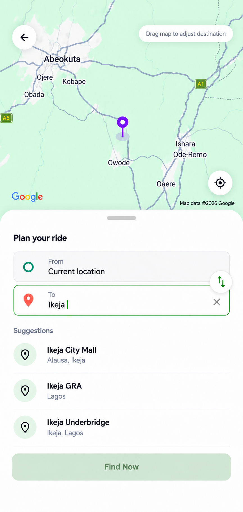

# Destination-search design proposal

Status: approved and implemented with compact text and outline icons.

The existing pattern stays: Google Maps occupies the upper area, with the selection marker, back and recenter controls. The lower sheet contains pickup/destination fields, address suggestions and a pinned Find Now button.

Implemented enhancements: shared 13–15px text variants, 14px address inputs, 16–18px outline icons, distinct pickup/destination symbols, a green active-field border, clear-query controls, and a tidier swap control. Interactive targets remain 44–48px even though visible icons are small. Both the From label and input focus the pickup field and reveal Use current location when a current location is available. Selecting it restores the pickup address after clearing the field.

This example shows a typed query with illustrative search results. Find Now remains disabled until both addresses are selected. Suggestions must continue to come from the existing places search; the samples are not static app content. The keyboard is omitted from the picture for review, and implementation must preserve keyboard avoidance, sheet expansion, loading/error states and route validation. Current-location selection remains available when editing pickup.

The map in the proposal is a public-area visual reference. The implementation continues using real Google Maps, actual location, map gestures, markers, provider attribution and existing route validation. No location coordinates or backend configuration were changed.

Validation: mobile TypeScript and targeted ESLint passed. Browser checks covered From-label focus, current-location pickup restoration, live autocomplete, destination selection and route loading, swap, clear and disabled/enabled Find Now states. Compact layouts were inspected at 375×812 and 320×640, and both light/dark themes. Native Android keyboard/rendering has not been verified in this change. No ride was booked during verification.

Generated using the built-in image tool. Complete prompts: [prompts.json](prompts.json).
