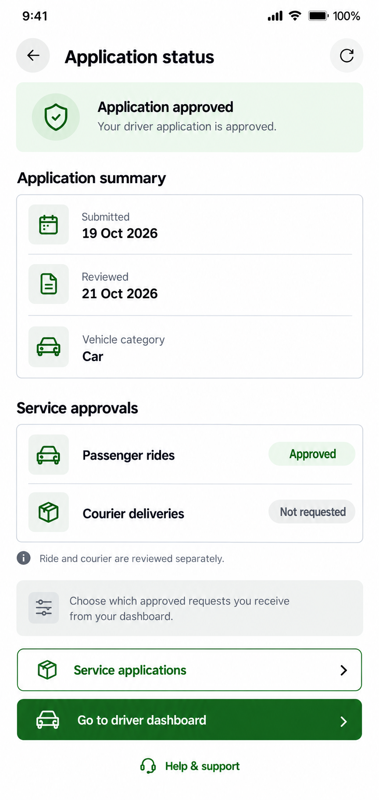
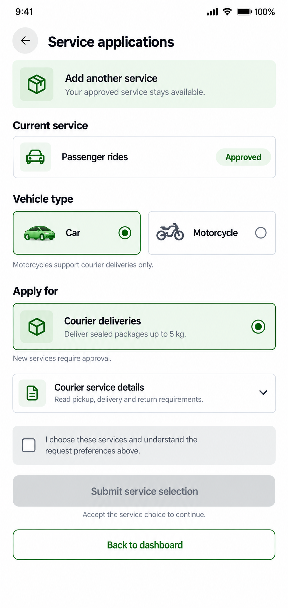

# Driver application status and service applications

Status: approved and implemented as two separate matching pages.

Keep the existing separate routes: Application status at /driver-status and Service applications in the approved-partner flow at /driver-onboarding. Match Vehicle & documents, driver history and wallet with white/silver surfaces, mint highlights, compact 13–15px shared typography, small conventional icons, semantic status colors and accessible controls. The generated car is a small generic illustration; prefer the existing green vehicle asset and native icon system when implementing.

## Application status

The approved example separates the overall application decision from individual passenger/courier service statuses. A short summary card replaces the oversized decision card. Submitted/reviewed dates and vehicle classification are metadata, not a checklist that claims every individual field or document was independently verified. Use existing authenticated application-status data; dates/category are fictional in the picture. Missing dates should be unavailable or not yet reviewed; absent classification remains awaiting classification. Do not substitute sample dates or add review-time estimates.

Keep pending, rejected and suspended states. Pending has an amber review indicator and its applicable Continue as rider or Complete service selection action. Rejected displays the actual review reason with the existing review/resubmit flow when eligible. Suspended services stay explicit, with support rather than bypassing suspension through a new application. Service review reasons stay visible. Overall approval never implies every service is approved or requests are enabled. The dashboard remains the place to choose eligible requests.

Refresh reads current data. Keep existing loading/retry/session protections and preserve the behavior of Go to driver dashboard, service selection, support and rider navigation. A direct link to Service applications makes adding eligible work easier without merging the routes.

## Service applications

The illustrated existing driver has Passenger rides approved and courier available to apply for. Their current approval is informational; it is not offered again as a new application. Only choices allowed by the existing service eligibility helper are selectable. Motorcycle remains courier-only. Both services remains available only when both are eligible new choices. No additional eligible service gets a clear empty state instead of a dead form.

The selected Car/Courier example represents form choices before consent. An existing server-classified vehicle category stays locked; the vehicle selector is available only when the existing flow allows classification. Do not turn this into an unapproved vehicle edit. Missing current category must not be silently defaulted to Car.

Courier service details is an expandable disclosure of the full existing server-provided consent description, including package limit, pickup, delivery-code and return instructions and request preference behavior. It must not replace the server wording with an invented summary. Render the relevant wording for each selected service. The checkbox stays unchecked by default and resets after selection changes. Submit stays disabled until category, eligible service choice and explicit consent are present. Preserve current duplicate-submit guard, consent version, expected settings version, error/reload handling and pending-review confirmation. Submission is not approval and cannot enable a service immediately.

The confirmation after submission should retain the compact style and clearly say the new selection requires review. Existing approved service permissions stay governed by the server. Keep appropriate Back to dashboard or Back to application status navigation.

## Artifacts

Both preview images use fictional metadata and service states. Live private pages were inspected locally and were not sent to image generation. Only the fictional Vehicle & documents proposal was supplied as a visual reference. No service category, consent, preference, account, application or document was changed.

Generated with the built-in image-generation tool. Both outputs were visually reviewed for complete layout, compact hierarchy, separate service decisions, unchecked consent and disabled submission. Full prompt set: [prompts.json](prompts.json).

## Implementation and validation

Both pages now share compact themed layout primitives and small code-native icons. Application Status reads full metadata through the existing auth-store refresh, which now returns its authenticated response as well as updating the canonical application/service stores. It preserves foreground and periodic refresh, retry, separate service decisions and their review reasons, pending selection, rejection/resubmission, suspension/support and the guarded dashboard role switch. Missing dates and classification remain explicit rather than using the illustration's sample values. Back navigation returns to the previous screen when available.

Service enrollment uses the canonical service store and existing API/eligibility helper. The original registration choices and consent components remain in place for initial onboarding; only the separate approved-partner enrollment page has the new layout. Current approvals are informational, classified vehicle categories stay locked, motorcycle remains courier-only, and unavailable services cannot be selected. Expanded details retain the exact server description. Consent starts unchecked and resets on category/service or settings-version changes. Submission revalidates category, services, consent version and expected settings version against the current store and blocks duplicate writes or stale-session results. A successful write remains saved if its follow-up read fails; new service requests still need review. No request preference is automatically enabled.

Validation: mobile TypeScript, targeted ESLint and whitespace checks passed. Fifty-two focused checks covered missing dates/classification, status actions and actual review reasons, suspension constraints, eligibility/locked categories, exact consent text and resets, missing consent, duplicate submissions, stale versions/session changes, saved-versus-failed results and the auth-store response contract. All API writes in these tests were mocked. Live browser checks covered metadata refresh, application-to-service navigation, local vehicle/service selection and expansion of the full consent wording. No live consent was accepted and no live application was submitted; the local test choices were discarded. Isolated sample-data browser checks covered pending/rejected/suspended, empty/saved/loading/error states, 403px layouts and 320px dark mode with full consent text and no horizontal overflow. Narrow vehicle cards keep the full Motorcycle label readable. The temporary preview route/tab was removed and appearance/viewport restored. Native Android/iOS rendering and a live submission were not exercised.

Sample-data screenshots: [Application status](implemented-status.png), [Service applications](implemented-services.png), [consent and submission controls](implemented-consent.png). No private account screenshot was saved in this folder.

