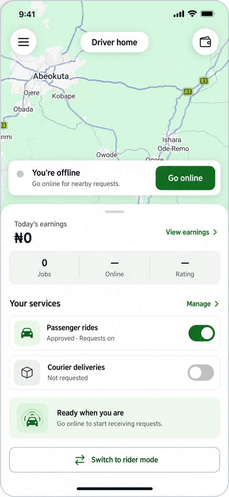

# Driver homepage proposal

Status: approved and implemented on 20 October 2026.

Preserve the current map, floating controls and bottom-sheet pattern. Use small text, conventional icons and compact service rows. This image depicts an offline driver with passenger rides approved and enabled, and courier deliveries not requested. Values are illustrative, not live account data.

## Proposed layout

- Keep the real Google Map as the background, with a small menu button, Driver home pill and a shortcut to the existing driver wallet.
- Compact availability card: Offline status and Go online. Preserve the actual online session, permissions, background location, service eligibility, debt limits, busy/error handling and Go offline flow.
- Earnings summary uses the existing earnings API; View earnings opens the existing earnings page. Loading and failed requests must remain distinct from a genuine zero balance.
- Jobs comes from the earnings summary. Online duration and rating show a dash until an actual source is available; do not retain the existing hardcoded 0h or 5.0 rating as real data.
- Compact Passenger rides and Courier deliveries rows retain their actual status, consent and enabled states. Courier is disabled until approved with consent. Styling does not grant service access.
- Manage exposes the existing complete service controls, including approval/review information, application management, refresh and consent withdrawal confirmation. Do not remove these behaviors to achieve the compact homepage.
- Short offline guidance replaces the long Work overview paragraph. When online, show an accurate online state rather than repeating Go online instructions.
- Preserve Switch to rider mode and the existing role-switch guards.
- Omit the hardcoded weekly goal and fake progress. A configurable goal would need an explicit follow-up scope and genuine data.

## Implementation constraints

Use semantic theme tokens, shared typography and spacing; maintain small labels around 13–15 logical pixels, icons around 16–18 and touch targets at least 44px. Support dark mode, safe areas, smaller viewports and scrolling. Preserve cash commission/debt warnings and settlement action when applicable. Preserve the real location-unavailable fallback; never insert test coordinates to make the map appear.

The image uses a public real-map reference from the earlier rider homepage proposal. It is a static approval picture only. Keep the actual AppMap/Google Maps embed and provider attribution in the application; never use this generated image as the live map or treat the pictured area as the driver's position.

Generated with the built-in image_gen tool. The full prompt and reference are recorded in [prompts.json](prompts.json). Selected output: [driver-home.png](driver-home.png).

## Implemented

- `DriverDashboardScreen.tsx`: compact map stage and bottom sheet, accessible menu/wallet/earnings shortcuts, genuine earnings/loading/error states, unavailable online-time/rating values, debt warnings, retry actions and guarded rider switching.
- `DriverOnlineControl.tsx`: existing location/online controller remains the owner of its session state. A render callback exposes that state to the dashboard presentation without a second online/location store. Kept the legacy overlay placement for its other caller. Added a synchronous duplicate-tap guard and compact themed view.
- `DriverServiceSettings.tsx`: compact service rows and an expandable Manage section, retaining refresh, applications, review reasons, consent withdrawal confirmation and server-backed eligibility. Native Switch is retained; web switches have semantic checked/disabled states and 44px targets.
- `HomeLocationFallback.tsx`: optional contained spacing for the driver's scrollable fallback area; existing callers retain their original spacing. No default/test coordinates were introduced.
- Shared `RideIcon.tsx`: added conventional menu and swap symbols. No new dependency, backend or notification/permission preference changes.

The app keeps its real Google Map and visible provider attribution. The generated proposal is not used as a map or runtime page asset.

## Validation

- Mobile TypeScript check, targeted ESLint and diff whitespace checks passed.
- 33 isolated behavior checks passed using mocked services. These covered disabled services, foreground/background permission refusal, disabled device location, duplicate online taps, server-rejected offline attempts, partial-startup cleanup, cash debt failures, online-session restoration, service consent/eligibility, duplicate saves, service errors, Manage controls, consent cancellation, actual earnings refresh and stale-response guards, navigation targets, role switching and genuine zero/error rendering.
- Live browser verified View earnings and wallet shortcuts and back navigation. Expanded Manage and opened/cancelled passenger consent confirmation without withdrawing consent.
- At 320 × 640, verified offline/online, long permission guidance, loading, failed earnings/wallet/services, cash commission warning and location-unavailable presentation. Controls remain scrollable with no horizontal overflow. Dark theme uses the existing semantic tokens and inverse foreground on filled actions.
- Temporary sample page and tab removed. Original Light preference and normal viewport restored. No actual online/offline transition, service preference change, consent withdrawal, permission prompt or payment was performed during browser QA.
- Native Android/iOS permission prompts, background tracking and platform switches still require device validation.

[Implemented sample layout](implemented-sample.png) uses a public real Google Map and illustrative earnings/service state, with inert/sample callbacks. It is not a screenshot of live financial records. The final live driver screenshot was retained locally for the chat rather than copied into repository documentation.

The later approved [Manage services redesign](../driver-services-v1/README.md) replaces the inline expansion with a dedicated sheet, adds a Settings entry and exposes the courier application shortcut.
