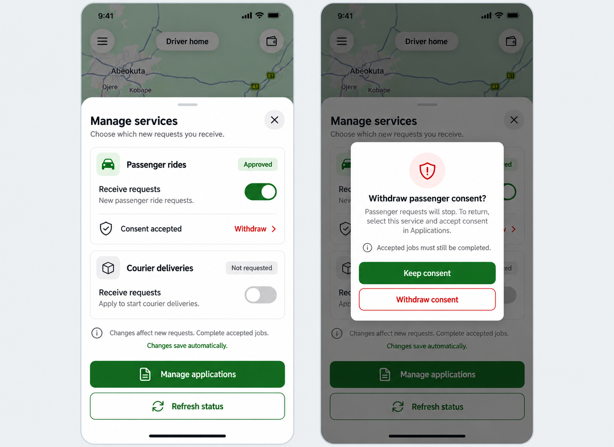

# Driver Manage services proposal

Status: approved and implemented on 20 October 2026.

## Implemented design

Replace the long inline expansion with a dedicated scrollable Manage services bottom sheet over the unchanged driver homepage. Keep compact service cards, small conventional icons and concise copy. Separate ordinary request preferences from withdrawing service consent.

- Passenger rides example: Approved badge, Receive requests switch, accepted consent row and clearly red secondary Withdraw action.
- Courier example: Not requested badge, disabled request switch and a short application instruction. One Manage applications action opens the existing service enrollment flow, avoiding duplicate Apply buttons.
- Refresh status remains available as a separate secondary action.
- Explain that changes affect new requests and accepted jobs still need completion.
- Changes save through the existing API. Preserve saving/busy indicators, backend errors, authoritative server state and retry handling. Do not show a successful-save status while a request is pending or failed; the pictured autosave caption describes the interaction rather than a confirmed write.
- Withdrawal has its own confirmation. Keep consent is the safe primary action; Withdraw consent is a distinct red outlined action. No withdrawal occurs when the sheet or confirmation is merely opened or dismissed.

## Preserved conditions

Only approved services with accepted consent can enable requests. Pending, suspended, rejected, missing-consent and loading states still need truthful labels. Preserve review reasons and application eligibility rules. Withdrawal still uses the existing explicit confirmation and server-backed service consent action; resuming requires selecting the service and accepting consent through the existing application flow.

Keep the sheet and confirmation accessible and scrollable, including small screens, long review reasons, keyboard/focus behavior, Android back and dark mode. Disable conflicting actions during saves and confirmation submission. Closing service management does not change online state, role, active jobs or service choices. Retain the existing live Google Map and attribution underneath; never insert this static generated map into the app.

The background reference is the earlier approved public-map homepage concept, not an actual driver location or financial record. No actual toggle, withdrawal, application submission, payment or permission change was performed for this proposal.

Generated with the built-in image_gen tool. Full prompt and reference are saved in [prompts.json](prompts.json). Final image: [manage-services.png](manage-services.png).

## Application and Settings access

The homepage keeps the operational passenger/courier request switches. Manage opens the dedicated sheet instead of expanding the dashboard. Approved driver accounts also have **Settings → Driver services**, using the same management UI and existing service controller.

When courier enrollment is available, the main action is **Apply for courier**, or **Complete courier application / Review courier consent** for an incomplete application or withdrawn consent. It opens `/driver-onboarding?service=courier` and preselects courier only when eligible. Vehicle selection and service consent remain explicit, and nothing is submitted by opening the form. Other states retain Manage applications. Pending consented and suspended services cannot apply again through this shortcut; motorcycles cannot enroll for passenger rides.

Source: `DriverServiceManagement.tsx` handles the sheet, concise status cards, platform switches, safe-default confirmation and focus handling. `DriverServiceSettings.tsx` retains the API-backed controller and enrollment flow, with guards against duplicate saves, withdrawals and applications. Shared eligibility is in `utils/driverServices.ts`. Settings and the account section route add the approved-driver entry and guard. No backend, dependency, online-state or map behavior changed.

## Validation

- Mobile TypeScript check, targeted ESLint and diff whitespace checks passed.
- 61 isolated checks passed with mocked services. They include existing driver online/location flows plus request eligibility, consent, duplicate saves, failure handling, application route/preselection, explicit consent requirement, duplicate submission guards, withdrawal success/failure and Settings entry visibility.
- Real browser: opened the new sheet, opened/cancelled withdrawal, checked Refresh status visibility and tested Apply for courier through to the application form. Courier was selected, consent unchecked and submit disabled pending the required choices. No form was submitted.
- Real browser: Settings → Driver services and back; 320 × 640 layout, scrolling, dark colors, disabled courier switch, Keep consent default focus and focus restoration to the invoking action after dismissal.
- Restored the original Light preference and normal viewport. No real request preference, consent or application record was changed. Native Android/iOS modal/back/switch behavior still requires device validation.

[Driver services in Settings](implemented-settings.png) is an actual browser capture without identity, financial history or map coordinates. Full homepage-sheet and confirmation captures are kept locally for the chat rather than copied into repository documentation.
