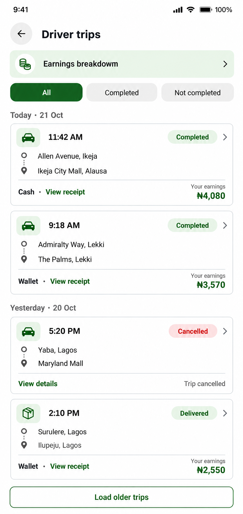
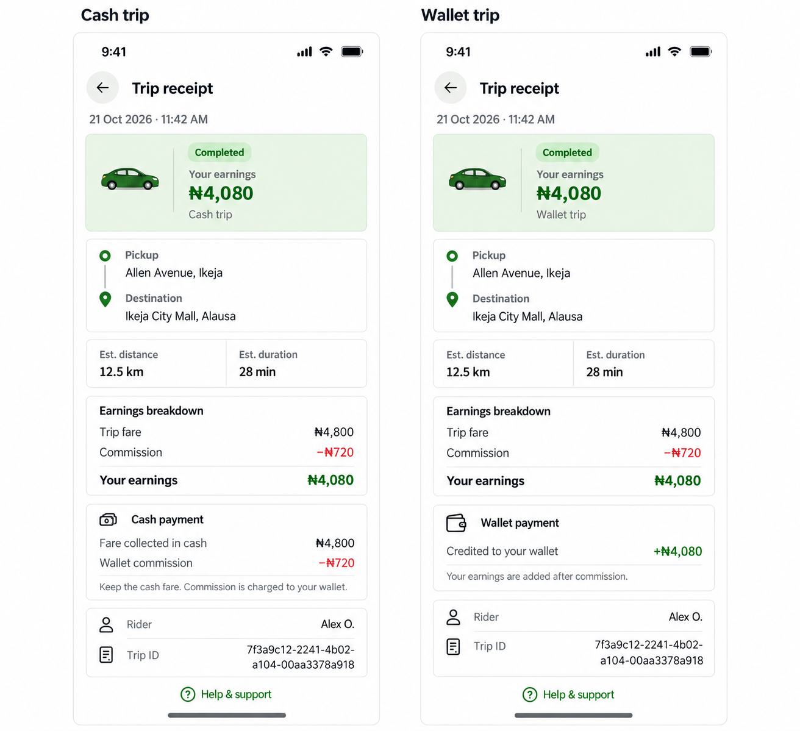

# Driver trip history and receipt proposal

Status: approved and implemented.

Follow the approved rider history: compact white and silver cards, mint accents, forest green actions, small conventional icons, 13–15px shared text, accessible touch targets. The generated artwork expresses layout rather than a required new asset or font. Use the existing code-native sedan/package icons at implementation.

Driver history groups trips by local calendar day, with All, Completed and Not completed filters. Keep returned courier trips distinctly labelled and accessible in the appropriate filter; the picture illustrates completed, delivered and cancelled samples. Use the existing pagination API and earnings-breakdown destination. No invented summary totals, tips or ratings.

Completed/returned rows show the server's driver_earning_kobo as Your earnings, never fall back to the gross fare when that value is absent. Missing earnings should be explicitly unavailable. Cancelled rows open Trip details and do not present the original fare estimate as earnings. Preserve real payment/outcome distinctions, courier status and returned deliveries. Loading, empty, retry and older-page states remain necessary.

Driver receipt shows trip fare, commission and driver earnings as separate values from the server, plus pickup/destination, explicitly estimated metrics, available rider name and full selectable trip ID. Its driver perspective must be selected from the authenticated user's participation in the trip, rather than merely their current UI role, so a driver who booked a personal ride still gets the rider receipt. Keep the rider receipt unchanged.

The two illustrated receipt states are settled fictional examples. Cash: gross fare is received in person and commission reduces the driver wallet; driver earnings after commission are not a wallet credit. Wallet: the driver wallet receives earnings after commission. Show credited/debited settlement claims only when the backend payment status supports them. Pending, unknown, held, cancelled and returned outcomes need truthful corresponding states; do not assert a transfer or cash collection was independently verified. A cash row can describe the expected collection method rather than proof of collection. Do not infer commission percentages or reconstruct missing historical amounts.

Keep current authenticated lookup, navigation, role permissions, support route and financial behavior. No new payment APIs, account changes, ledger writes, download/share feature or backend architecture changes are proposed.

All names, routes, trip IDs, dates and amounts in the generated images are fictional. Private live history and receipt screens were inspected locally and were not sent to image generation. Only existing fictional design proposals were used as visual references. Both generated outputs were visually reviewed for complete layout, consistent compact typography and cash/wallet arithmetic (4,800 minus 720 equals 4,080). No implementation tests were run because application code was not edited.

Generated with the built-in image-generation tool. Full prompt set: [prompts.json](prompts.json).

Implementation uses the shared history layout for both roles, with a separate driver presentation: earnings shortcut, compact date groups and status filters, driver earnings labels, cash/wallet glyphs, and a green outlined older-trips control. Only trips in which the authenticated user was the driver are displayed in the driver view. The existing driver-approval guard remains, and rider mode does not load driver-labelled history. Older-page loading deduplicates records, blocks duplicate requests, stops a repeated cursor and discards stale results after filter, session or screen changes.

Receipt perspective follows actual trip participation. Driver receipts display recorded fare/commission/earnings, rider details, settlement method, estimated metrics, route and full selectable ID. Settled wallet trips show the recorded earnings credit; cash trips show the cash fare separately from the wallet commission. Missing financial values remain unavailable, and unconfirmed settlement is never labelled credited. Cancelled trips display an original estimate rather than driver earnings. Existing rider receipt content, support navigation, courier distinctions and backend payment behavior remain in place.

Validation: mobile TypeScript and targeted ESLint passed, plus 49 mocked-read checks covering money precision/missing values, zero amounts, receipt perspective, cash versus wallet settlement, pending/held outcomes, cancellations, returned deliveries, history ownership, pagination/deduplication and stale responses. Live browser checks covered All/Completed/Not completed filters, cash/wallet/cancelled details, back navigation, earnings shortcut and support navigation. Isolated fictional data checked error/empty and missing-value presentations, returned deliveries, rider receipt compatibility, scrolling, full trip IDs and 320px dark-mode layouts without horizontal overflow. The temporary fixture route and tab were removed, and appearance/viewport restored. No trip, payment, account or ledger record was changed. Native Android/iOS rendering was not exercised.

Sample-data screenshots: [history](implemented-history.png), [older trips](implemented-history-older.png), [cash receipt](implemented-cash-receipt.png), [cash details](implemented-cash-details.png), [wallet receipt](implemented-wallet-receipt.png). Private live screenshots were not saved in this folder.

