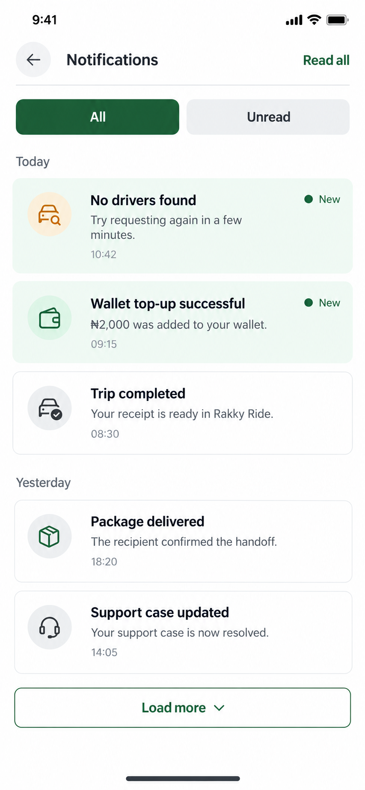
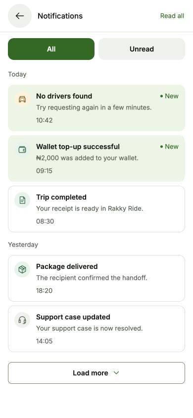

# Notifications design proposal

Status: approved and implemented. No real notifications were marked read during verification.

Generated with the built-in image generation tool. The complete prompt is saved in [prompts.json](prompts.json).

## Proposed changes

- Compact Notifications header with the existing Read all action.
- All and Unread filters, based on the existing readAt field.
- Local-date sections: Today, Yesterday, and older dates as needed.
- Small conventional category icons, short time labels, and readable message rows.
- Subtle mint unread surfaces with an explicit New label and dot; read items use white/silver surfaces.
- Existing Load more behavior when a server cursor is available.

## Implementation

Preserve the notification store, existing category semantics, read/open operations, unread counts, refresh, pagination, and destinations. Do not alter notification content or merge separate events. A missing-driver event uses an amber warning icon; wallet credits use green; cancellation/failure indicators retain red. Unread state is distinct from event severity.

Use shared Text variants, approximately 13–15 px for normal text, 16–18 px utility glyphs, semantic theme tokens, and at least 44 px action targets. Support dark mode, long messages, font scaling, and narrow phones. Keep read/open failures, loading, empty, and retry states reviewable.

For the Unread filter, retain pagination even if no unread items are found in the currently loaded records. Distinguish no unread items loaded from an exhausted unread list. Derive day headings using local calendar dates rather than UTC date slices. Use actual older dates and include the year where needed.

All notifications, timestamps, and amounts in the image are fictional examples of existing message categories. No private account records or identifiers were sent to image generation. The current app page was inspected read-only.

The Services proposal remains pending separately; this proposal does not approve its implementation.

## Verification

- Compact 13–15 px text, conventional 18 px icons, 44–48 px control targets, and shared light/dark semantic tokens.
- Live All/Unread filter inspection preserved existing read states and destinations.
- Sample-only read/open actions remove read items from the Unread view; the empty state still allows loading older pages until the cursor is exhausted.
- Sample initial loading, empty, fetch retry, read-action error, and pagination retry states were inspected.
- At 320 × 640, long titles and bodies wrap without clipping or horizontal overflow. Light mode and the normal browser viewport were restored afterward.
- Sixteen focused helper checks passed: local-day grouping, previous-year dates, unread filtering, non-mutating sorting, invalid dates, semantic icon colors, and a daylight-saving transition.
- A temporary preview route was removed after verification. The screenshot below uses fictional sample messages, not private records.
- Native Android verification remains outstanding.
- Final mobile typecheck, targeted ESLint, and diff whitespace checks passed. Live Load more appended the final two older notifications, displayed the 15 Oct group, and removed the exhausted pagination control. Read all and opening rows were exercised only with sample data, preserving the user's real read states.

