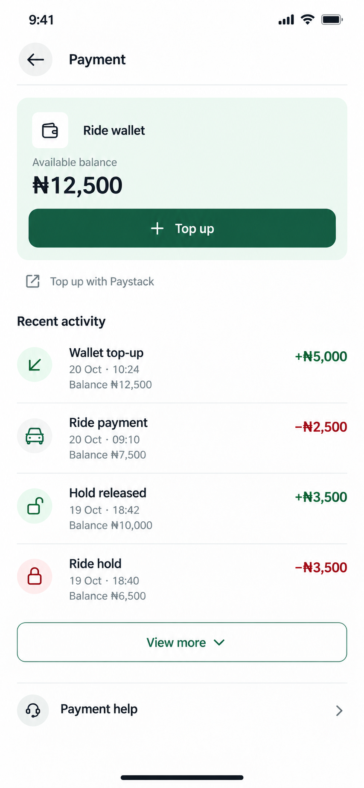

# Rider payment page proposal

Status: approved and implemented.

Generated with the built-in image generation tool. The complete initial and refinement prompts are in [prompts.json](prompts.json).

## Proposed layout

- Compact Payment header with the existing back action.
- Pale mint wallet summary with available balance and the existing Top up action.
- Informational Paystack note, followed by recent wallet activity with conventional small icons.
- Readable transaction names, signed credit/debit amounts, short dates, and balance after each entry.
- Initially show four recent transactions. View more reveals four additional loaded rows at a time, then uses the existing cursor to fetch older records. Hide the button once all records are visible and no cursor remains.
- Payment help links to the existing support screen.

## Implementation

The dedicated RiderPaymentScreen uses existing wallet data and Paystack top-up navigation. The rider wallet remains separate from driver earnings and withdrawals. Saved cards and payment-method selection were not added.

Use semantic theme tokens and existing text variants: approximately 13–15 px for normal text, 16–18 px utility glyphs, and at least 44 px action targets. The generated image is a visual reference; final code must use the shared theme and typography system, including dark mode.

Preserve loading, error, empty, and pagination states. Do not display an unloaded balance as zero. Show ledger entries from their real types and directions: a hold is reserved funds, and a hold release is not a new top-up or a settled ride payment. Do not change balances, ledger logic, payment processing, or backend behavior.

## Sample data

All amounts, dates, and transactions shown in the image are fictional. They are not the user's financial records. The four rows are chronologically consistent: a balance of ₦10,000 becomes ₦6,500 after a ₦3,500 hold, returns to ₦10,000 on release, becomes ₦7,500 after a ₦2,500 payment, and becomes ₦12,500 after a ₦5,000 top-up.

The live page was inspected read-only. No top-up or payment was initiated.

## Verification

- Mobile typecheck and targeted ESLint passed.
- Live wallet records render with friendly transaction names, signed amounts, and balance after each entry.
- Top up opens the existing wallet top-up form; Payment help opens the existing support screen and Back returns to Payment.
- Temporary sample views checked loading, zero balance/empty activity, independent balance/activity retry actions, View more appending older rows, long descriptions, and large amounts with kobo.
- At 320 × 640, rendered content stays within the viewport. Dark mode uses the shared semantic tokens and the green action pairs with its charcoal inverse label. Light mode and the normal viewport were restored.
- The temporary preview route was removed after inspection. No real payment was initiated and no financial record was changed.
- Native Android verification remains outstanding. Sample View more checks cover presentation; the live account had no next cursor, so a real second page was not exercised.
- Follow-up expansion check: the live list initially shows four entries; successive View more taps reveal eight, twelve, then all fourteen loaded entries. The button disappears when all fourteen are shown and no server cursor remains. Typecheck, targeted ESLint, and diff whitespace checks passed after this adjustment.
