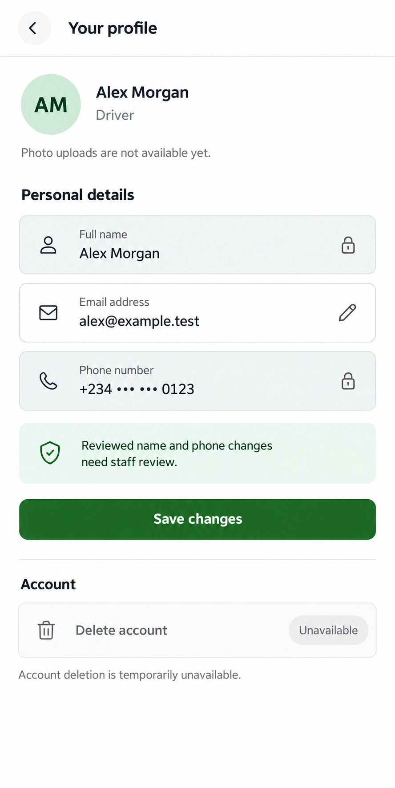
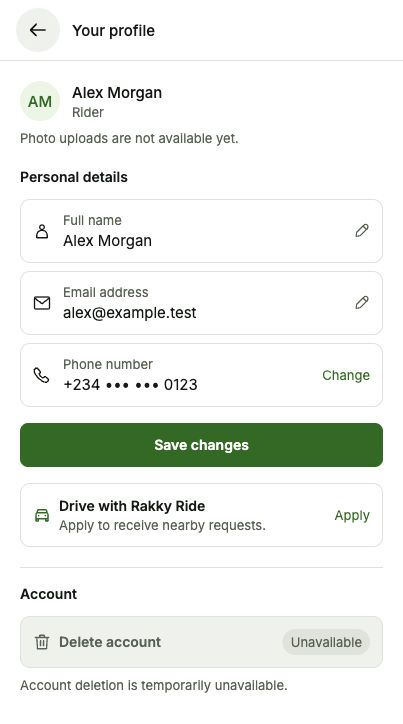
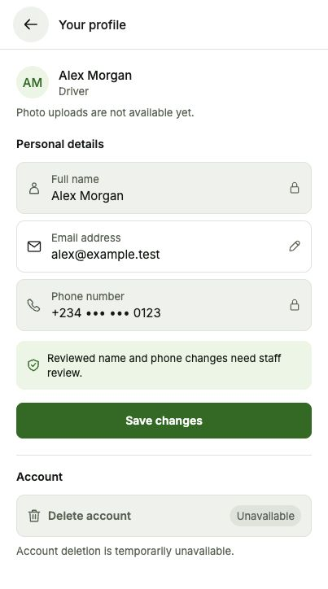

# Profile design proposal

Status: **Approved and implemented for rider and driver profiles.**

## Design

- Compact header and initials summary replace the oversized avatar.
- Small conventional icons, clear labels, and grouped name, email, and phone fields.
- Reviewed driver name and phone remain read-only with lock icons and one concise explanation. Email remains editable.
- Green Save changes action; account deletion stays visibly unavailable and disabled.
- Photo uploads remain unavailable. No camera affordance or verification claims are added.
- Implementation should use shared text variants (13px labels/helpers, 15px content), semantic theme tokens, and 44px minimum action targets. The image is a visual proposal, not a pixel-exact specification.

## Behavior to preserve after approval

The illustration shows an approved driver with fictional sample identity. Approved driver identity changes require staff review; active trips also lock identity changes. Use accurate copy for the actual lock reason.

For eligible riders, keep name editing and the existing phone-change verification flow. A compact Change action can reveal the existing new-number and OTP fields, preserving send, resend, expiry, verify, cancel, errors, and loading behavior. Do not show that action for locked identities.

Preserve the existing role-aware driver application card for eligible rider profiles and existing profile save behavior. Do not introduce password, email verification, photo upload, or account deletion functionality in this visual update.

## Assets

`profile.png` is a review-only generated mockup with fictional name, email, and masked phone number. It is not a runtime asset. The full generation prompt is in [prompts.json](prompts.json).

## Implementation and validation

- Shared `ProfileScreen` now serves `/account/profile` for both roles, using 13px labels, 15px values, a 40px initials avatar, themed field icons, and compact actions.
- Eligible riders can expand/cancel the existing phone verification flow. Approved driver identity remains locked in either active role. Active-trip restrictions use their own accurate helper copy.
- Profile saves retain the existing API and omit locked names from the payload. Synchronous guards prevent repeated save, role-switch, send-code, and verification actions. Existing driver application/status navigation remains available to riders.
- Account deletion and photo uploads remain unavailable.
- Typecheck, targeted ESLint, and diff whitespace checks passed. 51 isolated checks with mocked APIs covered role restrictions, saved payloads, changed-session protection, application navigation, duplicate actions, OTP code length, resend throttle, and cancellation.
- Browser checks covered the live driver profile, isolated rider/driver layouts, 403px and 320px widths, dark mode, scrolling, and phone-form expansion/cancellation. The temporary preview route and tab were removed and light mode restored.
- No real profile changes, phone verification SMS, role switches, or applications were submitted. Native Android/iOS keyboard and real SMS delivery were not tested.

### Implemented views

These screenshots use fictional sample identity. The rider phone preview used inert controls for layout; actual verification behavior was checked separately with mocked APIs.

