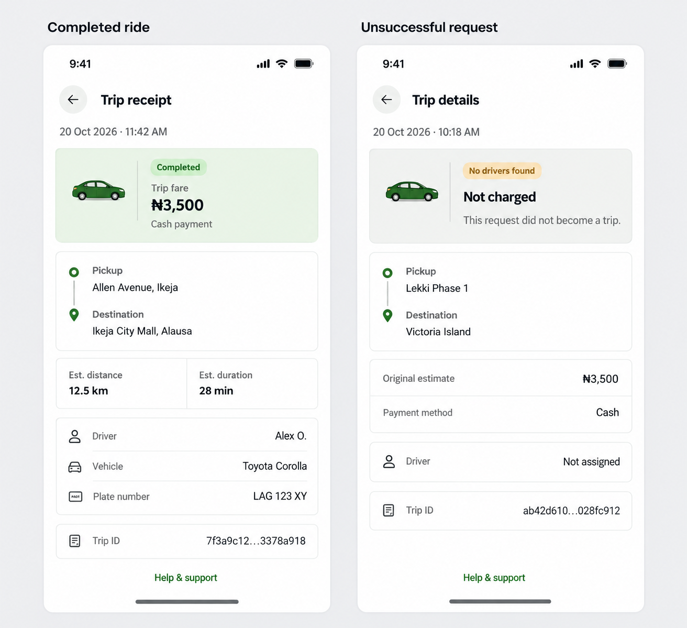

# Receipt and unsuccessful-request details

Status: approved and implemented.

Keep the compact white, silver and green style used by the approved ride history. Use the existing shared 13–15px text variants, small code-native car and utility icons, semantic light/dark tokens and accessible touch targets. The generated picture expresses hierarchy; its car artwork should be replaced by the existing small generic sedan, not added as a raster asset.

A completed trip shows a receipt with trip fare, payment method, route, estimated distance/duration, available driver and vehicle information and the trip ID. An unsuccessful request uses Trip details, with its outcome and payment state prominent. Its original fare quote is labelled Original estimate, never presented as a charged total. Do not claim Not charged when wallet funds remain held or when the payment outcome is unknown. Distinguish cancelled rides, unavailable drivers, delivered packages and charged returned deliveries. Do not invent fee components, actual travelled distance, driver ratings or refund confirmations.

Preserve existing authenticated trip lookup, loading/error states, full accessible/selectable trip IDs and back navigation. Help & support uses the existing support screen. No new payment behavior, receipt-download system or backend API is proposed.

All addresses, names, vehicle plates, IDs, dates and fares in the image are fictitious sample data. The private live receipt/history screenshot was not provided to image generation. Generated with the built-in image tool. Full prompt: [prompts.json](prompts.json).

Implementation uses the shared 13–15px text variants, 16–20px utility symbols, a 36px sedan, a 48px back control and a pinned Help & support action. Full trip IDs remain selectable and wrap on narrow screens. Addresses are not truncated. Driver and vehicle fields use actual data or a clear unavailable/not-assigned label; no vehicle is invented for unmatched requests. Estimated trip metrics remain explicitly labelled as estimates. Courier receipts retain package/recipient information and the returned status, without exposing a delivery code.

Payment presentation distinguishes completed/returned fares, original estimates, recorded payments, unreleased wallet holds, released holds and unknown outcomes. This is display logic only; payment services and ledger data are unchanged. Trip loading is keyed to the current ID and retry, with stale responses ignored. Existing authenticated lookup and back navigation are retained, with retry and the existing support screen available.

Validation: mobile TypeScript, targeted ESLint and whitespace checks passed. Fourteen focused checks covered fulfilled/unfulfilled outcomes, held/released/unknown payments, recorded charges, returned deliveries, active estimates and payment labels. Browser verification covered a live unsuccessful request, history-to-details/back navigation, Help & support navigation, completed and returned sample receipts, held-fund labels, error/retry presentation, long addresses, full selectable IDs, 390×844 and 320×640 layouts, scrolling with the support action available and light/dark appearance. The temporary preview route was removed. Native Android rendering was not exercised. No trip, payment, support message or ledger entry was created or changed.

Completed sample-data browser view: [implemented-completed.png](implemented-completed.png). Live private screenshots remain outside the repository.
