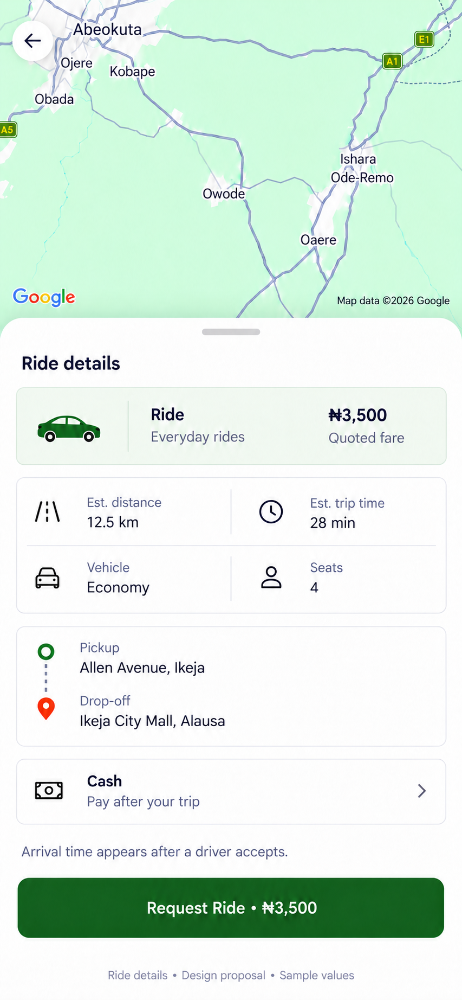

# Ride-details design proposal

Status: approved and implemented, with the user's requested Recommended tag retained.

Keep the live Google Maps background, the back control and the existing request-confirmation flow. Give the map a clearly visible upper area and fit the viewport to the current route and its endpoints rather than leaving it zoomed out to an unrelated scale. Preserve provider attribution above the sheet; do not use the generated image as a runtime map.

The large onboarding illustration is replaced with the same small standard sedan icon used on ride selection. A compact Recommended tag stays beside the ride name and wraps when needed on smaller phones. The duplicate fare row is removed; the quoted-fare summary and request action use the live quote.

Estimated distance, estimated journey duration, vehicle class and seat count are grouped into a compact two-column block. Pickup/drop-off and the arrival-time note remain in the scrolling body. Cash/wallet payment and the request action stay pinned at the bottom so both remain reachable on smaller phones. The back control stays available over the map, and the map fits the current route.

Implementation sizing: shared 13–15px text variants, a 13px Recommended label, 16–18px functional glyphs, 42px-wide car art and 48px controls. Existing code-native icons and semantic light/dark tokens are reused. The raster picture expresses visual direction, not literal responsive measurements.

Fare, distance, duration and addresses in the picture are samples. Runtime values must come from the existing quote and location stores. Estimated journey duration is not driver arrival time. Preserve quote refresh, fare-change review, loading/retry states, scheduled pickup time in WAT, wallet balance/top-up rules, confirmation, and duplicate-request protections. No new ride classes, provider, payment or booking behavior is proposed. The cash/wallet chooser should use the compact pattern already implemented on ride selection.

Validation: mobile TypeScript and targeted ESLint passed. Browser checks covered live route/fare/distance/duration, the Recommended tag, cash/wallet selection and checked-state accessibility, confirmation preview/cancellation, back navigation, 375×812 and 320×640 layouts, scrolling with pinned payment/action controls, and light/dark themes. The original booking controller was verified unchanged. No ride was booked; native Android rendering and scheduled booking were not exercised.

The proposal image was generated with the built-in image tool. Complete prompt set: [prompts.json](prompts.json).
