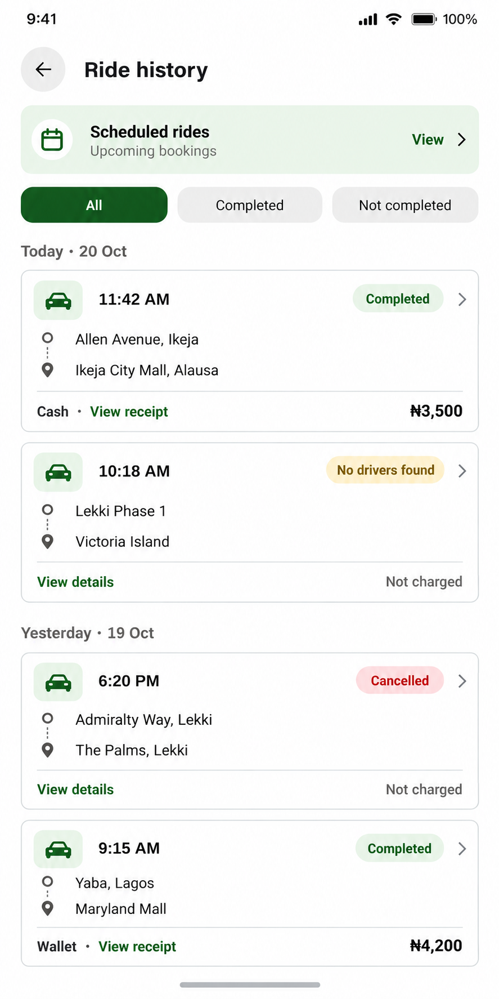

# Ride-history proposal

Status: approved and implemented.

Use the existing compact rider design language: white and silver surfaces, forest green actions, small conventional icons and shared 13–15px text variants. Keep the scheduled-rides shortcut, with filters for All, Completed and Not completed. The last filter includes cancelled requests and requests that found no driver. Group records by local calendar date, and keep pickup and destination on separate lines.

Use text and color for status: green Completed, amber No drivers found and red Cancelled. Completed rows show the actual rider fare and payment method. Unsuccessful requests should show Not charged when consistent with the payment outcome, rather than presenting their fare quote as a charge. The current cancellation service releases wallet holds; do not change payment or refund behavior as part of styling.

The complete row opens the existing trip-details/receipt flow. Use View receipt for completed rides and View details for unsuccessful requests. Retain loading, error and empty states. Runtime history must come from the existing service, with no fabricated records, spending totals or ratings. Preserve courier/returned-trip distinctions where present. Date grouping should follow the user's local calendar, not a fixed UTC date. Keep long routes accessible and allow the list to scroll on smaller phones.

All dates, routes, statuses and fares in this image are sample data. The existing private trip-history screenshot was inspected locally and was not provided to image generation.

Generated with the built-in image tool. The final image was reviewed and refined to keep its fourth card and bottom safe area fully visible. Full prompt set: [prompts.json](prompts.json).

Implementation: the rider history page now uses shared 13–15px text, 14–20px utility symbols, a 26px sedan icon, 44px filter controls, a 48px back control, date groups and compact status badges. The existing driver-history layout is preserved. Completed filtering uses the existing server filter; All and Not completed filter the loaded history with an explicit older-trips control, including a clear message when more records remain. Returned courier trips retain their fare and receipt; unsuccessful wallet requests with funds still held do not claim Not charged. Rider fare uses the trip fare, not the driver's net earnings.

Validation: mobile TypeScript and targeted ESLint passed. Browser checks covered live records, completed filtering, older-page loading, details navigation, the scheduled-rides shortcut, 320px/390px layouts, accessible selected tabs, and light/dark appearance. A temporary sample-data route checked completed/cancelled/returned/courier/held-fund states, empty history and retry feedback, and was removed afterward. Sixteen focused checks covered local-midnight grouping, a DST boundary, sorting without mutation, invalid dates and charge-state distinctions. Native Android rendering was not exercised. No ride or payment was created or modified.
