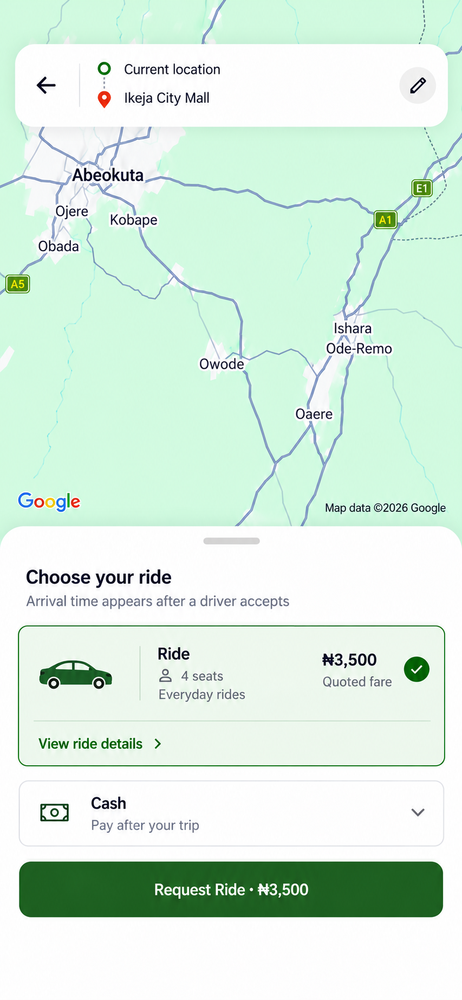

# Ride-selection proposal

Status: approved and implemented with compact shared typography and code-native icons.

Keep the real Google Maps layer, live route and endpoint markers. A compact two-line route summary replaces the truncated run-on address. Back and Edit lead to existing address editing. Remove the inactive add-stop control.

The ride card and confirmation dialog share a standard generic sedan silhouette from `mobile/src/components/common/RideIcon.tsx`. Passenger, banknote, wallet, check and chevron outlines use the same SVG/image approach. No new dependency was added.

The visual direction is compact: shared 13–15px text variants, 16–18px functional icons, approximately 42px-wide car art, and 44–48px interactive targets. Fit the lower sheet to its content while preserving scrolling and safe areas on smaller phones. The picture is a direction, not a literal raster layout to embed in the application.

Only the existing Ride class is shown. The sample ₦3,500 quote and route labels are illustrative; runtime values must come from the existing quote and location stores. Retain route/fare retry states, fare-change review, duplicate-request protection and confirmation before requesting. Arrival time must not be invented before a driver accepts. The selected ride still opens ride details.

Cash and wallet remain the supported payment methods. Style the chooser consistently with small banknote/wallet outlines and selected radio/check indicators. Keep actual wallet balance, top-up handling and scheduled-trip payment rules. Scheduled variants retain their pickup time and WAT label. No new ride tiers, payment provider or booking behavior is proposed.

The backdrop uses a public map reference. Existing map coordinates and live route behavior remain dynamic. Preserve provider attribution above the sheet. The generated picture is not a runtime map asset.

Implementation retains actual quotes, route/fare retry and fare-change messages, scheduled pickup labels, wallet top-up rules, and the existing confirmation/request controller. Wallet loading/error states are displayed explicitly; an immediate wallet payment waits for a usable balance, with a retry action if loading fails. The payment chooser announces its checked state on web as well as native.

Validation: mobile TypeScript and targeted ESLint passed. Browser checks covered live route/fare rendering, route editing, ride-details navigation, cash/wallet selection, checked-state accessibility, confirmation preview/cancellation, light/dark themes, and 375×812/320×640 layouts. The 320px confirmation controls fit on screen and no horizontal overflow was found. No ride was booked. Native Android rendering and scheduled booking were not exercised in this change.

Generated using the built-in image tool; complete prompts are saved in [prompts.json](prompts.json).
