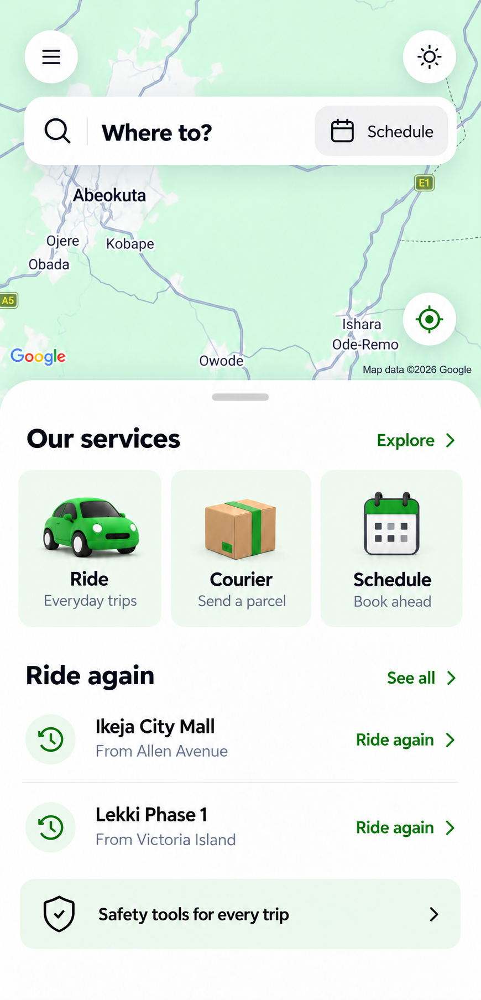

# Rider homepage proposal

Status: approved and implemented with the user's requested smaller fonts and compact spacing.

This proposal keeps the current homepage arrangement: Google Maps in the background, menu and theme controls, the top Where to? search and Schedule action, a recenter control, and a rounded lower sheet.

The lower sheet uses three equal service tiles with the requested green 3D car, courier parcel and calendar illustrations. Recent routes have a clear destination, smaller origin, and a Ride again action. See all opens the existing trip history. The safety strip is visually quieter.

The displayed routes are fictional examples. Implementation must use existing trip history and handle long addresses and empty history. The map shown is a design reference; the existing real Google Maps integration, user location, gestures, camera behavior and provider attribution must remain intact. No static screenshot or generated map replaces it.

The implementation uses the shared 13–15px text variants, small transparent service illustrations, equal-width tiles, outline controls and a scrollable lower sheet. Real Google Maps and real recent-route data remain in use. The map viewport ends above the sheet so its provider attribution remains visible.

Validation: mobile TypeScript check and targeted ESLint passed. Browser checks covered the normal viewport, 375×812, 320×640 with sheet scrolling, light/dark themes, and navigation for Ride, Courier, Schedule, Explore, See all, Safety and Menu. Native Android rendering has not been verified in this change.

Illustration assets and full extraction prompts are saved under `mobile/assets/images/home-v2/` as `ride.png`, `courier.png`, `schedule.png` and `prompts.json`.

Generated with the built-in image generation tool. Full initial and refinement prompts are saved in [prompts.json](prompts.json).
