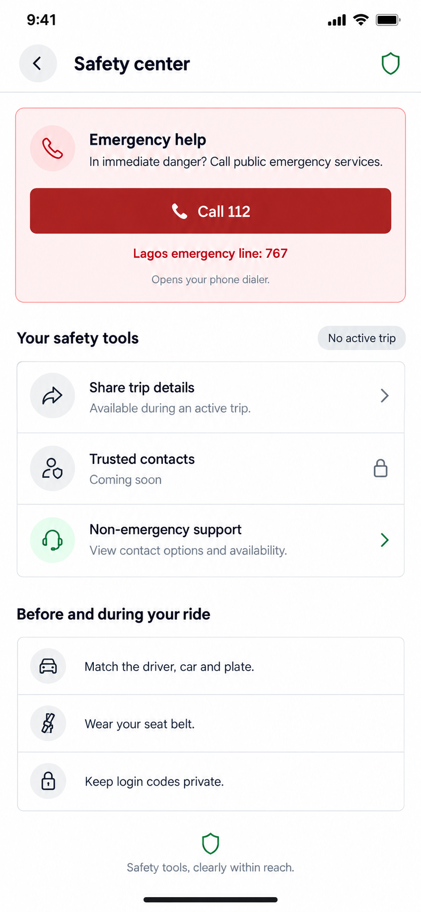
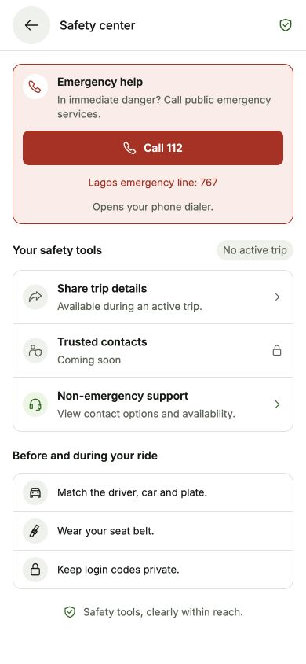
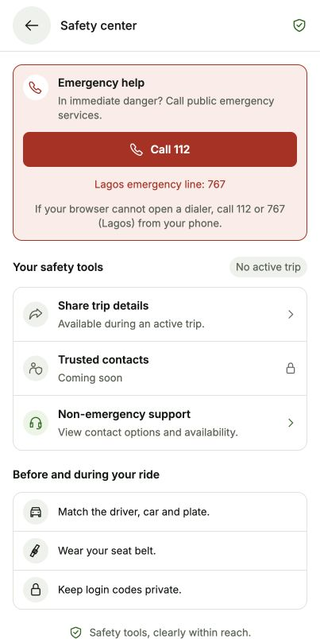

# Safety Center proposal

Status: approved and implemented. No real calls were placed and no contacts or trip details were shared during verification.

Generated using the built-in image generation tool. The complete prompt is saved in [prompts.json](prompts.json).

## Research and design decisions

Reviewed official sources on 20 October 2026:

- [Uber rider safety](https://www.uber.com/gb/en/ride/safety/): organizes emergency help, trip sharing, trusted contacts, and driver/vehicle checks as safety tools; also describes seat-belt reminders. The proposed hierarchy is our design interpretation, not a copy of an Uber screen.
- [Bolt ride safety](https://bolt.eu/en/rides/safety/): emphasizes emergency assistance, sharing ride details, trusted contacts, and matching the driver/car/registration before boarding. Bolt explicitly notes that features vary by country.
- [NCC Emergency Communications Centres](https://ncc.gov.ng/node/3132?page=1): identifies 112 as Nigeria's emergency number connecting callers to emergency response agencies.
- [Lagos State Citizens Gate](https://citizensgate.lagosstate.gov.ng/): lists 112 and 767 for emergencies, distinguishing emergency calls from non-emergency contact.

## Implemented screen

- Put Emergency help first, with a red Call 112 action and a smaller Lagos-only 767 option. Explain that it opens the phone dialer; do not imply automatic dispatch or transmission of trip/location details to responders.
- Show active-trip availability explicitly. Share trip details is inactive without a shareable trip; with an active trip, enable the existing user-initiated text-share flow. Call it trip details, rather than live tracking.
- Replace the misleading trusted-contact switch with a clearly unavailable Coming soon row. Do not present any contact as protected, notified, or saved.
- Add Non-emergency support linking to the existing contact-options page. Use real configured contact details and staffed hours; do not promise 24/7 coverage or response times.
- Add concise safety information: match the driver/car/plate before boarding, wear a seat belt, and keep login codes private.
- Use small conventional icons, 13–15 px shared Text variants, 44–48 px action targets, and the existing semantic green/white/silver/charcoal theme. Red conveys emergency action, not general branding. Support dark mode, narrow phones, font scaling, and scrolling.

## Findings in this project

- AccountSectionScreen's trusted-contact control is a local boolean initialized to true. It does not select, store, or notify a real contact.
- OngoingTripScreen's share function sends a text summary containing route and available driver/vehicle details. It does not create a live GPS tracking link.
- The customer-facing care API exposes support settings. Safety incidents currently have staff-only administration routes; an in-app customer incident-report form is not implemented.
- Support availability is configured by staff and may be unset. The design must not fabricate a staffed safety response service.

## Separate future features

Real trusted-contact setup, a secure expiring live trip link, and customer safety-incident submission would need their own backend/privacy/access design and review. Approval of this screen alone does not enable those capabilities or justify creating speculative tables. Keep them unavailable until implemented and verified.

For an active trip, the page may offer a link to existing driver/vehicle details so the rider can read them to a dispatcher. Use only actual trip data, handle missing/stale details, and do not claim data is sent automatically. The no-active-trip state is the state pictured above.

For web devices that cannot open a dialer, keep the emergency numbers visible and show a clear fallback rather than falsely confirming a call. Do not dial any emergency number as part of visual QA.

All UI preview content is generic. No private user contacts, precise location, or trip history were supplied to image generation.

## Implementation and verification

- SafetyCenterScreen uses the existing trip store, native Share summary, phone dialer, support route, theme tokens, and typography. No backend, provider, dependency, or financial logic changed.
- The old local trusted-contact switch and misleading live-sharing label were removed from this screen. Trusted contacts remain visibly unavailable.
- The rider's in-trip Safety control opens this same page. TripRecovery allows only the exact Safety and support account paths as exceptions to its trip navigation rules, so urgent help remains accessible even if the trip ends while the page is open.
- Sharing checks the current store value at the moment of the tap, permits only active statuses, and excludes recipient contacts, package contents, delivery/handoff codes, GPS coordinates, and tracking-link claims.
- Twenty-four focused checks passed for sharing eligibility, terminal/scheduled states, private-data exclusion, role-specific navigation, exact route exceptions, chat access, and normal completion redirects elsewhere.
- Browser visual checks covered 320 × 640 and 390 × 844, inactive/active sharing, busy controls, simulated dialer/share failures, lower-content scrolling, and dark-mode inverse text on the emergency fill. No horizontal overflow was observed at 320 px.
- Preview callbacks were inert; no emergency dialer or actual share sheet was opened during those checks. The temporary preview route was removed, and light mode plus the normal viewport were restored.
- Native Android dialer/share-sheet verification remains outstanding. The screenshot below is the native-copy layout rendered in the web preview, not an Android device capture.
- Final mobile typecheck, targeted ESLint, and diff whitespace checks passed. Live Home → Safety → support → Back navigation passed. The browser fallback copy keeps emergency numbers visible without claiming a call connected.

