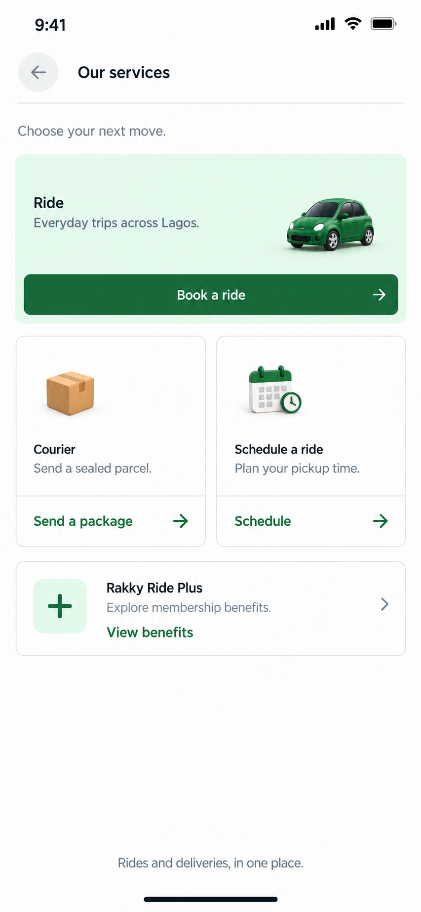
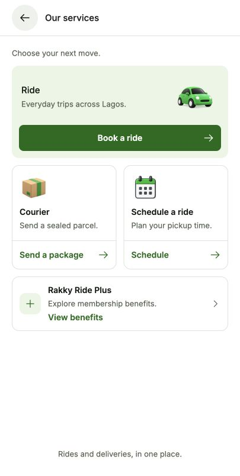

# Rider Services proposal

Status: implemented following user approval on 21 October 2026.

Generated with the built-in image generation tool. The complete initial and refinement prompts are saved in [prompts.json](prompts.json).

## Layout

- Compact Our services header and short introductory sentence.
- Ride card with a small green 3D car and Book a ride action.
- Courier and Schedule a ride cards side by side, using small parcel and calendar artwork in the homepage style.
- Lower-emphasis Rakky Ride Plus row with View benefits.
- Small text, subtle borders, white surfaces, and green actions.

## Implementation

Implemented in `mobile/src/screens/shared/RiderServicesScreen.tsx`, rendered by the existing account/services route. Rider-only access remains enforced. Existing routes are preserved: Ride to /set-destination, Courier to /courier, Schedule to /schedule, and Plus to /account/ride-plus. Back navigation is unchanged. No booking, payment, or membership logic was changed.

The screen reuses existing homepage artwork, shared Text variants (13–15 px normal text), semantic colors in both themes, and at least 44 px action targets. Utility glyphs are 16–19 px. The grid supports narrow phones, wrapping text, vertical scrolling and font scaling.

Verified all four action destinations in the signed-in browser and the layout at 405 × 804 and 320 × 640. TypeScript and targeted lint passed. No bookings, payments, or membership activation were submitted.

