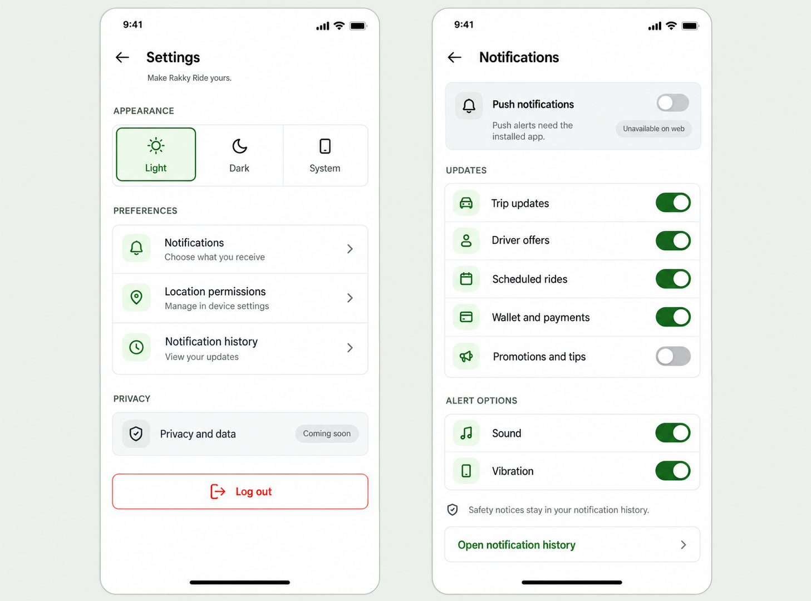

# Settings design proposal

Status: approved and implemented on 20 October 2026.

The proposed main Settings page puts Appearance first, followed by compact Notifications, Location permissions and Notification history rows. Notifications opens a separate preferences screen so every existing control remains available without crowding the main page.

## Preserved behavior

- Light, Dark and System appearance choices retain the existing theme preference.
- Push permission and availability remain platform dependent. This mockup shows the current web state: push unavailable. Native permission actions must reflect the actual permission state.
- Trip updates, driver offers, scheduled ride reminders, wallet/payments, promotions, sound and vibration remain connected to the existing preference store and save/error handling.
- Driver offers appears only for approved driver accounts, as in the existing panel. The mockup depicts that account state.
- Safety and security notices remain available in notification history; this does not promise push delivery when device permission is denied.
- Both notification history links open the existing notification center.
- Location permissions opens device settings where supported. A browser-specific explanation is needed on web rather than an unsupported native settings action.
- Privacy and data is currently a placeholder. The proposal labels it Coming soon and does not promise data export or other unavailable features.
- Log out keeps the existing sign-out flow.

## Implementation

Use semantic theme tokens, shared typography and spacing, conventional small icons and accessible touch targets. Keep labels around 13–15 logical pixels and utility icons around 16–18. Preserve loading, retry, foreground refresh, save guards and platform-specific permission handling. Support dark mode and smaller screens; allow vertical scrolling when required.

This is a visual proposal. It does not change notification preferences, request permissions, sign the user out or add backend functionality. The generated switch positions are illustrative of the inspected state, not a live interactive screen.

Generated with the built-in image_gen tool. The full generation prompt is saved in [prompts.json](prompts.json). Selected image: [settings.png](settings.png).

Implemented in `mobile/src/screens/shared/SettingsScreen.tsx`, the existing account section route, `ThemePreferencePicker.tsx`, `NotificationPreferencesPanel.tsx`, and the shared `RideIcon.tsx` icon set. Notification preferences opens `/account/notification-settings`; history still opens `/notification-center`. No backend, permission defaults or notification store behavior was changed.

The web switches use accessible themed controls with 44 × 44 touch targets. Native builds retain the platform Switch. Save errors are shown inline, and duplicate preference submissions are guarded. Logout waits for local cleanup; if remote revocation fails after the local session is cleared, the screen still leaves the signed-in area.

### Validation

- Mobile TypeScript check and targeted ESLint passed.
- 23 isolated behavior checks passed, covering unsupported push, permission refusal/grant, device registration order, preference saves, vibration channels, duplicate submissions, inline errors, driver visibility, foreground refresh, location fallback and logout failures. All service calls were mocked.
- Browser verified Settings → Notifications → notification history and back, Light/Dark/System selection, browser location instructions, and scrolling at 320 × 640. No horizontal overflow; notification switches expose 44 × 44 hit targets.
- Original Light preference and normal browser viewport restored. No notification preferences changed; no actual logout or permission prompt was triggered.
- Native device settings, notification permission prompts and native switches still need an Android/iOS device check.

Actual browser captures: [Settings](implemented-settings.png), [Notification preferences](implemented-notifications.png).

Approved-driver accounts also have a Driver services entry, implemented with the later [driver services design](../driver-services-v1/README.md). Request controls, applications and consent are available there using the same homepage service controller.
