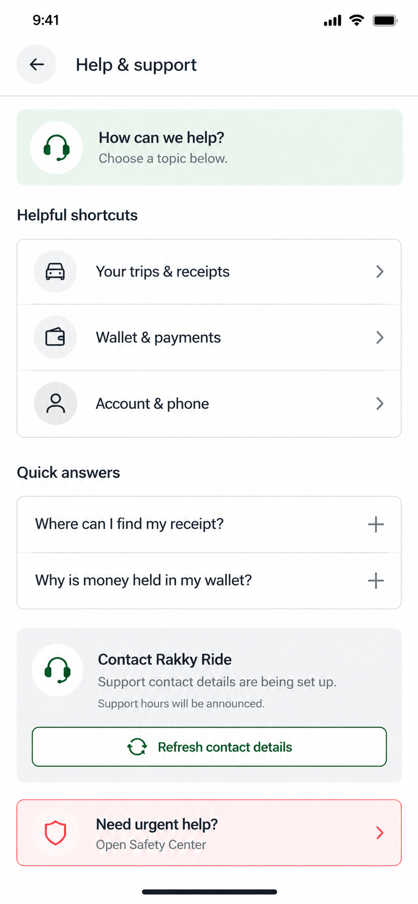
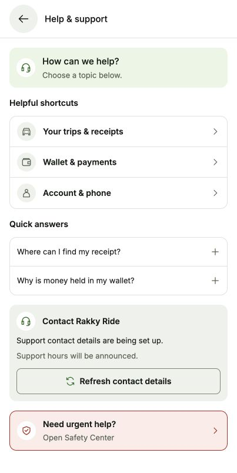

# Help & Support proposal

Status: approved and implemented. No support settings, contact messages, calls, or emails were sent or changed during verification.

Generated using the built-in image generation tool. The complete prompt is saved in [prompts.json](prompts.json).

## Implemented layout

- Compact Help & support header and small mint welcome strip.
- Helpful shortcuts to existing trip history/receipts, wallet/payment activity, and account/phone sections.
- Two expandable quick answers about receipts and wallet holds.
- A contact availability card populated from existing support settings, with Refresh contact details.
- A clearly separate urgent-help link to the already implemented Safety Center.

## Honest availability

The screenshot depicts the current unconfigured contact state: the backend returns no phone/email, and support hours have not been announced. Do not fabricate an email, phone number, staffed schedule, live chat, ticket form, response time, refund guarantee, or 24/7 coverage.

When staff configure an actual phone or email, display the real contact values and existing Call support / Email support actions. Preserve server-provided availabilityMessage and staffedHours, refresh/error states, and foreground refresh. Empty configuration must remain distinct from a network failure.

## Implementation

Use shared typography (13–15 px normal text), 16–18 px utility glyphs, semantic light/dark theme tokens, and at least 44 px control targets. Use existing line-icon assets rather than the generated screenshot as live UI. Allow scrolling, long contact values, narrow phones, and font scaling.

Reuse existing role-appropriate destinations: rider history/payment or driver history/wallet, and profile for account/phone. During an active trip, the trip shortcut should open the existing current-trip route. Respect TripRecovery's existing navigation restrictions; defer unrelated account shortcuts until the trip ends rather than silently bouncing the user back into the trip.

Quick answers should describe current behavior without inventing policy. Proposed rider answers:

- Receipt: Open Ride history and select a completed trip to view its receipt. Other requests show trip details.
- Wallet hold: A ride hold reserves funds for a wallet trip. Payment shows hold, release, and top-up entries. A hold release is not a new top-up. Do not promise an unverified release/refund deadline.

Keep answers appropriate to the current role; do not misdescribe driver withdrawal holds as rider trip holds. Expandable sections need accessible expanded/collapsed states. Opening contact apps must remain user initiated and must never claim a message was delivered merely because the app opened.

The live page was inspected read-only. No private contacts, financial records, or trip details were supplied to image generation.

## Verification

- HelpSupportScreen replaces the old SupportSection and uses the same /care/settings API, generation guard, and foreground-refresh behavior. No backend, dependency, payment logic, or staff settings changed.
- Live trip-history, payment, and profile shortcuts open their existing screens and return to Support. Both quick-answer sections announce expanded/collapsed states and reveal their full answers.
- Sample-only checks covered unset/configured contacts, initial loading, fetch failure/retry, explicitly labelled last-loaded contact data after a refresh failure, simulated phone/email app errors, active-trip restrictions, and driver-specific copy.
- At 320 × 640, long availability text and a long sample email wrap without horizontal overflow. Scrolling reaches the contact actions and Safety Center link. Dark mode pairs the filled green call action with charcoal inverse text. Light mode and the normal viewport were restored.
- Sixteen focused checks passed for rider/driver routes, current-trip routing, stale-tap trip guards, phone/mailto link construction, duplicate actions, missing contacts, contact-open failure, and overlapping refresh order.
- The temporary preview route was removed. Sample contact callbacks were inert; no real calls, email drafts, or messages were initiated.
- Native Android phone/email-app verification remains outstanding.
- Final mobile typecheck, targeted ESLint, and diff whitespace checks passed. Live Menu → Support → Safety → Back navigation passed. Existing unconfigured contact settings remain unchanged.

