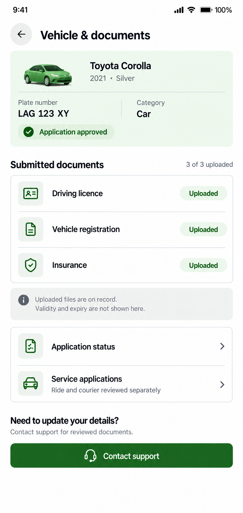

# Vehicle & documents proposal

Status: approved and implemented.

Use the compact white, silver and green language of the approved driver trip and wallet screens. Shared 13–15px text, small conventional document icons, 44px touch areas and a modest generic vehicle illustration. Group the vehicle model/year/color/plate/category and overall application status into one mint card. Keep the car illustration generic; it is not a photograph of the driver's submitted vehicle. Prefer an existing suitable project vehicle asset or code-native icon when implementing.

Submitted documents form one bordered group with driving licence, registration and insurance rows. Uploaded means only that the server reports a file is available. It is not a validity or individual verification claim. Compute the uploaded count from the three expected document kinds; missing records remain Not uploaded rather than silently disappearing. Do not invent expiry dates, upload dates, licence numbers, per-document approval, auto-renewal, document previews or replacement/download features.

The pictured Toyota Corolla, silver color, 2021 year, sample plate, Car category, approval and three uploaded documents are fictional examples. Runtime data must use the existing authenticated application-status response. Unknown or absent vehicle values/category get explicit unavailable or awaiting-classification labels, not sample defaults. Overall application approval remains separate from passenger/courier service eligibility. Preserve approval guards, loading, retry, missing-vehicle and missing-document states and semantic light/dark tokens.

Existing actions are reorganized into Application status, Service applications and Contact support. Reviewed document/vehicle changes continue through support; no new edit/upload service is proposed. Use the existing status and service-application flows. The information strip briefly explains that upload status does not establish document validity or expiry. The service shortcut explains the separate review for ride and courier.

The live account page was inspected locally. Its real plate, vehicle data and private documents were not passed to image generation. Only a fictional driver-trip design reference was supplied.

Generated with the built-in image-generation tool, then refined to reduce the vehicle card and illustration. Full prompt set: [prompts.json](prompts.json). Both outputs were visually reviewed; the refined complete page is selected.

Implementation: the page now has its own compact 15px header, mint vehicle summary, selectable plate, category and overall application badge, grouped document rows and uploaded count, concise information notice, two navigation rows and filled support action. It reuses the existing small green 3D car asset, with a code-native motorcycle symbol for motorcycle records and a neutral vehicle fallback when no vehicle exists. New ID-card and information symbols extend the existing icon system. All runtime colors use semantic theme tokens.

The existing approved-driver route guard remains. The existing authenticated application-status read uses the shared resource hook for loading/retry, foreground refresh and session-scoped stale-response protection. Missing vehicle fields and unknown classification are explicit; each of the three required document types remains visible, and duplicate kinds cannot inflate the count. Uploaded is not labelled verified or valid. Private file paths, expiry dates, upload/replacement flows and backend writes are not introduced. The original application-status, service-enrolment and support destinations are preserved.

Validation: mobile TypeScript, targeted ESLint and whitespace checks passed. Twenty-two focused checks covered actual/missing vehicle fields, all application statuses, missing and duplicate document records, upload count, information-only document rows, motorcycle illustration, loading/error/retry and navigation callbacks. Live browser checks verified all three destinations. Isolated fictional data checked 403px layout, 320px dark mode, long model/registration text without horizontal overflow, missing vehicle/documents, loading and retry states and reachable support/navigation actions. The temporary preview route/tab was removed and appearance/viewport restored. Native Android/iOS rendering was not exercised. No vehicle, document, service preference or account was changed.

Sample-data implementation screenshots: [page](implemented.png), [actions and support](implemented-actions.png). Private live screenshots are kept outside the repository.

