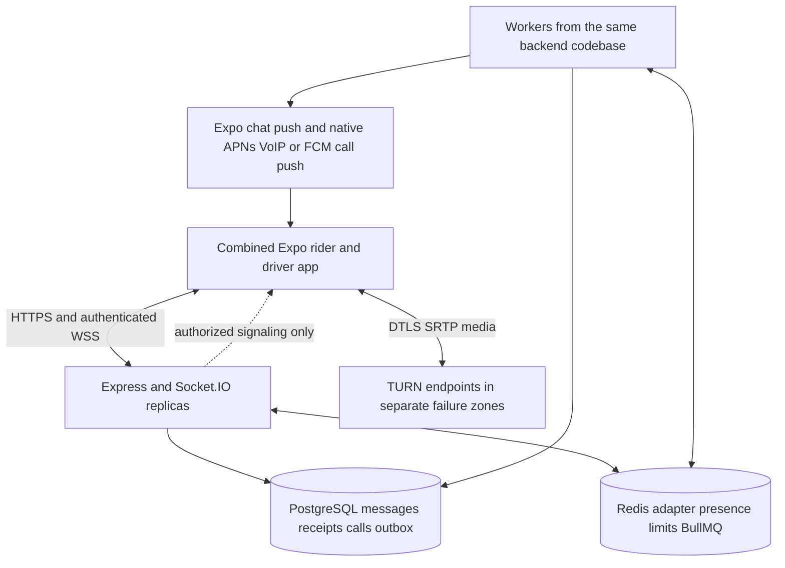

# Rakky Ride messaging and calling implementation plan

Prepared 24 October 2026. Status: proposed architecture and delivery plan; no application changes or dependencies installed.

## Recommendation

Build trip communication inside the existing combined rider and driver app and Express modular monolith. PostgreSQL owns messages, receipts, call sessions, and work awaiting delivery. Socket.IO delivers live events and WebRTC signaling. Redis supports cross-instance socket delivery, rate limits, presence, and the existing BullMQ workers. WebRTC carries one-to-one audio and video through direct connections or encrypted TURN relays.

Deliver messaging first, audio second, and video third. Start the native incoming-call feasibility work during foundation, because background and locked-screen calling is the largest delivery risk. Do not label foreground-only calling production-ready.

This plan uses the supplied **Rakky Ride Communication PRD v1.0**, dated 24 October 2026, as requirements research. Its proposed folder structure, tables, libraries, and open decisions are recommendations to evaluate, not instructions authorizing implementation. Repository instructions and existing application contracts take precedence. Schema additions, new modules/libraries, and TURN infrastructure below need approval before implementation.

## Existing foundations and gaps

The reviewed repository already has:

- Expo `~57.0.30`, React Native `0.86.3`, React `19.2.3`, development-client support, Zustand, AsyncStorage, SecureStore, Socket.IO, and Expo notifications.
- An authenticated Socket.IO gateway with session checks, token-expiry disconnects, named user/driver/trip rooms, and the Redis adapter. Extend this implementation instead of introducing another socket connection.
- `trip_messages`, introduced in migration `022_browser_push_trip_messages.sql`. Message sends derive the sender from authentication, validate trip membership/status, persist transactionally, enforce a unique retry key, and apply a Redis rate limit.
- `GET/POST /api/trips/:id/messages`, including backward history pagination. The backend currently limits text to 1,000 characters; the PRD asks for 2,000.
- `push_devices`, notification preferences, durable `notifications` records, BullMQ delivery/recovery workers, Expo delivery, and browser push.

The missing pieces are material:

- `TripChatScreen.tsx` keeps messages in component state, does not load persisted history, ignores the persisted send acknowledgement, and displays optimistic messages as sent. There is no durable mobile pending queue or delivered/read state.
- Chat emission occurs after the database transaction without a durable socket-dispatch record. A process crash between commit and emit can leave a stored message undiscovered until history is fetched.
- Existing database IDs are useful record identifiers, but neither an ordinary sequence nor timestamps alone guarantee commit order under concurrent sends. Forward synchronization needs an explicit ordering rule.
- `TripCallScreen.tsx` is a UI scaffold: its timer and controls are local state, audio optionally opens a `tel:` URL, and video is disabled. No WebRTC dependency or backend call lifecycle was found in the reviewed paths.
- `push_devices` currently requires an Expo token. Native FCM and APNs VoIP tokens cannot simply be passed through that contract.
- The existing trip state machine uses `driver_assigned`, `driver_arrived`, `in_progress`, `returning`, and `returned`, rather than the PRD's sample status names.

Relevant source files are listed at the end. The working tree contains unrelated changes; implementation should preserve them.

## Product rules and proposed defaults

1. Only the rider and driver assigned to the trip can communicate. Derive participants from the trip, never route parameters, client-supplied roles, or phone numbers.
2. Communication opens when the trip becomes `driver_assigned`. Text and audio remain eligible through `driver_arrived`, `in_progress`, and `returning`. Close on `completed`, `returned`, or `cancelled`. Trips still searching or without a driver cannot communicate.
3. Default to no post-trip sending/calling grace period. Keep participant-authorized history read-only for the approved retention period. A future grace period is an explicit policy setting.
4. Allow video only before the trip starts, with fresh stationary-driver evidence and affirmative acceptance by both parties. `in_progress` and `returning` always disable video. Missing, stale, or uncertain motion evidence disables video. Apply the rule to both participants' cameras and video tracks.
5. Use existing Redis driver-location data for motion eligibility. If speed must be derived, compute it transiently from authenticated samples in that same location system; add no second live-location store. Stationary thresholds and freshness are safety-review decisions, not GPS guarantees.
6. If the driver starts moving or trip eligibility changes, downgrade video to audio. Keep audio available where policy permits. Driver call controls should be minimal and work with native headset/Bluetooth controls.
7. No PSTN calling, private phone-number exchange, recording, attachments, group calls, transcription, or support-agent joining. Remove `tel:` and phone route parameters from the new calling flow.
8. The first launch is the native Android/iOS app. Existing browser chat remains compatible; browser calling needs its own scoped work and testing.

These are proposed implementation defaults. Retention, video eligibility, post-trip access, and media routing must be settled before their release gates.

## Architecture and ownership

### Control and data flow



The diagram shows one app type; each call connects two installations. With direct media enabled, those installations can exchange media peer-to-peer. Media never passes through Express, Socket.IO, PostgreSQL, or the job queue.

**PostgreSQL:** authoritative conversation eligibility snapshots, ordered text, receipt watermarks, call transitions, active participant reservations, and transactional outbox records.

**Redis:** transient presence, typing, abuse limits, adapter pub/sub, and job scheduling. Losing a Redis key must not allow a user to join two calls. Keep the existing driver-trip `SET NX EX` lock separate; a communication call must not change trip matching locks.

**Workers:** outbox dispatch, chat push fallback, ringing expiry, abandoned-call reconciliation, and retention cleanup. Use the existing BullMQ stack and database sweeps rather than adding Kafka or another scheduler. A worker process may run separately for deployment resilience while remaining part of the modular monolith.

**TURN:** an additional network infrastructure component requiring approval. Recommend two independently reachable Coturn endpoints, or an approved operated TURN service if the team cannot maintain relay infrastructure. No SFU is needed for one-to-one calls without recording or server media processing. Coturn supports the required relay architecture; deployment details must be tested, not inferred from a package installation. [Coturn documentation](https://github.com/coturn/coturn)

### Module boundaries

Propose backend `modules/communication/` for policy, chat, call state machine, signaling, repositories, outbox, and reconciliation. Follow the existing `communication.routes.ts`, `communication.controller.ts`, and `communication.service.ts` pattern and split related internals by concern. Extend `modules/notifications/` for native call delivery. Trip transitions call the communication service within their database transaction; notification delivery stays in notifications.

Keep existing `/api/trips/:id/messages` routes as compatibility adapters. Keep event constants in `backend/src/websocket/events.ts` and the mobile event contract. Retain `shared/config/db.ts`, `shared/config/redis.ts`, and the existing `backend/src/config/env.ts`; do not create parallel infrastructure configuration because the PRD suggests different paths.

This new module is a proposed addition. Interpret AGENTS.md's “matching module folder” rule as the corresponding domain folder, consistent with its examples and separation-of-concerns requirements. Confirm that interpretation before implementation if it is intended literally to require placing all new backend logic under driver matching.

On mobile, retain the repository layout: shared communication screens, `components/communication/`, `services/communicationService.ts`, a non-visual `services/callController.ts`, `store/chatStore.ts`, `store/callStore.ts`, and focused hooks. Reuse the existing socket singleton and notification registration lifecycle. No state-manager or ORM substitution is needed.

## Proposed data changes requiring approval

Reuse `trip_messages`, `push_devices`, `notifications`, and notification preferences. Do not introduce parallel `messages`, `device_push_tokens`, or notification tables. Propose four new tables for specific guarantees:

1. **`trip_communications`** — `trip_id` primary key and trip FK; assigned rider/driver user FKs; open/closed status; opened/closed timestamps; next message sequence; monotonic delivered/read sequence watermarks for each participant; receipt version. One durable conversation per trip without another public conversation identifier. This row also serializes message ordering.
2. **`call_sessions`** — UUID ID; trip/user FKs; initial and negotiated media type; call status and version; caller and answering device identity; idempotency key and request fingerprint; expiry, acceptance, connection, heartbeat, and ending timestamps; terminal reason; negotiation generation; upgrade-request state and expiry. Unique `(caller_id, idempotency_key)`, plus participant/history and reconciliation indexes. Compute duration from connected and ended times, not from screen mount time.
3. **`active_call_participants`** — `user_id` primary key/FK and `call_id` FK, with a unique `(call_id,user_id)` relationship. Insert two reservations in the call-creation transaction. The primary key prevents a user from occupying two active calls across trips, roles, devices, or backend instances. Delete reservations only when the call reaches a terminal state. These are occupancy records, not financial ledger entries.
4. **`communication_outbox`** — event ID; aggregate ID/version; event type; bounded payload/references; recipient targets; attempts; next attempt; lease token/expiry; dispatched timestamp. Unique event/destination keys. The outbox closes the database-commit-to-delivery gap; Redis jobs are an acceleration mechanism rather than the only record of pending work.

Extend existing tables through a new forward migration:

- `trip_messages`: add a per-trip sequence with unique `(trip_id,sequence)` and indexes for before/after pagination. Raise the body limit to 2,000 characters after upgrading validators. Preserve existing IDs and retry keys; use UUID client keys for new clients without rejecting supported legacy keys immediately.
- `push_devices`: evolve into provider-specific registrations (`expo`, `fcm`, `apns_voip`), with appropriate token uniqueness, app/environment/device/session binding, capabilities, revocation, and protected token storage. Existing Expo registrations continue working. Token values stay out of logs.
- Notification preferences: add communication controls if product needs them, preserving current preferences and privacy settings. Do not equate unread-chat badges with unread notification counts.

Backfill one communication row per existing assigned trip, close terminal trips, sequence historical messages deterministically by existing record order, and initialize watermarks conservatively. Historical record order cannot reconstruct unknown original commit order; the stronger guarantee starts at cutover. Do not mark old messages read without evidence. Pause legacy writes briefly during sequence cutover or make every legacy writer use the new serialization transaction before backfill completes. Choose the next migration number at implementation time.

No optional `call_events` audit table in the first release. Use bounded session metadata and redacted structured transition logs; propose a separate audit store only if approved requirements need it.

## Messaging implementation

### Persist and acknowledge

For either REST or Socket.IO, call the same typed send service. Authenticate, validate membership, enforce body/payload limits and rate limits, and open a transaction. Lock the trip and communication row in the documented order. Check for an existing retry key before allocating a sequence. The same key with different text returns a conflict; the same key with identical text returns the original result, including after closure when the sender remains authorized.

For a new message, verify the window is open, allocate the next sequence while holding the row lock, insert the message and outbox event, then commit. Acknowledge **sent** only after commit. A worker can retry publication without changing the persisted outcome. Never return send failure just because post-commit broadcasting fails.

Serialize all sends for a trip through that row lock, including compatibility routes. This makes sequence order consistent with committed send transactions and avoids skipping a late-committing lower database ID during forward synchronization.

### Recover and track receipts

Use a bounded, account-scoped Zustand pending queue persisted through AsyncStorage. Save a UUID client key and pending text before transmitting. Retry with capped exponential backoff and jitter; reconcile server records by the same key. Report **pending**, **sent**, **delivered**, **read**, and **failed** honestly. AsyncStorage is not encrypted; cap pending-text lifetime and clear it on logout/account change. If encrypted offline history becomes a requirement, propose secure storage separately rather than silently adding a database library.

Load initial history, older pages, and forward changes from PostgreSQL. Join authorized live events first, buffer while fetching a server high-water snapshot, then merge by server sequence and ID. Page forward through the snapshot before advancing the cursor. Repeat on reconnect and foreground, and periodically while a conversation is open to recover silent pub/sub loss.

Keep backward history pagination and add forward `afterSeq` synchronization. Treat bigint IDs/sequences as strings on the wire. Fetch current receipt watermarks/version separately with synchronization; fetching only new messages would miss read-state changes on old messages.

Define delivered as received by at least one recipient installation, acknowledged after local state acceptance. Define read as displayed in a foreground conversation. Validate the cursor belongs to that trip, is within the authorized received range, and never decrease a watermark. Receipt updates must not accept an arbitrary client timestamp as proof of delivery. User-level watermarks synchronize the participant's other devices; per-device read history is outside scope.

Persist push intent with message work. Send a privacy-safe chat notification when no recipient receipt arrives within a short configurable delay; presence alone is insufficient because a socket may be connected while its app cannot display chat. Respect preferences, deduplicate, collapse bursts, and expire stale pickup notifications. Push-provider acceptance is not a message-delivered receipt.

Typing/unread quick replies are P1. Typing expires in Redis and is never stored as message history.

Socket.IO's default delivery is at most once; the installed Redis pub/sub adapter does not provide connection state recovery. Database synchronization and idempotency therefore remain mandatory. [Socket.IO delivery guarantees](https://socket.io/docs/v4/delivery-guarantees/), [Redis adapter capabilities](https://socket.io/docs/v4/redis-adapter/)

## Audio and call lifecycle implementation

### Authoritative state and concurrency

Use the PRD lifecycle with explicit terminal paths:

```text
RINGING -> ACCEPTED -> CONNECTING -> CONNECTED -> ENDED
RINGING -> DECLINED | MISSED | CANCELLED | FAILED
ACCEPTED / CONNECTING -> FAILED | ENDED
CONNECTED -> RECONNECTING -> CONNECTED | FAILED | ENDED
```

Trip closure or account/session revocation can end any nonterminal state. Every mutation checks actor, expected state/version, current trip policy, server time, and idempotency. The callee accepts/declines; the caller cancels ringing; either participant ends. A stale command cannot revive a terminal call.

Call creation locks the trip/communication row, then both users in deterministic UUID order, checks eligibility, creates `call_sessions`, inserts both database reservations, and writes outbox work in one transaction. Opposite-direction simultaneous invites produce one winner and a busy result. An idempotency retry returns that winner's original call if the request matches. Redis call locks are optional contention optimizations, never the only busy protection.

Use a consistent mutation lock order: trip, communication, participant user rows in sorted order, call session, reservations. Expiry, acceptance, termination, and trip-transition integration must follow it. Workers should claim work separately from the domain transaction rather than holding outbox/call locks and then taking earlier domain locks.

The first eligible callee device to accept atomically binds `answering_device_id`. Caller device ownership is also bound. Other devices dismiss as answered elsewhere. Only those two devices can negotiate media; all the user's authorized devices may receive lifecycle updates. Avoid returning the private phone number as a native caller handle; use the call UUID and safe participant display name.

### Signaling and media

Propose `react-native-webrtc` and its compatible Expo config plugin for capture, peer connections, and rendering. They are new dependencies, pending approval and a physical-device build spike against the exact SDK 57/RN 0.86 project. The library documents development-client support; that is not proof that a specific release/plugin combination works in this app. [React Native WebRTC documentation](https://github.com/react-native-webrtc/react-native-webrtc), [Expo SDK 57 reference](https://docs.expo.dev/versions/v57.0.0/)

- Obtain microphone permission before placing or answering audio. Request camera permission only for an explicit video action. Permissions do not change the server's authority to accept a call.
- Exchange SDP and ICE only after server acceptance. Every packet carries call ID, negotiation generation, bounded payload, and authenticated device identity. Derive sender and peer destination on the server.
- Use deterministic caller-offer ownership for the first release. A callee's media-change request asks the caller to negotiate; it does not create a competing offer. Queue ICE until the matching remote description exists; discard candidates from older generations.
- Use secure WebRTC defaults and DTLS-SRTP. Store session metadata, not raw SDP, ICE candidates, IP addresses, or audio/video. Avoid promising independently audited end-to-end encryption or identity verification.
- Issue short-lived TURN credentials only to eligible participants/devices. Renew ahead of ICE restart or allocation renewal during longer calls. Expose no TURN shared secret to the app. Block private/internal relay destinations and enforce relay quotas to reduce abuse.
- Configure UDP relay plus TCP/TLS 443 fallback on actual reachable relay addresses and certificates. An HTTP reverse proxy is not a substitute for TURN transport and relay-port configuration.
- Recommendation for privacy: launch with relay-only media to avoid revealing peer IP addresses. This routes every call through TURN and increases cost; direct-first is an explicit alternative if that privacy trade-off is approved.
- Separate **signaling reconnected** from **media connected**. On network change, perform an authorized generation change/ICE restart. Show reconnecting, bound retries, and terminate with a useful reason if recovery fails.
- Start duration when two-way media connectivity is reported, corroborating both clients' reports for quality metrics. Release tracks, audio session, peer connection, wake locks, subscriptions, and native UI on terminal state.

### Background and locked-screen calls

Propose `react-native-callkeep` with compatible configuration as the initial native UI bridge candidate. Verify current SDK compatibility and native entry-point behavior; if it fails the spike, evaluate a maintained bridge or a separately approved native module. CallKeep and its plugins are additional dependencies, not installed by this plan. [CallKeep documentation](https://github.com/react-native-webrtc/react-native-callkeep)

**iOS:** register APNs VoIP tokens, receive genuine call invites through PushKit, and report them promptly to CallKit from the native entry point before waiting for JavaScript or a server request. Then authenticate and reconcile call status; dismiss already-ended or expired calls through CallKit. Use the resumed network connection for cancellation/status updates rather than sending cancel-only VoIP pushes. Do not use PushKit for chat. [Apple PushKit requirements](https://developer.apple.com/documentation/pushkit/pkpushtype/voip?language=objc), [Apple incoming VoIP flow](https://developer.apple.com/documentation/pushkit/responding-to-voip-notifications-from-pushkit)

**Android:** use native FCM call delivery and supported Telecom/ConnectionService integration with call-style notifications, audio routing, and the appropriate foreground lifecycle. Validate SDK/target-specific background, microphone/camera, notification, and full-screen restrictions. Use full-screen behavior only where permitted; otherwise provide the supported answer notification. [Android calling architecture](https://developer.android.com/develop/connectivity/telecom/voip-app), [Call notifications](https://developer.android.com/develop/connectivity/telecom/voip-app/notifications?hl=en), [FCM receive behavior](https://firebase.google.com/docs/cloud-messaging/android/receive-messages)

Keep ordinary message/missed-call push on the existing Expo delivery path. Expo exposes standard push tokens, but it is not the native VoIP lifecycle integration. [Expo SDK 57 notifications](https://docs.expo.dev/versions/v57.0.0/sdk/notifications/)

Always include call ID, safe context, and server expiry; never include credentials or SDP. Deduplicate socket/push/native reports using the call UUID. Android should check expiry/status before opening app ringing UI; iOS must meet CallKit reporting requirements first and then reconcile promptly. Queue native answer/end events until the authenticated controller is ready. Refresh an expired access token before acceptance; logout revokes device eligibility.

Test foreground, background, locked screen, OS process termination, user force-stop/force-quit, permission denial, and battery restrictions separately. Wakeup cannot be guaranteed in every OS/user-disabled condition. Measure reachable-device performance separately and show a missed call after the next successful sync when wakeup is blocked.

## Video implementation

Build video on the proven audio transport and state machine. Add remote rendering, local preview, camera selection, camera-off, and explicit audio fallback. Do not create a second video-call backend.

Recheck server video eligibility on initiate, accept, upgrade, and while video is active. Use a lightweight server policy check against Redis motion freshness and the trip state; native clients also stop video immediately when their safety signal becomes unsafe. Re-enable only after a fresh safe policy result and renewed consent.

Audio-to-video upgrades are P1: persist a bounded request ID/version, require recipient acceptance and camera permission, then negotiate via the caller-owned offer path. Rejection, timeout, camera denial, or policy denial keeps audio connected. Camera-off stops video capture; video-to-audio removes the video track. Camera-on after a safety downgrade requires a new eligible consent flow.

Start with conservative, adaptive video constraints and prioritize audio under poor connectivity. Choose final bitrate/resolution targets from physical-device carrier tests, not a desktop demonstration. OS backgrounding stops camera capture; preserve authorized audio where supported.

## Trip closure and recovery limits

At acceptance, create the communication row in the same transaction as the trip transition. At completion/cancellation/return completion, close the communication row, end active sessions, release reservations, and write lifecycle outbox events in the trip transition transaction. Update trip/communication state before accepting subsequent mutations. Reconcile legacy active trips idempotently; client requests cannot create a conversation without a qualifying server trip state.

Run database expiry reconciliation in addition to BullMQ delayed jobs. Proposed configuration: 30-second ringing expiry, a short setup deadline, bounded media reconnect, and a recurring sweep of overdue sessions. Use server timestamps; a process-local timer is never the sole timeout mechanism. Recheck deadlines on every call mutation even if the sweep is late.

**Media termination has a practical limit:** refusing signaling or expiring TURN credentials does not instantly stop an established peer connection/relay allocation. Send terminal events and have the global native call controller stop tracks. Add a short server-authorized call lease renewed over authenticated HTTPS; if policy cannot be renewed, the supported client ends media after a bounded grace period. A proposed starting point is renewal every 10 seconds and expiry after 30 seconds, tuned during testing. Cancellation should normally end immediately; the lease bounds compliant-client behavior during control-plane loss.

This is not enforcement against a modified malicious client. If product requires the server to forcibly sever already-established media against untrusted clients, separately evaluate authenticated relay-allocation teardown or a media-server architecture. Do not claim immediate server-enforced termination from P2P or credential expiry alone.

## API and event contract

Keep the current `/api` prefix rather than introducing a second `/v1` namespace just for this feature. Publish typed request/response contracts and validation rules before implementation.

- `GET /api/trips/:id/communication`: availability, participant-safe profile, history policy, receipt watermarks, active call, and feature capabilities.
- Existing `GET /api/trips/:id/messages`: preserve `before`; add bounded forward `afterSeq` pages and snapshot metadata. Do not mix backward and forward modes in one request.
- Existing `POST /api/trips/:id/messages`: accept a client retry key and text; return the canonical persisted record and sequence.
- `POST /api/trips/:id/communication/receipts`: delivered/read watermark update, also available through acknowledged socket events.
- `GET /api/trips/:id/calls`: bounded cursor call history.
- `POST /api/trips/:id/calls`: type plus idempotency key, returning a session and server expiry.
- `GET /api/calls/active`: authenticated device/account recovery, safe across a route change or app restart.
- `GET /api/calls/:id` and `POST /api/calls/:id/accept|decline|cancel|end`: authorized state-machine operations with expected versions and retry keys where applicable.
- `POST /api/calls/:id/turn-credentials` and `POST /api/calls/:id/lease`: short-lived media authorization for bound devices.
- P1 `POST /api/calls/:id/media-request` and acceptance/rejection action: consented video change.
- Extend notification-device registration for provider/capabilities; revoke all relevant registrations on logout/account disable.

Preserve existing `trip:message:send` and `trip:message` constants as compatibility wrappers. Add `communication:available`, `chat:receipt`, `chat:typing`, `call:incoming`, `call:state`, `call:media-request`, and `webrtc:offer|answer|ice` through constants. Every durable event includes its ID and aggregate version/sequence; consumers ignore stale versions and resynchronize on gaps. Buffer and negotiate ICE by generation rather than ordering it as durable chat.

Only the server joins `user:{id}`, `driver:{id}`, and participant-authorized `trip:{id}` rooms. Rooms route events; they do not replace authorization. Revalidate membership for each command, especially after trip closure, session revocation, or assignment changes. Never broadcast globally. Establish explicit payload caps, per-event rate limits, origin policy for browser clients, and a socket error/ack envelope.

Keep existing error conventions where compatibility requires them. New contracts use structured codes for unauthenticated, inaccessible resource, busy, state conflict, expired call, invalid payload, and rate limiting, with request IDs. Do not reveal the existence of another user's trip through inconsistent 403/404 responses.

## Mobile integration

Mount one call controller under the authenticated app root. It owns native events and media throughout navigation, role switching, and screen unmounts. Screens render Zustand state and dispatch actions; they do not own peer connections. Prevent duplicate socket listeners and duplicate rings.

Expand the current chat and call screens rather than introducing separate rider/driver implementations. Add incoming/outgoing/reconnecting/permission-denied views, native answer/decline handling, call history, and a minimal active-call return affordance. Use `useTheme()` tokens and the existing white/green Rakky Ride brand; keep decline/end semantics red and filled-control labels on `textInverse`.

Hydrate the trip context from an authorized API when opening a push or history link. Current `canContactTrip` requires an active trip in memory and would incorrectly block closed-trip read-only history. Separate history access from the send/call policy. Stop and clear account-scoped media/pending state on logout; a role toggle alone must not misattribute the participant or make an active call disappear.

Native dependency/configuration changes require a rebuilt binary and a compatible update/runtime policy. JavaScript over-the-air updates must not invoke a missing native module on older installations. Expose server capabilities, keep feature flags default-off for unsupported builds, and preserve old message clients during rollout.

## Reliability and operational design

Deploy at least two API/socket replicas with the existing Redis adapter, PostgreSQL backups and tested restore, and an approved Redis availability setup. Keep Redis private with TLS/ACLs; use appropriate non-eviction capacity for queue data so location churn cannot silently evict pending jobs. Separate Redis connections and key prefixes by purpose; isolate workloads operationally when contention warrants it.

Clients currently use WebSocket transport only. Configure load-balancer upgrades, connection drain, and idle timeouts accordingly. If HTTP long-polling fallback is introduced, add sticky sessions as required. Do not assume the adapter makes load-balancer affinity irrelevant. [Socket.IO multi-node adapters](https://socket.io/docs/v4/adapter)

Outbox workers claim bounded batches with leases and `FOR UPDATE SKIP LOCKED`, publish outside long-held transactions, and mark progress using the matching lease token. Retries may duplicate events; client deduplication is required. Dispatch different channels independently so a push failure cannot indefinitely block socket updates. Recover expired leases after process death. Use ordering/version checks at consumers, and skip obsolete ringing work after checking canonical call state.

On Redis/adapter outage, preserve PostgreSQL state, use REST history/send fallback only if abuse controls remain enforceable, and expose degraded real-time status. Reject new calls if timely signaling/delivery cannot be supported. Existing compliant calls follow the authorization-lease policy. Do not interpret missing presence as proof a user cannot be reached.

Monitor persisted-ack latency, outbox age, client receipt lag, receipt sync failures, socket authorization errors, invite-to-display time, accept-to-media time, established-call drops, ICE failures, relay usage, TURN egress/allocations, queue retries, and abandoned reservations. Separate foreground, background, OS version, app build, carrier, and network type. Record message/call/request IDs without message text, tokens, SDP, or candidate addresses. Avoid user IDs as unbounded metric labels.

Proposed initial acceptance targets follow PRD section 14: message ack p95 <800 ms; online fan-out p95 <1.5 s after commit; foreground invite p95 <2 s; accept-to-media p95 <8 s; eligible call setup success >=98%; established-call drop rate <2%; API availability 99.9% monthly. These are targets, not measured results or promises. Define supported networks, denominator, sample size, and pilot observation period before using them as release gates; report background reachability separately rather than hiding failures in exclusions.

TURN capacity depends mainly on concurrent relayed calls and negotiated bitrate. For symmetric media bitrate `b` Mbps per participant, relay egress is approximately `2 × b × relayed concurrent calls` Mbps, before overhead and headroom. Relay ingress adds roughly the same traffic. Model audio/video separately; relay-only means 100% of calls use that capacity. Set cost/abuse alarms and test node loss; alternate endpoints improve new/restarted connections but do not migrate existing allocations automatically.

Before launch, approve retention/deletion and incident-reporting rules; verify cascade behavior, backups, and any retention hold requirements. Support receives audited metadata under separate permissions, not routine message or media access. No money or payment logic changes are needed.

## Delivery sequence and estimated effort

Planning estimate: **10–14 elapsed weeks** for one backend engineer, one React Native engineer with native-call experience, and regular QA/operations support. This assumes available signing credentials, physical devices, infrastructure access, and prompt product decisions. App-store review and vendor/account lead times are external. Re-estimate after the foundation spike; this is not a committed deadline.

### Phase 0 Foundation and native feasibility about 2 weeks

- Confirm policy, schema/module/dependency approvals, retention owner, supported devices, and relay routing.
- Prove a rebuilt SDK 57 app can establish two-way WebRTC audio, force TURN, report/answer a native incoming call from locked/background states, and reconcile a late invite on each platform.
- Define typed contracts, capability flags, lock ordering, metrics, migration/cutover, and rollback approach. Prototype video capture compatibility without enabling production video.
- **Exit:** physical-device evidence on both platforms and a reviewed schema/security design. Failure here changes the estimate or bridge choice before the main calling build.

### Phase 1 Reliable messaging about 2–3 weeks

- Add communication metadata, sequence/cutover, outbox, and receipt changes. Reuse message APIs and notification workers.
- Build mobile history, durable pending retries, honest status, forward/receipt synchronization, push fallback, and closed-trip read-only access.
- **Exit:** process death after commit, lost acknowledgement, reordered live events, duplicate sends, concurrent sends, and reconnect tests lose no acknowledged messages and create no duplicates. Unauthorized users cannot read or send.
- **PRD coverage:** MSG-01 through MSG-04; typing/unread enhancements MSG-05 can follow after P0.

### Phase 2 Production audio about 3–4 weeks

- Build durable call lifecycle/reservations, REST actions, signaling, TURN authorization, global controller, mute/speaker/Bluetooth routing, native push, and native UI.
- Add device arbitration, expired invite handling, deadlines/reconciliation, network-change recovery, trip closure, and call leases.
- **Exit:** exactly one call wins simultaneous invites/answers; no lingering device ring after terminal sync; background and locked-screen acceptance passes the supported matrix; pilot meets agreed audio targets.
- **PRD coverage:** CALL-01/02/04/05/06 and audio controls in CALL-03; SEC-01/02 throughout.

### Phase 3 Video and consent about 1–2 weeks

- Add local/remote video, camera permissions/flip/toggle, fallback, and server/client safety checks.
- Implement mutual upgrade consent as P1 only after direct video and policy checks pass.
- **Exit:** permission denial preserves a useful audio path; moving/stale-location/in-progress conditions disable video on both sides; downgrade and camera-off actually stop capture; no silent upgrade.
- **PRD coverage:** video portions of CALL-01/03; CALL-07 is separately tracked P1.

### Phase 4 Field validation and controlled release about 2–3 weeks

- Run multi-instance, database recovery, queue/Redis failure, TURN-node failure, abuse, and load tests. Complete retention and operational runbooks.
- Field-test physical Android/iOS devices on Nigerian carriers and Wi-Fi, including poor coverage, data saver, Wi-Fi/cellular changes, and restricted networks. Older/low-end Android behavior matters as much as flagship devices.
- Roll out chat, then audio, then video to staff and a small cohort before expansion. Use separate `communication_chat`, `communication_audio`, and `communication_video` server flags and compatible-build checks.
- **Exit:** all P0 gates, measured pilot targets, on-call ownership, support training, privacy/safety decisions, and rollback drills pass. Video can remain disabled without blocking chat/audio.

Some QA and operational work overlaps delivery, so phase ranges are not an additive fixed schedule.

## Required verification

- **Authorization:** third-party read/join/signal denial, forged sender/device, expired/revoked sessions, role switching, closed trips, deep links, and redacted logs.
- **Messages:** retries after closure, same key/different text conflict, commit-before-emit crash, commit ordering under concurrency, socket events during snapshot fetch, old receipts changing without new messages, pagination, app restart, and account-switch isolation.
- **Calls:** simultaneous opposite calls, acceptance on multiple devices, accept/cancel at expiry boundary, process death between reservation and response, trip closure during acceptance, stale offers/candidates, bounded restarts, and abandoned reservation cleanup.
- **Native/media:** foreground/background/locked/killed/force-stopped states; microphone/camera denial and revocation; Bluetooth/headsets; cellular-call interruptions; audio-session focus; airplane mode; blocked UDP/TLS-only TURN; relay certificate/credential rotation; camera shutdown; binary/update compatibility.
- **Scale/recovery:** two backend instances, adapter outage, queue loss/recovery from SQL, relay saturation/node loss, database failover/restore, and at least the agreed peak-load/headroom model.

Use the repository's existing integration tooling. Before considering implementation complete, run `npm run typecheck` in both backend and mobile, backend integration tests for changed domains, and mobile lint. Native physical-device verification is a separate required gate that TypeScript cannot replace. No new test framework is proposed.

## Rollback and decisions

Keep migrations additive, old message IDs/routes usable, and new capabilities default-off for old builds. Disable new calls/video centrally during incidents; explicitly choose whether active sessions drain or terminate according to incident severity. Keep history readable while writes are disabled. Drain/reconcile workers and active calls before rolling back code; do not drop tables or roll back durable history. Take a database backup and rehearse restoration before production cutover.

Before implementation, approve the four proposed tables, communication module, native dependencies/plugins, and TURN infrastructure. Foundation must also settle native push-provider integration and ownership. Before video launch, approve stationary evidence, unknown-motion behavior, and routing/privacy trade-offs. Before any public launch, approve retention, history access, supported OS/build matrix, target load, operational ownership, and the precise pilot SLO measurement window.

The recommended delivery order remains messaging, audio, then video, with native feasibility tested at the beginning.

## Evidence and references

Primary product reference: `/Users/mac/Downloads/Rakky_Ride_Communication_PRD.docx`, sections 1–6 (scope/flows), 7–13 (proposed architecture/security), and 14–22 (targets, recovery, roadmap, open decisions).

Repository evidence reviewed on 24 October 2026:

- `mobile/package.json`, `backend/package.json`, `mobile/app.config.ts`
- `backend/migrations/015_notifications.sql`, `backend/migrations/022_browser_push_trip_messages.sql`
- `backend/src/modules/trips/tripMessages.service.ts`, `trips.routes.ts`, `tripStateMachine.ts`
- `backend/src/modules/notifications/notifications.service.ts`, `notificationQueue.ts`
- `backend/src/websocket/index.ts`, `handlers.ts`, `events.ts`, `notifications.ts`
- `mobile/src/services/socket.ts`, `mobile/src/screens/shared/TripChatScreen.tsx`, `TripCallScreen.tsx`, `mobile/src/utils/roleAccess.ts`

Official technical references are linked beside their associated decisions. SDK documentation was checked at the project's required [Expo 57 version](https://docs.expo.dev/versions/v57.0.0/); library availability does not replace an app-specific compatibility test.
