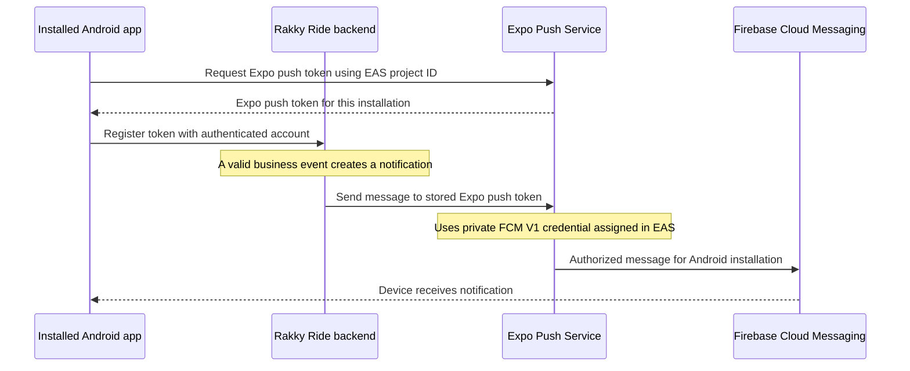
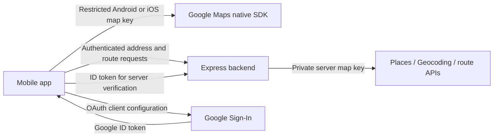

# Firebase, Google Maps, signing fingerprints, Google Sign-In, and EAS

A step-by-step setup guide for a junior developer working on Rakky Ride.

Written against this checkout and the [Expo SDK 57 documentation](https://docs.expo.dev/versions/v57.0.0/) on **28 October 2026**. Console labels can change; use the linked official instructions if a menu moves. This is documentation, not evidence that a cloud setting or device test has just been completed.

Read the explanations first, then follow the numbered stages. Examples containing `YOUR_...`, `REPLACE_...`, or `example.com` require your own values. Commands use macOS/Linux shell syntax and run from `mobile/` unless another folder is shown. Merge configuration into existing files; do not replace working configuration with an example.

## Contents

1. [Understand the pieces and their connections](#1-understand-the-pieces-and-their-connections)
2. [Prepare your accounts and identify the right projects](#2-prepare-your-accounts-and-identify-the-right-projects)
3. [Register the Android apps in Firebase and download their client files](#3-register-the-android-apps-in-firebase-and-download-their-client-files)
4. [Create or reuse the private FCM sender credential](#4-create-or-reuse-the-private-fcm-sender-credential)
5. [Connect Firebase to EAS and configure build environments](#5-connect-firebase-to-eas-and-configure-build-environments)
6. [Obtain Android signing fingerprints](#6-obtain-android-signing-fingerprints)
7. [Generate and restrict the Google Maps keys](#7-generate-and-restrict-the-google-maps-keys)
8. [Build Android and test push notifications](#8-build-android-and-test-push-notifications)
9. [Configure Google Sign-In](#9-configure-google-sign-in)
10. [Configure iOS notifications and identity](#10-configure-ios-notifications-and-identity)
11. [Read the configuration from command to running app](#11-read-the-configuration-from-command-to-running-app)
12. [Understand EAS Update and its different fingerprint](#12-understand-eas-update-and-its-different-fingerprint)
13. [Understand the separate native incoming-call path](#13-understand-the-separate-native-incoming-call-path)
14. [Prepare a Google Play release and submission credential](#14-prepare-a-google-play-release-and-submission-credential)
15. [Troubleshoot one layer at a time](#15-troubleshoot-one-layer-at-a-time)
16. [Use the final setup checklist](#16-use-the-final-setup-checklist)

## 1. Understand the pieces and their connections

### 1.1 What each service does

**Google Cloud** is the container for Google APIs, permissions, credentials, quotas, and billing. A project is a named container with a unique project ID and project number.

**Firebase** adds mobile services to a Google Cloud project. Creating a Firebase project also creates an underlying Google Cloud project; you can open that same project in either console. Firebase Cloud Messaging, abbreviated **FCM**, delivers messages to Android installations. Enabling Firebase does not replace this application's Express backend, PostgreSQL, Redis, or JWT authentication. [Firebase project relationships](https://firebase.google.com/docs/projects/learn-more).

**Google Maps Platform** supplies the map SDKs and address/route APIs. Its keys authorize Maps usage and associate it with a billed Google project. A map key does not authorize push delivery or sign a user into Google.

**Google Sign-In** identifies a person with a Google account. It uses OAuth client IDs. Our backend checks Google's ID token, then uses our own application authentication. It does not currently use Firebase Authentication for that flow.

**Expo** provides the app framework and native libraries. **EAS** means Expo Application Services:

- **EAS Build** compiles and signs an installable application.
- **EAS credentials** stores or references build signing and provider credentials.
- **EAS environment variables** supply inputs to builds and update exports.
- **EAS Update** delivers compatible JavaScript/assets to an installed app.
- **EAS Submit** uploads a built app to a store.

The **Expo Push Service** accepts messages addressed to Expo push tokens. For Android, it forwards them to FCM using the service-account key configured in EAS. EAS Build and the Expo Push Service perform different jobs even though they use the same Expo project.

### 1.2 Ordinary Android notification delivery



The Android app also registers with the native push system as part of obtaining its push identity. The diagram shows the application-level sequence; the Expo token wraps the provider routing information.

There are two separate setup directions:

- **Receiving side:** `google-services.json` tells the compiled Android app which Firebase app/project it belongs to.
- **Sending side:** a private service-account JSON authorizes a trusted sender. For ordinary notifications, that trusted sender is Expo.

Having one does not supply the other.

### 1.3 Maps and login use separate paths



Driver coordinates come from device location, pass through our backend and Redis, and reach authorized clients through Socket.io. Firebase is not the live driver-location database. Push delivery also does not decide whether an old ride offer is still valid; the backend remains authoritative.

### 1.4 The names that are easiest to confuse

**Android package / iOS bundle ID:** the installed app's identity, such as `com.rackyride.app`. The spelling is part of the configuration. Although the visible brand is Rakky Ride, this repository uses **`rackyride`** in its identifiers. Do not silently change it to `rakkyride`.

**Firebase project ID:** identifies the Firebase/Google project. It appears in client and server Firebase JSON files. It is not an Expo project ID.

**Firebase app ID:** identifies one registered Firebase application inside that project. A Firebase Android app ID is not an Android package name.

**EAS project ID:** identifies the Expo project. This checkout has `fed34124-2ccf-4a63-93e0-ea317a1d5587` in `mobile/app.json`. The UUID is an identifier, not a private key.

**Maps API key:** authorizes a specific set of Maps APIs for an allowed app, website, or server. Native/browser keys are embedded in distributable software, so application and API restrictions matter.

**OAuth client ID:** identifies a login client. A typical value ends in `.apps.googleusercontent.com`. It is not a Maps key or a service-account private key.

**Service account:** a machine identity. Its permissions come from IAM roles. A downloaded service-account JSON containing `private_key` lets software act as that identity and must remain private.

**Android signing keystore:** contains the private signing material used for Android builds. It is not a Firebase service account. Preserve existing production signing credentials.

**SHA-1 / SHA-256 certificate fingerprints:** public hashes of a signing certificate. They describe the signer; they are not passwords, API keys, or device biometrics.

**Expo push token:** an address for one app installation through Expo Push Service. Our ordinary notification worker uses this token.

**Native FCM token:** an Android installation's address through FCM directly. Our native incoming-call path uses it. It cannot be substituted for an Expo push token.

**EAS runtime fingerprint:** a compatibility hash used for updates. It is unrelated to the certificate SHA-1 you enter in Google Cloud. Section 12 explains it.

## 2. Prepare your accounts and identify the right projects

### 2.1 Accounts and tools

Have access to:

1. The Expo account/team that owns the existing app.
2. The Firebase project used for Android messaging.
3. The Google Cloud project containing the existing Google Sign-In clients.
4. The Google Cloud project owning the Maps key and its billing account.
5. An Android phone for the first complete test.
6. An Apple Developer team and a provisioned iPhone when doing iOS.
7. Google Play Console when testing store signing/submission.

These can involve the same Google login but still be different projects. Being signed into a console does not grant every permission in every project.

From the repository root:

```sh
cd /Users/mac/Desktop/project/ride_app/mobile
node --version
npm --version
eas --version
```

This checkout uses Expo `~57.0.30`, and `eas.json` requires EAS CLI `>= 24.8.0`. The local CLI inspected for this guide is 24.8.0. Its current environment command is `eas env:set`; `env:create` is deprecated in that CLI. No new mobile dependency is required for this guide.

If the `eas` command is missing, install the EAS CLI, then authenticate:

```sh
npm install --global eas-cli
eas login
eas whoami
eas project:info
```

Confirm the existing project. Do not create a replacement Expo project for this checkout. For a genuinely new application, Expo's initial setup uses `eas init` and `eas build:configure`; those initializers are not steps to repeat over this already configured repository. [First EAS build](https://docs.expo.dev/build/setup/).

**Fresh-checkout ordering:** some EAS commands resolve `app.config.ts`, which requires Maps inputs before it can finish. If a command stops with “Google Maps is not configured,” use the consoles to complete Firebase registration and obtain the Maps keys described in sections 3 and 7, save the local Maps inputs, then return to the command. You can create an unused Android Maps key with its API restriction first, obtain the signing SHA-1 in section 6, and finish its Android package/SHA restriction before building/testing. Do not loosen an existing production key or use made-up values to bypass this check. This ordering comes from our app's config guard, not a Firebase dependency on Maps.

### 2.2 Record the existing project boundaries

The setup record in [app-variants.md](app-variants.md) reports:

- Firebase messaging project: **`rakky-ride-f1892`**.
- Existing Google Sign-In web/iOS clients: Google Cloud project **`rackyride-510222`**.
- Existing Maps key owner/restrictions: **not yet verified in that record**. Do not assume it belongs to either project above.

Those are recorded findings, not a fresh inspection of the consoles. Confirm them before changing credentials. Do not move the login clients into the Firebase project merely to make all project names match.

For a new unrelated application you would plan these boundaries before creating credentials. For this application, preserve the working project relationships and configure the missing registrations in their actual owning projects.

### 2.3 Choose the application variant

The current `mobile/config/appVariants.ts` defines:

- **development:** `Rakky Ride Test`, identifier `com.rackyride.app.test`, scheme `rackyride-test`, local file `google-services.test.json`. Runs as a development client.
- **preview:** the same test name, identifier, scheme, and Firebase file. An internal APK bundles JavaScript and runs without Metro.
- **production:** `RackyRide`, identifier `com.rackyride.app`, scheme `rackyride`, local file `google-services.json`. Android output is an AAB for Google Play.

Production and test can coexist on one phone. Development and preview share an identity and replace one another when their signing permits installation. They are not separate databases: each app talks to the backend selected by its API URL.

**Checkpoint:** you can name the variant, package, Firebase project, Expo project, login project, and backend you intend to configure. Keep a private setup note for these non-secret identifiers.

## 3. Register the Android apps in Firebase and download their client files

### 3.1 Select or create the Firebase project

For Rakky Ride, open the existing project in [Firebase Console](https://console.firebase.google.com/). For a new application only, use **Create a project**, select/create its underlying Google Cloud project, and complete the wizard. Google Analytics is not required just to configure push notifications.

Go to **Project settings → General**. Record the project ID and project number. The project number is also associated with FCM sender identity. It will not equal the EAS UUID.

### 3.2 Register the exact Android package

1. Under **Your apps**, choose **Add app → Android**, or open an existing matching registration.
2. For production, use `com.rackyride.app`.
3. For test, use `com.rackyride.app.test` and a descriptive nickname.
4. Register both under the existing Firebase project, following this repository's current arrangement.
5. You may add signing fingerprints after obtaining them in section 6. Basic FCM setup does not require inventing a SHA value to get past this step.
6. Download the client configuration from the matching Android app registration.

Registering a different package creates a different app identity. Editing a package string in downloaded JSON does not register an app with Firebase. [Firebase Android setup](https://firebase.google.com/docs/android/setup).

### 3.3 Save the two client files

Use these exact local paths:

```text
mobile/google-services.json       ← production registration
mobile/google-services.test.json  ← test registration
```

The Firebase download may initially be called `google-services.json` for either app. Rename the **test download's filename** to `google-services.test.json`; do not alter its internal identifiers.

Both files are ignored by this checkout. Firebase client configuration contains identifiers intended for client applications, but keep this project's existing policy of supplying the files locally/EAS instead of committing them. It is not the server credential. [Expo FCM client configuration](https://docs.expo.dev/push-notifications/fcm-credentials/).

To inspect only the project/package metadata without dumping keys, run from `mobile`:

```sh
node --input-type=module <<'NODE'
import { readFileSync } from 'node:fs';
for (const path of ['google-services.json', 'google-services.test.json']) {
  const config = JSON.parse(readFileSync(path, 'utf8'));
  console.log({
    file: path,
    firebaseProject: config.project_info?.project_id,
    androidPackages: config.client?.map(
      client => client.client_info?.android_client_info?.package_name
    ),
  });
}
NODE
```

Expected: the production file includes `com.rackyride.app`, and the test file includes `com.rackyride.app.test`. A downloaded file can contain multiple clients; what matters is that the selected package has a real matching registration.

If only one file is available, inspect that file alone until the other is downloaded.

### 3.4 Understand the fields

- `project_info.project_id`: the Firebase project's ID.
- `project_info.project_number`: Google's numeric project identifier.
- `client_info.mobilesdk_app_id`: the registered Firebase app's ID.
- `android_client_info.package_name`: the Android package that registration serves.
- `api_key.current_key`: a Firebase client API key. Do not assume this is the existing Maps key.
- `oauth_client`, when present: OAuth registrations associated with that Firebase configuration. They do not establish that our separately configured Google Sign-In project has the required clients.

If the Firebase client API key itself is restricted, preserve its required **FCM Registration API** and **Firebase Installations API** access and the intended Android application identities. Do not restrict it to Maps SDK alone. The Firebase client key and dedicated Maps SDK key have different jobs.

**Checkpoint:** both package registrations exist, and each local file includes the package it will be used to build.

## 4. Create or reuse the private FCM sender credential

### 4.1 Why a second JSON is necessary

The client file answers: **which Firebase app is receiving?**

The service-account file answers: **which trusted machine identity may send?**

A service-account JSON has fields such as `type: "service_account"`, `client_email`, `project_id`, and `private_key`. Never put this file in `android.googleServicesFile`, `EXPO_PUBLIC_...`, an app asset, or a committed source file.

For the current ordinary notification flow, the backend calls Expo; Expo uses the private FCM credential stored in EAS. Uploading it to EAS does not automatically install it on our backend. The backend only needs its own copy for the separate direct native-call sender in section 13.

### 4.2 Enable the modern messaging API

In the Firebase project's **Project settings → Cloud Messaging**, check **Firebase Cloud Messaging API (HTTP v1)**. If disabled, follow the link to enable it in that same Google Cloud project. Avoid older tutorials asking for an FCM legacy server key. The current integration uses HTTP v1. [Firebase HTTP v1 authorization](https://firebase.google.com/docs/cloud-messaging/send/v1-api).

### 4.3 Prefer an existing suitable credential

The existing variant setup record says an FCM V1 account was already assigned to the production and test packages. First check EAS credentials in section 5. Reuse a suitable existing account; a new APK, a new Firebase Android registration, or a new SHA fingerprint does not automatically require a new service-account key.

If you actually need a new sender identity, choose **one** method:

**Method A — dedicated messaging sender:**

1. In the Firebase project's Google Cloud console, open **IAM & Admin → Service Accounts**.
2. Choose **Create service account**, name it descriptively, and record its email.
3. Grant **Firebase Cloud Messaging API Admin**, role ID `roles/firebasecloudmessaging.admin`, in the target Firebase project.
4. Open the account's **Keys** tab, then **Add key → Create new key → JSON**.
5. Download the private JSON once and store it securely outside this repository.

This avoids granting Project Owner merely to send messages. The role permits messaging operations; it does not grant every Firebase management, Maps, or Play Console operation. [FCM role permissions](https://docs.cloud.google.com/iam/docs/roles-permissions/firebasecloudmessaging).

**Method B — Firebase's existing Admin SDK service account:**

1. Open **Firebase Project settings → Service accounts**.
2. Choose **Generate new private key**, confirm, and securely save the JSON.
3. Review that account's existing permissions rather than assuming they are limited to messaging.

This is the console route in Expo's [FCM credential guide](https://docs.expo.dev/push-notifications/fcm-credentials/). It is an alternative to Method A, not another required key.

If your organization blocks service-account key creation, have the project administrator handle the permitted credential setup. Do not disable organization policy or grant broad roles to bypass the block.

### 4.4 Store it as a server credential

For example, place it at an operator-managed location outside Git, then restrict local permissions:

```sh
chmod 600 "$HOME/.config/rakkyride/credentials/expo-fcm-v1.json"
```

Run that only after saving the actual file there; the command changes file permissions and does not create a credential. Keep a protected backup and record where it is used. If a key is exposed, replace its consumers and revoke the exposed key in IAM; deleting a local copy does not revoke Google's key.

For this guide's ordinary path, use a service account from the same Firebase project as the Android client. Google supports explicit cross-project sender permissions, but this backend derives the native-call target project from the service-account file and is not configured as a general cross-project sender.

**Checkpoint:** you have identified an authorized sender account and know which private JSON, if any, needs uploading. You have not confused it with either Android client JSON.

## 5. Connect Firebase to EAS and configure build environments

### 5.1 Assign the FCM V1 credential to the application identifier

From `mobile`, explicitly select the test identity:

```sh
APP_VARIANT=preview eas credentials --platform android
```

1. Select the **preview** profile when asked.
2. Confirm the displayed package is **`com.rackyride.app.test`**.
3. Select **Google Service Account**.
4. Choose **Manage your Google Service Account Key for Push Notifications (FCM V1)**.
5. Select an existing suitable key, or upload the private service-account JSON from section 4.
6. Confirm the Firebase project and service-account email match your intended sender.

Repeat for production using `APP_VARIANT=production` and the production profile, confirming **`com.rackyride.app`**. If both packages use the same Firebase project, the same authorized sender can be assigned to both. This assignment is per application identifier; choosing an environment name alone does not guarantee the right credential is attached.

The Expo dashboard also provides **Project settings → Credentials → Android application identifier → FCM V1 service account key**. Follow the [official upload/assignment procedure](https://docs.expo.dev/push-notifications/fcm-credentials/). Preserve existing production assignments when configuring the test app.

### 5.2 Supply the Android client JSON as an EAS file variable

This is a different EAS storage location and a different JSON:

- **FCM V1 credential in Credentials:** private sender key from section 4.
- **`GOOGLE_SERVICES_JSON` in Environment variables:** Android **client** configuration from section 3.

In **Expo project → Project settings → Environment variables**:

1. Add/select `GOOGLE_SERVICES_JSON`.
2. Choose **File** and **Secret** visibility.
3. Upload the test client file for **development and preview**.
4. Upload the production client file for **production** as its own environment-scoped value.
5. Confirm the test upload did not overwrite the production environment's file.

Equivalent commands, run from `mobile` after confirming the selected Expo project:

```sh
eas env:set --environment development --name GOOGLE_SERVICES_JSON --type file --visibility secret --value ./google-services.test.json
eas env:set --environment preview --name GOOGLE_SERVICES_JSON --type file --visibility secret --value ./google-services.test.json
eas env:set --environment production --name GOOGLE_SERVICES_JSON --type file --visibility secret --value ./google-services.json
```

EAS materializes a file variable on the build machine. `process.env.GOOGLE_SERVICES_JSON` contains its **temporary file path**, not the JSON text. Our app config passes that path to `android.googleServicesFile`. Secret file variables cannot be pulled back for local use, so retain the correct local downloads. [EAS file variables](https://docs.expo.dev/eas/environment-variables/manage/#secrets-and-file-variables).

### 5.3 Add the other build inputs

For each environment, configure the values that the app actually reads:

- `EXPO_PUBLIC_API_BASE_URL`: backend root URL, for example `https://api-staging.example.com`, without a trailing `/api`. Our API client appends `/api` itself.
- `EXPO_PUBLIC_GOOGLE_MAPS_ANDROID_KEY`: restricted Android Maps SDK key.
- `EXPO_PUBLIC_GOOGLE_MAPS_IOS_KEY`: restricted iOS Maps SDK key.
- `EXPO_PUBLIC_GOOGLE_MAPS_WEB_KEY`: browser Maps key, when building web.
- `EXPO_PUBLIC_GOOGLE_WEB_CLIENT_ID`: Web OAuth client ID used by native/web login.
- `EXPO_PUBLIC_GOOGLE_IOS_CLIENT_ID`: iOS OAuth client ID for the selected bundle, when configuring iOS.
- `RAKKY_APNS_ENVIRONMENT`: only when configuring iOS native calls; match the signed entitlement as described later.

Generate Maps keys in section 7 and OAuth IDs in section 9. Firebase itself does not need Maps or login, but **this repository's app config requires Android and iOS Maps keys, or its shared fallback, even for an Android build**. Complete that Maps setup before attempting the whole-app build.

Use **plain text or sensitive**, rather than secret visibility, for public frontend inputs needed by local config resolution and EAS Update export. Sensitive hides casual display; it does not make an embedded value private. Never put backend secrets in an `EXPO_PUBLIC_` variable. [EAS variable visibility](https://docs.expo.dev/eas/environment-variables/), [build and update variable availability](https://docs.expo.dev/eas/environment-variables/usage/).

Example of setting a non-secret URL:

```sh
eas env:set --environment preview --name EXPO_PUBLIC_API_BASE_URL --value https://api-staging.example.com --visibility plaintext
```

Replace that example hostname before building. Enter real keys through your approved private configuration workflow.

Our build profiles already set `APP_VARIANT` in `eas.json`. Avoid adding another conflicting `APP_VARIANT` in the environment dashboard. A profile's `environment` and its `APP_VARIANT` perform separate jobs: one selects stored variables; the other selects our app identity.

### 5.4 Local `.env` is separate from the cloud build

Edit the ignored `mobile/.env` using `mobile/.env.example` as a reference. Do not overwrite an existing `.env` that contains working values.

```dotenv
EXPO_PUBLIC_API_BASE_URL=http://YOUR_MAC_LAN_ADDRESS:4000
EXPO_PUBLIC_GOOGLE_MAPS_ANDROID_KEY=YOUR_RESTRICTED_ANDROID_MAPS_KEY
EXPO_PUBLIC_GOOGLE_MAPS_IOS_KEY=YOUR_RESTRICTED_IOS_MAPS_KEY
EXPO_PUBLIC_GOOGLE_MAPS_WEB_KEY=YOUR_RESTRICTED_BROWSER_MAPS_KEY
EXPO_PUBLIC_GOOGLE_WEB_CLIENT_ID=YOUR_WEB_CLIENT_ID.apps.googleusercontent.com
EXPO_PUBLIC_GOOGLE_IOS_CLIENT_ID=YOUR_IOS_CLIENT_ID.apps.googleusercontent.com
```

The last two values become available after section 9. A real phone's `localhost` is the phone itself. Use the Mac's reachable LAN IP for local testing or a staging HTTPS URL. Preview requires an explicit reachable URL; production rejects local/private and non-HTTPS URLs.

`eas env:pull --environment preview` can retrieve readable cloud variables into `.env.local`, but our custom `app.config.ts` and preflight script explicitly load **`.env`**. Keep the inputs needed by those scripts in `.env` or the shell, and keep `.env.local` consistent for Metro. A pull does not retrieve secret files. Do not assume a pulled file alone configures every local script.

**Checkpoint:** each EAS environment has the correct client file and public build inputs; the private sender credential is assigned under Credentials.

## 6. Obtain Android signing fingerprints

### 6.1 Understand what you are generating

A **keystore** holds signing keys. Building an Android APK signs it with a key. A **certificate fingerprint** is calculated from that signer's public certificate.

You do not generate random SHA text for Google. You obtain the fingerprint of the certificate that signs the app the user will actually install. A source-code edit does not by itself change this certificate.

There can be several signers:

- A local debug build's debug certificate.
- An EAS preview/test build's certificate.
- The production EAS/upload certificate.
- Google Play's **app signing certificate**, used for APKs delivered by Play.

They can differ. Authorize every package/certificate pair you actually distribute. [Google Android client authentication](https://developers.google.com/android/guides/client-auth).

### 6.2 View or configure EAS signing

For test credentials:

```sh
APP_VARIANT=preview eas credentials --platform android
```

Select preview, confirm `com.rackyride.app.test`, and inspect its build credentials. Record **SHA-1** and **SHA-256**. If no test keystore exists, configure one:

```sh
APP_VARIANT=preview eas credentials:configure-build --platform android --profile preview
```

Allow EAS to generate a **test** keystore only if one is missing. The existing setup notes already record a test keystore. Do not replace an existing production keystore to solve a Maps/login error.

For production inspection, use `APP_VARIANT=production`, choose production, and confirm `com.rackyride.app`. Store any keystore backup/passwords privately; the displayed fingerprints themselves are public metadata. [App signing credentials](https://docs.expo.dev/app-signing/app-credentials/).

### 6.3 Obtain a local debug fingerprint when needed

For the commonly used user debug keystore:

```sh
keytool -list -v -alias androiddebugkey -keystore "$HOME/.android/debug.keystore"
```

Its conventional password is `android`. This is only the debug keystore. Some generated native projects use their own `android/app/debug.keystore`; do not assume the user-level file signed your build.

If the generated Android project exists, inspect what Gradle actually uses:

```sh
cd android
./gradlew signingReport
cd ..
```

Use the certificate for the relevant variant. You do not need to generate/recreate native folders just to inspect existing EAS signing.

### 6.4 Obtain the Google Play signer

Open the production app in **Google Play Console → App integrity / App signing**. Record the **App signing key certificate** SHA-1 and SHA-256. Do not mistake **Upload key certificate** for the signer of the APK Play delivers.

If Play lists multiple active app-signing certificates after a signing-key upgrade, authorize the relevant certificates for supported devices. A successful directly installed APK does not prove the Play-installed APK has the same signer.

### 6.5 Put each fingerprint in the correct place

There are three separate registrations:

1. **Firebase → Project settings → General → Android app → Add fingerprint:** add the relevant SHA-1 and SHA-256 to the correct package registration. Re-download its client file when Firebase configuration changes, and update the EAS client file if its contents changed.
2. **Maps key → Application restrictions → Android apps:** add **package + SHA-1** pairs. Section 7 walks through it.
3. **Google Sign-In project → Android OAuth clients:** register **package + SHA-1** pairs. Section 9 walks through it.

Saving a fingerprint in Firebase does not automatically edit the existing Maps key's restrictions, and does not fix OAuth clients in a different Google project. SHA-256 does not substitute for a SHA-1 field.

Basic FCM messaging is not inherently dependent on SHA registration. If you restrict the Firebase client API key itself by Android application, its allowed certificate/package pairs and required Firebase APIs must also be correct. Those are restrictions on the client key, separate from sender IAM permissions.

**Checkpoint:** you know which signer corresponds to local, EAS test, and Play production installations. You have recorded real fingerprints, not copied another app's examples.

## 7. Generate and restrict the Google Maps keys

### 7.1 First identify the owning project

The project owning the **actual Maps key** controls its enabled APIs, application restrictions, billing, and usage. It may be different from the messaging and login projects.

Open [Google Cloud Console](https://console.cloud.google.com/), choose the intended project, then **APIs & Services → Credentials**. Match the actual configured key privately to its key entry. Record its name/project and inspect usage before changing it. Do not infer ownership from the app name or the Firebase JSON's API key.

If the existing key serves production traffic, preserve the authorized production entries while adding test entries. Do not rotate or delete it merely to discover what it is. Restriction changes can affect existing installs immediately. [Maps key security guidance](https://developers.google.com/maps/api-security-best-practices).

### 7.2 Enable the APIs the implementation actually calls

Verify a linked billing account and enable the applicable products under **APIs & Services → Library**:

- **Maps SDK for Android:** Android map rendering.
- **Maps SDK for iOS:** native iOS Google map rendering.
- **Maps JavaScript API:** this checkout's browser map.
- **Places API (New):** backend autocomplete and place details.
- **Geocoding API:** backend coordinates-to-address conversion.
- **Directions API (Legacy):** the backend's current route endpoint.
- **Distance Matrix API (Legacy):** the backend's current estimate endpoint.

The web component `mobile/src/components/map/AppMap.web.tsx` loads `maps.googleapis.com/maps/api/js`. Despite older feature notes describing an embed, the current browser implementation needs **Maps JavaScript API**, not merely Maps Embed API. [JavaScript API setup](https://developers.google.com/maps/documentation/javascript/get-api-key).

**Important for a brand-new Google project:** Directions and Distance Matrix are legacy products, and Google does not make legacy services available to new Cloud projects. The present backend still calls their legacy endpoints. Enabling Routes API does not make those existing requests use the new API. Reuse the established eligible Maps project where appropriate, or plan an explicitly approved backend migration to Routes API. A new key alone cannot resolve this limitation. [Google Maps legacy product policy](https://developers.google.com/maps/legacy).

Set budgets/alerts and available request quotas. An alerts-only budget warns about spending; it does not automatically cap spending. Use the actual APIs' pricing/quotas when planning usage. [Google Cloud budget behavior](https://docs.cloud.google.com/billing/docs/how-to/budgets).

### 7.3 Create the Android SDK key

1. Select the Maps-owning Google Cloud project.
2. Open **APIs & Services → Credentials → Create credentials → API key**.
3. Give it a clear name, such as `Rakky Android Maps`.
4. Under **Application restrictions**, choose **Android apps**.
5. Add the relevant `com.rackyride.app.test` + EAS test **SHA-1** pair.
6. Add production package + production signer pairs if this key is deliberately shared across those apps. For Play delivery, include Play's app-signing SHA-1.
7. Add the local-debug pair only if you will use that key in local native builds.
8. Under **API restrictions**, allow **Maps SDK for Android**.
9. Save. Put the key in `EXPO_PUBLIC_GOOGLE_MAPS_ANDROID_KEY` locally and in the intended EAS environments.

One Android key can authorize multiple Android package/certificate pairs. Separate test/production Android keys can provide clearer usage isolation, but preserve the existing setup unless intentionally changing it. [Android Maps key setup](https://developers.google.com/maps/documentation/android-sdk/get-api-key).

### 7.4 Create the iOS SDK key

1. Create/name another API key in the Maps project.
2. Choose **iOS apps** application restrictions.
3. Add the intended bundle identifiers: production `com.rackyride.app`, test `com.rackyride.app.test` when provisioning it.
4. Restrict APIs to **Maps SDK for iOS**.
5. Set `EXPO_PUBLIC_GOOGLE_MAPS_IOS_KEY` locally and in the corresponding EAS environments.

iOS Maps restrictions use bundle IDs, not Android signing SHA-1. This key is required by our current config guard even when the immediate build target is Android. [iOS Maps key setup](https://developers.google.com/maps/documentation/ios-sdk/get-api-key).

### 7.5 Create the browser key if using web

1. Create/name a browser-only key.
2. Choose **Websites / HTTP referrers** application restrictions.
3. Add actual development origins, including the used port, for example `http://localhost:8081/*`.
4. Add the actual deployed web origins, for example `https://app.example.com/*`.
5. Restrict APIs to **Maps JavaScript API**.
6. Put it in `EXPO_PUBLIC_GOOGLE_MAPS_WEB_KEY` for the applicable web build environment.

Browser Maps referrer entries are separate from Google login's authorized JavaScript origins. Configuring one does not configure the other.

### 7.6 Create the backend web-service key

1. Create/name a server-only Maps key in the eligible Maps project.
2. Choose **IP addresses** application restrictions.
3. Add the backend's public **outbound/egress** IP addresses. If requests leave through NAT, use the NAT egress IP; it may differ from the inbound API hostname's address.
4. Allow **Places API (New)**, **Geocoding API**, and the legacy **Directions/Distance Matrix** APIs used by this implementation.
5. Put the value in the backend runtime secret store or ignored `backend/.env`.
6. Restart the intended backend after changing its environment.

For local backend testing, the allowed source is your connection's current public egress IP, not the phone's LAN address. If your hosting has changing outbound IPs, establish a supported stable-egress/restriction plan instead of assuming an inbound IP restriction will work. [Places API key setup](https://developers.google.com/maps/documentation/places/web-service/get-api-key).

The backend supports both variable names:

```dotenv
GOOGLE_MAPS_SERVER_KEY=YOUR_PRIVATE_BACKEND_MAPS_KEY
```

or the older:

```dotenv
GOOGLE_MAPS_API_KEY=YOUR_PRIVATE_BACKEND_MAPS_KEY
```

In `backend/src/config/env.ts`, `GOOGLE_MAPS_SERVER_KEY` takes precedence when defined, including an empty string. Prefer one populated name rather than conflicting duplicate entries. The maps service receives the resolved value as `env.GOOGLE_MAPS_API_KEY`.

Never put this server key in the mobile `.env`, an `EXPO_PUBLIC_` value, or `extra`.

### 7.7 Why the shared fallback is limited

`mobile/app.config.ts` supports `EXPO_PUBLIC_GOOGLE_MAPS_KEY` as a fallback when a platform-specific key is missing. The browser component also has that fallback.

This is compatibility behavior, not a reason to create one unrestricted key. An Android application restriction cannot also serve as a browser HTTP-referrer restriction or an iOS bundle restriction on that same key. Use the platform-specific variables and keep the server key separate.

### 7.8 Verify rendering and backend APIs separately

After installing a build with the correct native keys:

1. Open Home: real map tiles should render.
2. Allow location: the app should locate you, subject to device location availability.
3. Search for a destination around Lekki/Amuwo: suggestions should appear.
4. Choose pickup/drop-off: route, distance, time, and fare should load.
5. Check nearby-driver behavior independently with appropriate test accounts.

Tiles working proves the SDK path. Suggestions working proves the Places/backend path. A route/fare failure can still indicate legacy API eligibility or server-key restrictions. GPS permission and Redis driver state are additional, separate concerns.

**Checkpoint:** native Maps keys are in mobile build inputs, the browser key is restricted to web origins, and the private web-service key lives only on the backend.

## 8. Build Android and test push notifications

### 8.1 Confirm existing integration rather than adding another

This repository already includes `expo-notifications`, `expo-device`, `expo-constants`, and the `expo-notifications` config plugin. Do not add a second Firebase SDK or rewrite notification registration just to follow a generic tutorial.

Current registration lives in `mobile/src/services/notificationService.ts`:

1. Check that the native notification module is present.
2. Create Android notification channels.
3. Check/request OS notification permission.
4. Require a physical device (`Device.isDevice`).
5. Read the EAS project ID from Expo constants.
6. Call `getExpoPushTokenAsync({ projectId })`.
7. POST the Expo token to authenticated `/notifications/devices` using the app API client.

That route is relative to our configured API prefix. You do not put a Firebase service-account key in that request.

The configured default channel is `trip_updates`. The current channel names come from `configureNotificationChannels()` and include `driver_offers`, `trip_updates`, `scheduled_reminders`, `wallet_updates`, `safety_security`, `support`, and `promotions`.

### 8.2 Run the preflight and TypeScript checks

Ensure the ignored local **test client file** and the Maps inputs are present. Substitute a real staging URL below:

```sh
APP_VARIANT=preview EXPO_PUBLIC_API_BASE_URL=https://api-staging.example.com npm run check:build
npm run typecheck
```

Expected preflight output:

```text
Build configuration ready: preview, com.rackyride.app.test.
```

`check:build` validates package/client-file matching and the API URL; it does **not** validate Maps authorization, OAuth console state, or real delivery. The cloud `eas-build-post-install` hook also runs this preflight before native compilation.

### 8.3 Build an installable preview APK

```sh
eas build --platform android --profile preview
```

Or use the existing script:

```sh
npm run build:test:android
```

Install the resulting APK on your Android phone. Preview has its JavaScript bundle and does not require Metro. An AAB is the store-upload format; use the APK for this direct-install test. [EAS APK builds](https://docs.expo.dev/build-reference/apk/).

For Metro development instead:

```sh
eas build --platform android --profile development
npm start -- --dev-client
```

Install the development build before opening it with Metro. Android remote push is unavailable in Expo Go for SDK 57; an older development client can also be missing the native notification module. [SDK 57 notifications](https://docs.expo.dev/versions/v57.0.0/sdk/notifications/).

### 8.4 Register a real installation

1. Open the installed test app and sign in to a test account.
2. Open its notification preferences and enable push.
3. Accept the operating system notification request.
4. Confirm the phone can reach the intended backend.
5. Confirm a successful authenticated device-registration request and an enabled `push_devices` row for that account/installation, using your private backend/database tooling.

The app's push preference and OS permission are separate gates. Both must permit push. A new install must open/register before you can send to it. Our code deliberately skips ordinary device registration on an emulator even though some Google Play-enabled emulators support FCM in general; use a physical phone for this application's complete test.

### 8.5 Send an isolated transport test

For a first isolated test, obtain **your own test installation's Expo push token** privately. In a development build, pause in `registerCurrentDevice()` after `getExpoPushTokenAsync()` and inspect `token` with the React Native debugger. Alternatively, use an authorized private database viewer to inspect that test installation's `push_devices.expo_push_token`. There is no public token-display endpoint to call.

Use the [Expo push notification tool](https://expo.dev/notifications), or send a simple request from your private terminal:

```sh
curl --request POST 'https://exp.host/--/api/v2/push/send' \
  --header 'Content-Type: application/json' \
  --data '{"to":"ExponentPushToken[REPLACE_WITH_YOUR_TEST_TOKEN]","title":"Rakky Ride setup test","body":"Android push delivery is connected.","channelId":"trip_updates","sound":"default"}'
```

Use the exact token value you obtained, including its actual prefix. Put the app in the background for this first display test. In our foreground handler, OS banners/sound are suppressed deliberately while the app uses its own notification presentation.

If Expo push access-token security is enabled, the send request also needs its authorized bearer token; use the existing backend path or a private authorized test client. Keep that access token server-side. This backend reads it as `EXPO_ACCESS_TOKEN`. It is not a Google FCM key, and it is not a mobile env value.

Expo first returns a **ticket**; a successful ticket means the request was accepted. Use its ID with the receipts endpoint, or inspect the existing worker's receipt processing. A successful provider receipt still does not prove a person saw/opened the notification. [Sending notifications, tickets, receipts, and access-token security](https://docs.expo.dev/push-notifications/sending-notifications/).

A generic transport test is not stored as one of our application notifications. Tapping it may not navigate because the app validates a real notification record through the backend. That is expected. Do not weaken ownership checks to make a generic test navigate.

### 8.6 Test a real application event

1. Use test accounts to create an authorized event that the existing notifications module handles, such as a valid trip status change.
2. Verify the notification appears in the correct account's inbox.
3. Verify background/locked-screen delivery on its registered phone.
4. Tap the notification and confirm the correct screen loads current server state.
5. Repeat with the app foregrounded: check the app's own banner/offer presentation and duplicate suppression.
6. Test logout/re-login: the previous account's device registration should not keep receiving new account-specific notifications.

The backend queue needs its PostgreSQL records, Redis connection, and running notification workers. A socket banner alone does not prove FCM delivery.

**Checkpoint:** a physical phone receives both an isolated push and a real app event, and the real event opens the correct authorized screen.

## 9. Configure Google Sign-In

### 9.1 Keep Google login separate from Firebase messaging

Our native app calls `GoogleSignin.configure({ iosClientId, webClientId })` in `mobile/src/services/googleSignIn.native.ts`.

It receives a Google **ID token** and sends it to the backend. `backend/src/modules/auth/google.service.ts` verifies Google's token and accepted audience. Our backend then participates in our own login/session flow.

You do not need to enable the Google provider in Firebase Authentication for this current direct Google Sign-In integration. Google Sign-In can be configured without Firebase. [Library configuration instructions](https://react-native-google-signin.github.io/docs/setting-up/get-config-file).

### 9.2 Configure branding and audience

In the **existing login project's** Google Cloud console:

1. Open **Google Auth Platform**; older layouts call this **OAuth consent screen**.
2. Under **Branding**, enter the app name, monitored support contact, and required application/domain information.
3. Use real accessible homepage/privacy-policy pages. An admin login or missing privacy page is not a completed public branding setup.
4. Under **Audience**, choose **External** for an application intended for ordinary public Google accounts. Internal is for the associated Workspace organization.
5. Under **Data Access**, request only the identity scopes the app needs; this implementation uses the normal identity flow.
6. Check publishing/verification requirements in the console before a public release.

The existing setup record reports Branding saved, but Audience still **Testing**, with public publishing not confirmed. Do not present that as completed public OAuth setup.

Testing commonly involves a test-user list. Google documents an exception for apps requesting only `openid`, `email`, and `profile`: those identity-only requests can work without the testing allowlist. Workspace admin policy can still block access. Publishing status and verification status are separate; a working login is not proof either is complete. [Google OAuth app states](https://developers.google.com/identity/protocols/oauth2/production-readiness/overview).

### 9.3 Create or reuse the Web OAuth client

1. Open **Google Auth Platform → Clients**, or **APIs & Services → Credentials**.
2. Reuse the existing **Web application** OAuth client used by this app/backend, or create that type if it does not exist.
3. For browser sign-in, add actual **Authorized JavaScript origins**, such as `http://localhost`, `http://localhost:8081`, and the deployed app/dashboard origins you actually use.
4. Origins contain scheme, host, and port; do not paste a route or wildcard path into an OAuth JavaScript-origin field.
5. Copy the **client ID** into mobile/EAS `EXPO_PUBLIC_GOOGLE_WEB_CLIENT_ID`.
6. Set backend `GOOGLE_CLIENT_ID_WEB` to that same client ID and restart the intended backend.

Our browser implementation uses Google's rendered popup sign-in button. Do not invent a redirect URI from another tutorial unless implementing a redirect flow that needs it. The Web client ID is also the `webClientId` used by native sign-in to request a token for backend verification. Its Web type is intentional even on Android.

A Web client's downloaded configuration may include a client secret. That secret is not required in this app's frontend and must not be copied into mobile configuration. [Google Identity Services Web setup](https://developers.google.com/identity/gsi/web/guides/get-google-api-clientid).

### 9.4 Register Android OAuth clients

In that **same login project**:

1. Check whether the intended Android package + signer SHA-1 pair already has an OAuth client.
2. If missing, create an OAuth client of type **Android**.
3. Enter the exact package, e.g. `com.rackyride.app.test`.
4. Enter the corresponding **SHA-1**, e.g. the EAS test signer from section 6.
5. Create/reuse clients for the other actual package/signer combinations, including Play's app-signing certificate for the store app.

The Android registration authorizes the native app/signer pair. The Web client ID remains the value supplied as `webClientId` in our mobile code. There is no `EXPO_PUBLIC_GOOGLE_ANDROID_CLIENT_ID` read by this checkout's native sign-in configuration.

The backend also supports `GOOGLE_CLIENT_ID_ANDROID` as an accepted audience, but setting it is not a substitute for registering the Android package/SHA pair or aligning the Web audience this app requests. Do not add an unused frontend Android env name and expect it to fix login.

### 9.5 Register the iOS OAuth client

1. Create/reuse an OAuth client of type **iOS** in the login project.
2. Enter the exact bundle identifier for the variant.
3. Copy its client ID to `EXPO_PUBLIC_GOOGLE_IOS_CLIENT_ID` in the relevant EAS environment/local setup.
4. Set backend `GOOGLE_CLIENT_ID_IOS` if accepting tokens with that audience in your supported flows.
5. Rebuild iOS after native URL scheme/client configuration changes.

Our `app.config.ts` derives the reversed client-ID URL scheme for the sign-in plugin. For example, `123-abc.apps.googleusercontent.com` becomes `com.googleusercontent.apps.123-abc`. This callback scheme is different from the app's own `rackyride`/`rackyride-test` link scheme. A production iOS client registered only for the production bundle is not a completed test-bundle login setup.

These native libraries require a custom build; Expo Go cannot supply their native modules. [Expo Google authentication guide](https://docs.expo.dev/guides/google-authentication/).

### 9.6 Verify login with each actual build source

Test local debug if supported, the EAS preview APK, and a Play-installed production app separately. Confirm the backend accepts the returned ID token and creates the intended application session.

If Google succeeds but our backend rejects the token, check audience/client-ID alignment. If Android produces `DEVELOPER_ERROR`, check package + **installed signer** SHA-1 in the actual login project first. Adding a fingerprint to the messaging project's Firebase app may not fix it.

**Checkpoint:** a real user can sign in through each supported distribution path, and frontend/backend agree on the requested Web audience.

## 10. Configure iOS notifications and identity

### 10.1 Ordinary iOS push uses Apple's delivery service

Our ordinary iOS path is:

```text
Backend → Expo Push Service → Apple Push Notification service (APNs) → iPhone
```

It does not require adding Firebase's iOS SDK solely for the existing Expo notification flow. `GoogleService-Info.plist` is Firebase's iOS client file for integrations that actually use Firebase on iOS; it is neither an APNs private key nor a requirement to add speculatively here.

### 10.2 Prepare signing and APNs through EAS

1. Have a paid Apple Developer team and permission to manage the intended identifiers/credentials.
2. Register/provision the selected bundle ID: production `com.rackyride.app`, test `com.rackyride.app.test`.
3. Enable Push Notifications for the App ID and ensure the signing profile includes the capability.
4. For internal iPhone distribution, register the test devices when EAS requests it.
5. Use EAS credentials/build setup for the selected profile to create or reuse the appropriate Apple signing and **ordinary push** credential.
6. Accept the push configuration prompts when setting it up for the first time.
7. Build/install/open the app, sign in, grant notification permission, and complete the same ordinary-event tests used for Android.

The provider/signing prompts are documented in [Expo push setup](https://docs.expo.dev/push-notifications/push-notifications-setup/). Use the actual signed entitlements/provider credential environment to diagnose APNs delivery.

For example, after the relevant environment has all its required inputs:

```sh
eas device:create
eas build --platform ios --profile preview
```

### 10.3 Match the native-call APNs settings separately

This repository also has native incoming calls. `RAKKY_APNS_ENVIRONMENT` controls the custom plugin's push entitlement and defaults locally to `development`. For a distribution-signed iOS app, set the appropriate EAS environment value to `production` before building; inspect the **signed app's** `aps-environment` to verify it.

The EAS profile name does not prove the entitlement. Our development profile requests internal distribution too. Follow [the iOS/VoIP procedure](../deployment/trip-audio-setup.md#8-add-apple-voip-credentials-and-an-ios-build) for the private backend `.p8` key, Key ID, Team ID, bundle/topic, and matching APNs endpoint. That direct VoIP sender is separate from EAS-managed ordinary notifications.

The current direct-call backend has one configured APNs bundle/environment. Test and production iOS call delivery therefore need correctly isolated backend settings; merely installing both apps does not make one configured VoIP topic serve both.

**Checkpoint:** ordinary notifications work through Expo/APNs, and any native-call APNs setup has been verified independently.

## 11. Read the configuration from command to running app

This section explains where the values go, using the current source files. You do not need to create another configuration system.

### 11.1 `mobile/eas.json`: select the build recipe

The current preview recipe is:

```json
{
  "distribution": "internal",
  "environment": "preview",
  "channel": "preview",
  "env": { "APP_VARIANT": "preview" },
  "android": { "buildType": "apk" }
}
```

This is the contents of the existing `build.preview` object, not a replacement for the whole file.

- `distribution`: how the build is distributed.
- `environment`: which EAS-hosted variable set the build reads.
- `channel`: the update routing channel embedded into that binary.
- `env.APP_VARIANT`: our code's identity selector.
- `android.buildType`: APK for direct test installation.

Development selects its own environment/channel and sets `developmentClient: true`. Production selects production, emits an `app-bundle`, and uses `autoIncrement: true` with remote version management. These settings describe builds; they do not deploy Express or choose a PostgreSQL database.

The `submit.production.android` block separately selects Play's `internal` track and `draft` release status. A successful production build is not automatically a public store release. [EAS configuration reference](https://docs.expo.dev/eas/json/).

### 11.2 `mobile/app.json`: base application metadata

The base config contains the slug/version, base package/bundle, plugin declarations, `extra.eas.projectId`, update URL, and fingerprint runtime policy.

This checkout's dynamic `app.config.ts` starts from that config and overrides identity for the chosen variant. Reading only `app.json` can therefore mislead you: a preview build resolves to `.test` even though the base package says production.

### 11.3 `mobile/config/appVariants.ts`: select identity and validate it

`appVariant(process.env.APP_VARIANT)` returns the selected name, package/bundle, link scheme, and default client file. If the variable is absent, the local default is development/test.

`validateVariantApi()` checks preview/production API URL suitability. `validateFirebaseClient()` requires that the supplied JSON include the selected Android package. These checks catch a copied production client file being accidentally used for test.

They do not query the Google consoles. Passing them does not prove provider authorization.

### 11.4 `mobile/app.config.ts`: resolve environment values into native config

In order, the current config:

1. Loads the ignored local `.env` if present. Already supplied process values take precedence under the current Node loader.
2. Selects the variant.
3. Chooses `GOOGLE_SERVICES_JSON` if provided; otherwise chooses that variant's local Firebase file.
4. Validates the API URL and any Firebase client file it can read locally.
5. Resolves Android/iOS Maps keys, with the shared key as fallback.
6. Configures `react-native-maps` using `androidGoogleMapsApiKey` and `iosGoogleMapsApiKey`.
7. Configures `expo-notifications`, including default channel `trip_updates`.
8. Derives the iOS Google Sign-In callback scheme when the iOS client ID exists.
9. Returns the selected name, package/bundle, scheme, and `extra.appVariant`.
10. Applies existing native-call, Android NDK, and variant networking plugins.

Native config plugins write build-time platform configuration during native generation. Changing `.env` later cannot rewrite a key already compiled into an installed Android manifest or iOS binary. SDK 57's `react-native-maps` plugin documents the same platform key options used here. [SDK 57 map configuration](https://docs.expo.dev/versions/v57.0.0/sdk/map-view/).

### 11.5 Runtime values and backend values

Metro replaces frontend `EXPO_PUBLIC_` references when exporting/bundling the app. They are not fetched dynamically from your laptop's `.env` each time a user opens the installed app.

Backend configuration lives in **`backend/src/config/env.ts`** in the current checkout. Some older overview material points to a different config path; inspect the current source. It reads private server runtime values for Maps, Google token audiences, Expo push authorization, and native-call providers.

Editing EAS environment variables does not change an already deployed backend. Editing backend secrets does not replace compiled native keys. Apply each change to the system that consumes it.

### 11.6 Trace one complete preview build

```text
eas build --profile preview --platform android
  → read build.preview in eas.json
  → load EAS preview environment variables
  → APP_VARIANT=preview selects com.rackyride.app.test
  → GOOGLE_SERVICES_JSON resolves to the test Firebase client file
  → resolve Maps/native plugin configuration
  → run build preflight
  → generate native project and compile JavaScript/native code
  → sign APK with selected Android test keystore
  → install app and request notification permission
  → app obtains Expo push token using EAS project ID
  → backend registers token against authenticated account
  → backend sends event through Expo
  → Expo uses assigned FCM V1 account to deliver through Firebase
```

The signing keystore signs the APK. The FCM service account authorizes sends. The client JSON selects the receiving Firebase app. These jobs remain separate throughout the flow.

## 12. Understand EAS Update and its different fingerprint

### 12.1 Certificate fingerprints and runtime fingerprints answer different questions

An Android **certificate SHA-1** answers: **which certificate signed this app?** You register it for Android Maps restrictions and Google login.

An EAS **runtime fingerprint** answers: **which native configuration/dependency state is this update compatible with?** The build/update tooling computes it. Do not paste it into Firebase or a Google SHA-1 field.

The app already has:

```json
"runtimeVersion": {
  "policy": "fingerprint"
}
```

Keep this policy. It helps prevent an update that requires different native code from reaching an incompatible installed binary. [Runtime compatibility](https://docs.expo.dev/eas-update/runtime-versions/), [SDK 57 fingerprint tooling](https://docs.expo.dev/versions/v57.0.0/sdk/fingerprint/).

Biometric fingerprint login is a third, unrelated subject; it is not part of these signing/update credentials.

### 12.2 What requires which release action

- **JavaScript/UI changes compatible with the installed native runtime:** can use an EAS Update after testing.
- **New native library, native permission/plugin change, package/bundle change, native Maps key change, or changed Firebase native client configuration:** build and install a new binary.
- **Adding an allowed signer/package to an existing Maps key restriction:** a console-side change; a rebuild is not inherently required if the installed app already contains that same key.
- **Replacing the FCM sender credential assigned in EAS:** changes sender authorization; it does not itself require rebuilding a correctly configured receiving app.
- **Backend server-key or accepted OAuth audience changes:** update/restart the intended backend; rebuild only if the app also needs changed native/client configuration.

Check the computed runtime compatibility rather than assuming any environment-only change can reach an old binary. This project reads several environment values into native config.

### 12.3 Use the existing aligned update commands

After testing against a compatible preview binary:

```sh
npm run update:test:android -- --message "Describe the tested change"
```

Its existing script selects all three:

```text
APP_VARIANT=preview
--channel preview
--environment preview
```

After release approval/testing, the production script is:

```sh
npm run update:production:android -- --message "Describe the release"
```

EAS Update export does not implicitly inherit `build.preview.env` from a build command. That is why these scripts also set `APP_VARIANT`. SDK 57 requires an explicit EAS Update environment; the scripts supply it. Secret-visibility values are unavailable to the local exporter. Retain the variant's local client file if local config/fingerprinting needs it, and keep it consistent with what the build used. [Environment variables for updates](https://docs.expo.dev/eas/environment-variables/usage/).

An **environment** supplies values. A **channel** routes installed builds toward updates. A **runtime version** enforces native compatibility. None of them selects your Git branch automatically.

Installed release builds normally download a compatible update and apply it on a subsequent launch. Loading Metro in a development client does not test the release update-delivery path. [EAS Update setup](https://docs.expo.dev/eas-update/getting-started/).

### 12.4 Existing fingerprint normalization

`mobile/scripts/normalize-native-fingerprint.ts` runs during `postinstall`. It normalizes a dependency Android manifest before fingerprint calculation so local/native-build side effects do not produce inconsistent dependency state. It is part of the current repository workflow.

If you encounter a fingerprint mismatch, compare the local/cloud dependency and native-config inputs, the selected variant, and environment values. Do not replace signing keys or disable runtime compatibility to hide a mismatch. See [the existing update guide](eas-update.md).

## 13. Understand the separate native incoming-call path

This is additional context for this ride app. Complete ordinary notification delivery first.

### 13.1 Android calls use the backend as direct FCM sender

```text
Ordinary alert: Backend → Expo Push Service → FCM → Android
Native call:    Backend → FCM HTTP v1 → Android native call bridge
```

For native calls, the backend needs a private service-account JSON itself. Assigning that key to EAS does not make the file available on the backend server.

The current backend checks:

- Local default: `~/.config/rakkyride/credentials/expo-fcm-v1.json`.
- Server default: `/run/secrets/rakky-fcm.json`.
- Explicit overrides: `CALL_FCM_CREDENTIALS_FILE`, then `GOOGLE_APPLICATION_CREDENTIALS`, before the discovered default.

It derives `CALL_FCM_PROJECT_ID` from the JSON. Do not add a contradictory project override. The account must be able to send in the Firebase project from which the target Android native token came.

Its account can be the same existing authorized account used by Expo, as the current setup describes. Sharing that identity does not mean both consumers share one automatically synchronized file. Separate credentials can be planned for isolation later; generating duplicates is not a required setup step.

### 13.2 Native calls require more than Firebase

Provider credentials alone do not create working calls. The existing call flow also requires:

- A binary containing the custom native call bridge.
- Authenticated native token registration.
- Stable backend `CALL_PUSH_TOKEN_KEY` for encrypting native tokens at rest.
- The required communication migrations/workers.
- Microphone permissions and audio routing.
- Working WebRTC connectivity, including authenticated TURN fallback for production.

Do not use Firebase's ordinary notification composer as proof that a signed app call invitation works. Test an actual call between authorized rider/driver test participants. `npm run check:audio` from `backend` reports configuration readiness; real ringing and two-way sound still need device tests.

### 13.3 iOS calls use direct APNs VoIP delivery

The backend uses an Apple `.p8` key, Key ID, Team ID, the matching bundle's `.voip` topic, and the correct APNs environment. A Firebase iOS client file or an Expo push token does not configure this direct VoIP path.

Use [the existing full call setup procedure](../deployment/trip-audio-setup.md) for provider/environment requirements and physical-device checks. It covers TURN, encrypted token storage, and Apple VoIP configuration in more depth than this credential guide.

## 14. Prepare a Google Play release and submission credential

### 14.1 The Play upload account has another purpose

EAS Submit can use a Google service account authorized to upload releases through the Google Play Android Developer API. Although it is also represented by a private JSON file, its required permissions are different from FCM's.

An account with only `roles/firebasecloudmessaging.admin` cannot automatically submit an app to Play. Do not grant it unrelated permissions merely because the file format looks familiar.

### 14.2 Configure Play submission

1. Create/access the correct application in Google Play Console with package `com.rackyride.app`.
2. Complete the required initial/manual upload and store/account setup described by Expo/Play before expecting automated submission to work.
3. Create/select a dedicated Google Cloud service account for store submission and enable the **Google Play Android Developer API** as required.
4. In Play Console's user/permission controls, grant that account access to the intended app and the release permissions required by the selected track, using the linked official procedure.
5. Generate/store its private JSON outside Git.
6. Assign it to the production app's **Google Play submission** credential in EAS; do not upload it into the FCM V1 slot or `GOOGLE_SERVICES_JSON`.
7. Build production and submit the intended build ID:

```sh
eas build --platform android --profile production
eas submit --platform android --profile production --id YOUR_COMPLETED_BUILD_ID
```

The current profile targets **internal**, **draft**. Finish/review the release in Play Console before promotion. Verify Maps and Google login from the Play-installed app, using the Play app-signing certificate registrations. [EAS Submit for Android](https://docs.expo.dev/submit/android/).

**Checkpoint:** you can distinguish Android signing credentials, FCM sender credentials, and Play submission credentials, and can identify which EAS slot each uses.

## 15. Troubleshoot one layer at a time

### The build says the Firebase client package does not match

Check `APP_VARIANT`, resolved Android package, and the selected client file. Preview/development require `.test`. Confirm the EAS file variable is the **client JSON** for that package, not a renamed production-only client or service-account JSON. Do not edit the downloaded package string to bypass validation.

### The build says Google Maps is not configured

Both Android and iOS keys must resolve in `app.config.ts`, even on an Android build. Check the selected EAS environment and the platform variable names. A backend Maps key does not satisfy or belong in this mobile configuration.

### Maps tiles are blank but the application opens

Check the exact key compiled into this binary, its owning project, enabled SDK, billing, and application restrictions. For Android, compare the installed package and **actual signer SHA-1**. Adding `.test` to Firebase alone does not authorize Maps. Native key replacement needs a rebuilt app; adding a valid pair to that same key's restrictions generally does not.

### Tiles work, but search/routes/fare fail

Check backend reachability, `GOOGLE_MAPS_SERVER_KEY`/`GOOGLE_MAPS_API_KEY`, egress-IP restriction, enabled web-service APIs, and legacy-project eligibility. A new-project Routes API key does not update old Directions/Distance Matrix code.

### Google Sign-In shows `DEVELOPER_ERROR`

Inspect Android package + signer SHA-1 registration in the **login project** and its relationship to the configured Web client. Verify the installed build source. A Play signer and EAS signer can differ. Check the existing library's [Android configuration guidance](https://react-native-google-signin.github.io/docs/setting-up/get-config-file).

### Google succeeds, but our API rejects the login

Check the ID token audience against backend accepted client IDs, especially the shared Web client ID. Do not replace ID-token verification with trust in an email sent by the app.

### No Expo token or no device registration

Check for a physical device, a rebuilt notification-capable binary, granted OS permission, enabled app preference, EAS project ID, correct Firebase client, network access, and an authenticated session. This app skips registration on web and on `Device.isDevice === false`.

### In-app banners work, but background push does not

That may only prove the Socket.io path. Check the account's enabled token, worker health, selected package's EAS FCM credential, and tickets/receipts. Wrong Firebase sender/project routing can produce `MismatchSenderId`; unavailable or invalid sender credentials can produce `InvalidCredentials`.

### Push receipt reports `DeviceNotRegistered`

That token is no longer usable. Our worker disables it. Open/register the currently installed app and test its current token; do not keep retrying the old one.

### An isolated push arrives, but tapping it does nothing

The generic transport test has no valid application notification record. Test navigation using an actual backend-created event. The app authenticates ownership and loads current data before navigating.

### Push works with the app backgrounded but not after force-stop

Record the exact OS/app state. Backgrounding, ordinary process death, Android user force-stop, and iOS user force-quit have different delivery limits. High-priority push is not a guarantee of immediate execution or display. Check OS permission, channel settings, device policies, provider receipts, and Expo's [push troubleshooting guidance](https://docs.expo.dev/push-notifications/faq/).

### Preview opens but cannot reach the API

Check whether its bundled API URL is an old Mac LAN address or `localhost`. A standalone APK has no Metro host to infer. Use the current reachable staging endpoint and the appropriate rebuild/compatible-update procedure. Profile selection does not automatically deploy a staging backend.

### Native calls fail while ordinary alerts work

Check the backend's direct FCM/APNs credential file, registered native token, token-encryption key, native bridge, topic/environment, and call authorization. If ringing works but sound fails, investigate WebRTC/TURN/audio permissions. See section 13; ordinary Expo success does not validate those paths.

### An EAS Update does not reach an installed build

Check the project, platform, channel mapping, runtime fingerprint, and selected environment/variant. Confirm the installed binary includes update support and has restarted after download. A correct channel cannot make an incompatible native runtime accept an update.

## 16. Use the final setup checklist

### Account and identity

- [ ] The existing Expo project is selected.
- [ ] Firebase, login, and Maps owning projects are recorded separately.
- [ ] Production/test package names match source configuration exactly.
- [ ] Production signing credentials are preserved.

### Android push

- [ ] The correct Firebase Android registrations exist.
- [ ] Local client JSON files include the matching packages.
- [ ] EAS `GOOGLE_SERVICES_JSON` file variables are scoped correctly.
- [ ] FCM HTTP v1 is enabled and the sender has messaging permissions.
- [ ] The sender credential is assigned to both intended EAS application identifiers.
- [ ] No private service-account JSON is bundled into the app or committed.
- [ ] A physical installed test app registers an Expo token against the correct backend account.
- [ ] Background delivery, real-event tap routing, and logout behavior pass.

### Maps and Google login

- [ ] Android Maps restrictions include every relevant package/SHA-1 pair.
- [ ] iOS Maps restrictions include the actual bundle IDs.
- [ ] Web Maps restrictions include the actual referrers and JavaScript API.
- [ ] Backend Maps key allows the real egress IPs and APIs used by current code.
- [ ] Legacy route-API eligibility is confirmed, or an approved migration is planned.
- [ ] Map tiles, destination search, routes, and fares are tested separately.
- [ ] Android OAuth clients exist in the login project for the real signers.
- [ ] The Web client ID aligns between mobile and backend.
- [ ] iOS OAuth identity/callback scheme matches the selected bundle.
- [ ] Public OAuth publishing/verification is checked independently of APK distribution.

### iOS, updates, and release

- [ ] Apple signing, ordinary push credentials, and physical iPhone delivery are verified before iOS rollout.
- [ ] Direct native-call providers are configured/tested separately if releasing calls.
- [ ] Build and update use matching variant/environment/channel settings.
- [ ] Native changes receive a rebuilt binary; compatible updates retain fingerprint checks.
- [ ] Play submission credentials are stored in the submission slot, separate from FCM.
- [ ] Play-installed Maps/login tests use the Play app-signing certificate.

### Source files and related guides

For configuration, start with `mobile/eas.json`, `mobile/app.json`, `mobile/app.config.ts`, `mobile/config/appVariants.ts`, `mobile/.env.example`, `mobile/scripts/check-build-config.ts`, and `backend/src/config/env.ts`.

For runtime behavior, start with `mobile/src/services/notificationService.ts`, `mobile/src/components/notifications/NotificationBootstrap.tsx`, `backend/src/modules/notifications/notificationQueue.ts`, `mobile/src/services/googleSignIn.native.ts`, `mobile/src/components/map/AppMap.web.tsx`, and `backend/src/modules/maps/maps.service.ts`.

Related repository guides:

- [App variants and recorded setup status](app-variants.md)
- [EAS Update](eas-update.md)
- [Google Maps setup notes](../third-party/google-maps.md)
- [Notification system](../features/notifications.md)
- [Native call provider and TURN setup](../deployment/trip-audio-setup.md)

These instructions explain how to configure the existing integration. Provider console access, a successful build, a startup screen, and a real end-to-end feature test are separate milestones; record each when you actually verify it.
